<div align="center">

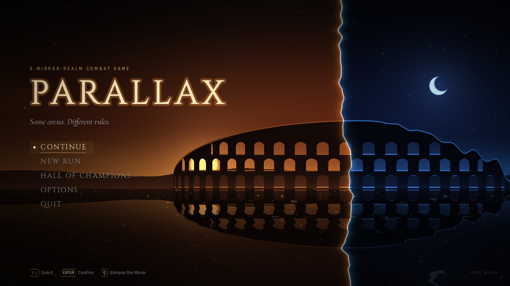

# PARALLAX

### Same arena. Different rules.

**A single-player, third-person melee action game about choosing which version of the world is real, fought alongside an AI squad you command in plain language.**


[Overview](#overview) ·
[Showcase](#showcase) ·
[Features](#features) ·
[Controls](#controls) ·
[The Ascent](#the-ascent) ·
[Squad](#the-squad) ·
[Enemies](#enemies) ·
[Scoring](#scoring) ·
[Getting started](#getting-started) ·
[Architecture](#architecture) ·
[Testing](#testing) ·
[Documentation](#documentation)

</div>

---

## Overview

You climb **The Ascent**, a ruined cliff-top pilgrimage that ends in a mirror colosseum. Every space exists twice:

- **Reality** is warm and amber.
- **Mirror** is cold and cobalt.

Press `Q` and the world flips under you. Bridges that are broken in one realm stand whole in the other. Shields that block you in Reality do not exist in the Mirror. Some enemies can only be fought on the far side of the glass.

You do not climb alone. Three companions, **Brannoc, Sera and Ivo**, follow you, fight on their own, and take orders typed or spoken in everyday language. Examples:

- "Brannoc, taunt the brute while Sera flanks it."
- "Everyone hold the rear."
- "Ivo, bait that skeleton and run in circles."

A run lasts roughly 20–30 minutes from the terrace to the summit. It is scored, ranked, and saved to a local leaderboard.

<p align="center">
  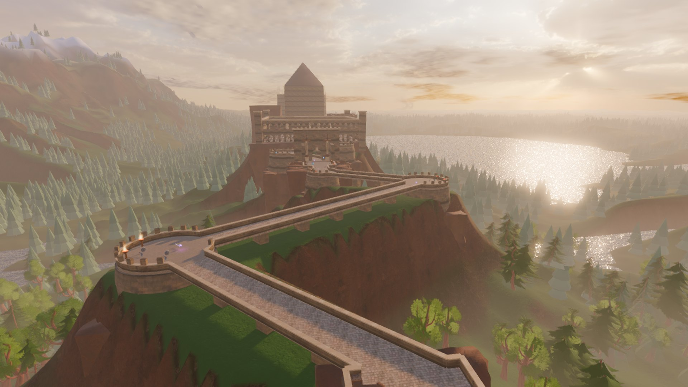
  <br><sub><i>The Pilgrim's Causeway: a winding bridge with two bastions, the first stretch of the climb.</i></sub>
</p>

## Showcase

All images are real in-engine captures from a single run. They are taken by [`tests/readme_showcase_shots.gd`](tests/readme_showcase_shots.gd), which you can re-run to refresh them.

### Two realms, one world

<table>
  <tr>
    <td width="50%">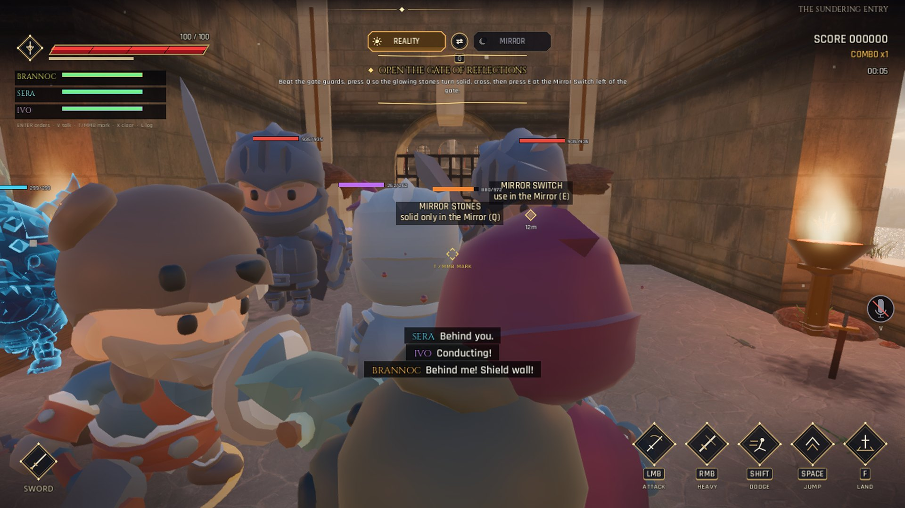</td>
    <td width="50%">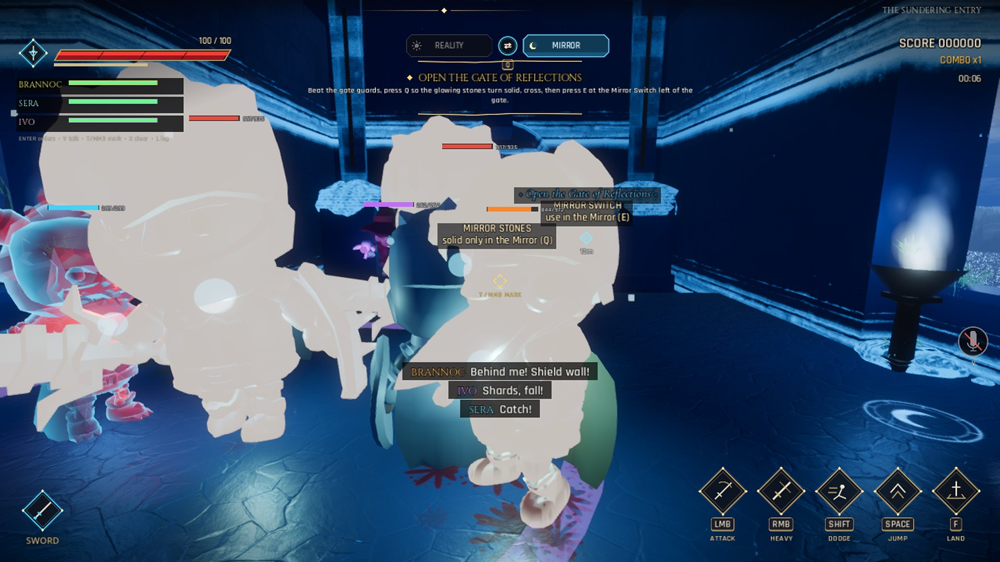</td>
  </tr>
  <tr>
    <td align="center"><sub><b>Reality.</b> Shielded gate guards and a sealed gate.</sub></td>
    <td align="center"><sub><b>Mirror</b> (press <code>Q</code>). Shields become ghosts and the hidden route lights up.</sub></td>
  </tr>
</table>

### The Hall of Echoes: three waves, every column a weapon

<p align="center">
  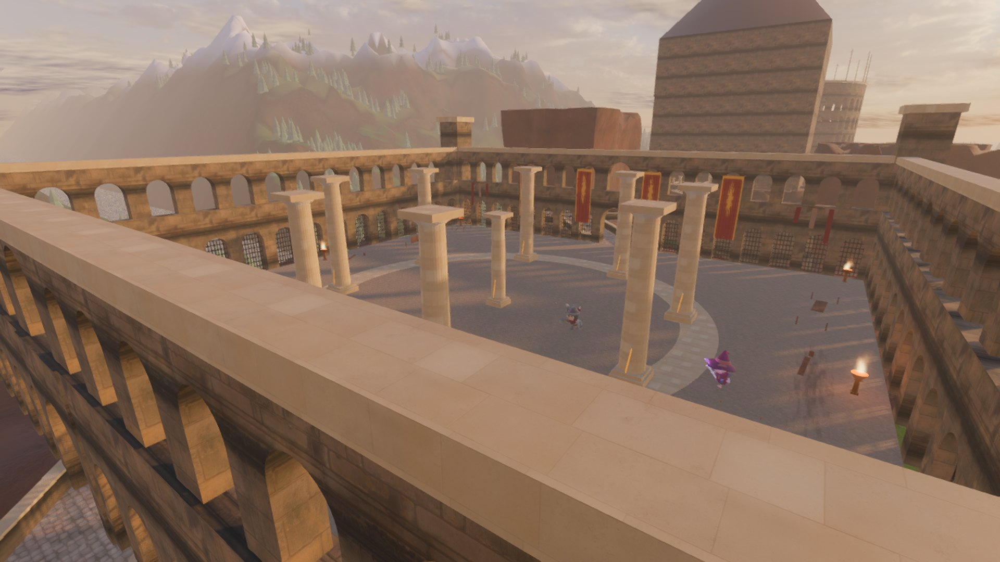
</p>

<table>
  <tr>
    <td width="50%">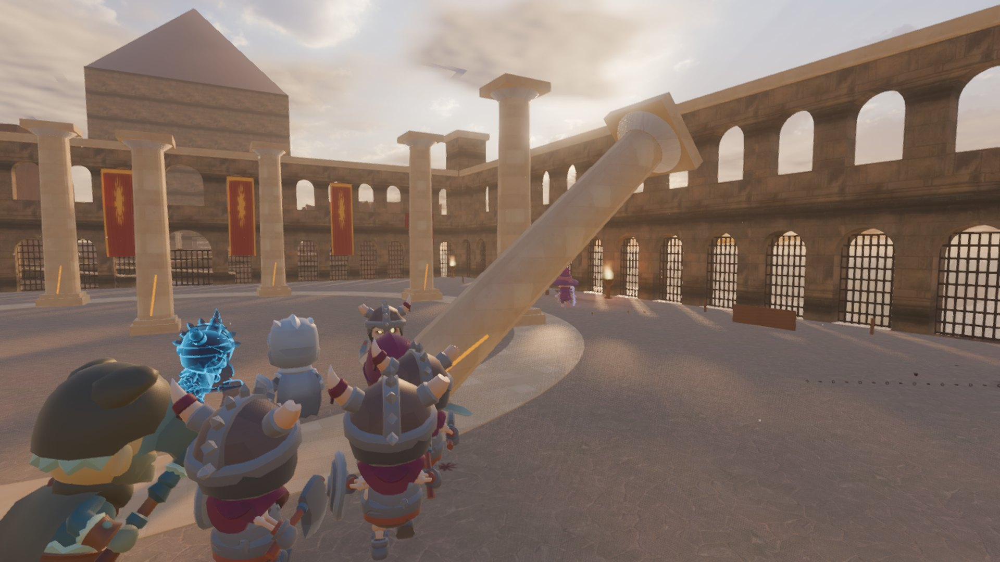</td>
    <td width="50%">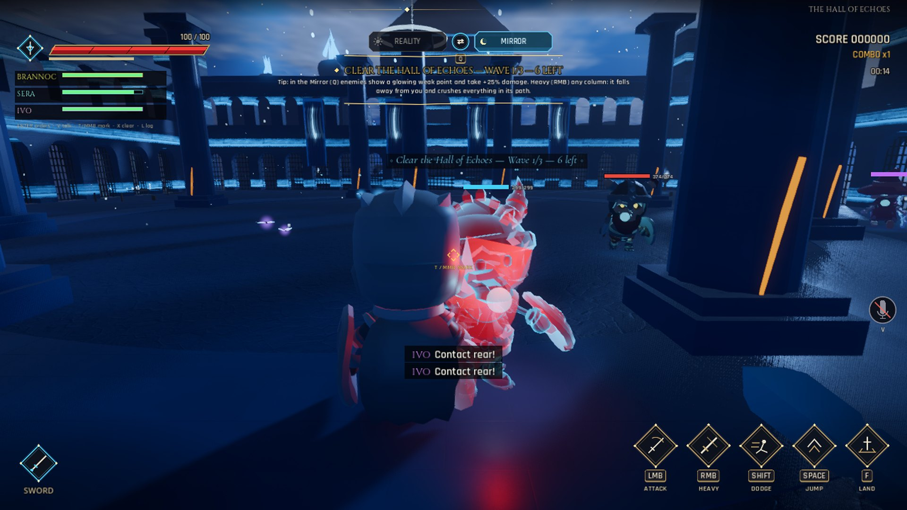</td>
  </tr>
  <tr>
    <td align="center"><sub>A heavy attack topples a column <b>away from you</b>. It crushes everything along its fall line.</sub></td>
    <td align="center"><sub>The hall in the Mirror. Phantoms can only be fought here, and the objective tracks the wave.</sub></td>
  </tr>
</table>

### A squad that listens

<table>
  <tr>
    <td width="50%">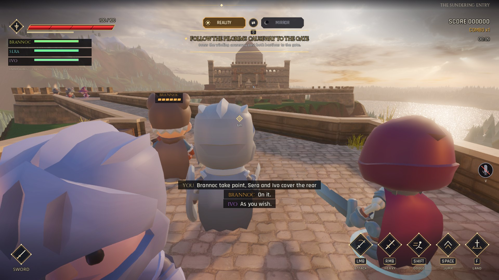</td>
    <td width="50%">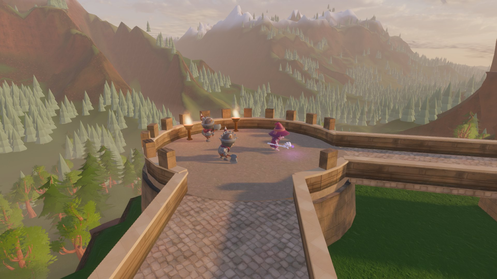</td>
  </tr>
  <tr>
    <td align="center"><sub>"Brannoc take point, Sera and Ivo cover the rear." Every companion answers and acts.</sub></td>
    <td align="center"><sub>Each bastion on the bridges holds a garrison.</sub></td>
  </tr>
</table>

### The climb

<table>
  <tr>
    <td width="50%">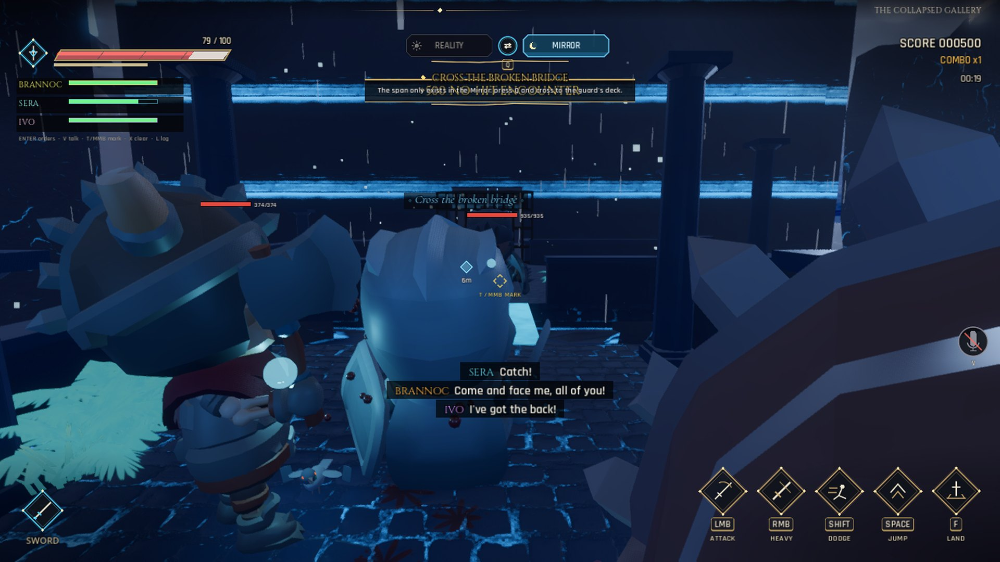</td>
    <td width="50%">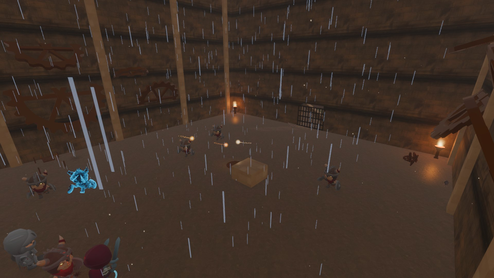</td>
  </tr>
  <tr>
    <td align="center"><sub><b>Collapsed Gallery.</b> The span over the gorge exists only in the Mirror.</sub></td>
    <td align="center"><sub><b>Clock-Tower Chamber.</b> Three waves around the weight-and-plate puzzle, in a storm.</sub></td>
  </tr>
  <tr>
    <td width="50%">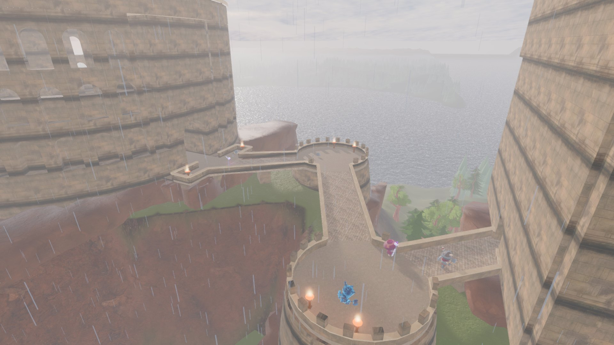</td>
    <td width="50%">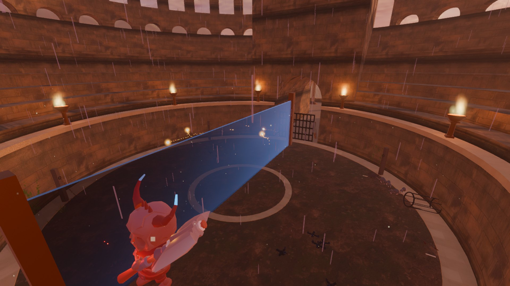</td>
  </tr>
  <tr>
    <td align="center"><sub><b>Processional.</b> Bastion bridges between the clock tower and the colosseum.</sub></td>
    <td align="center"><sub><b>Mirror Colosseum.</b> The central mirror plane splits the arena.</sub></td>
  </tr>
  <tr>
    <td width="50%">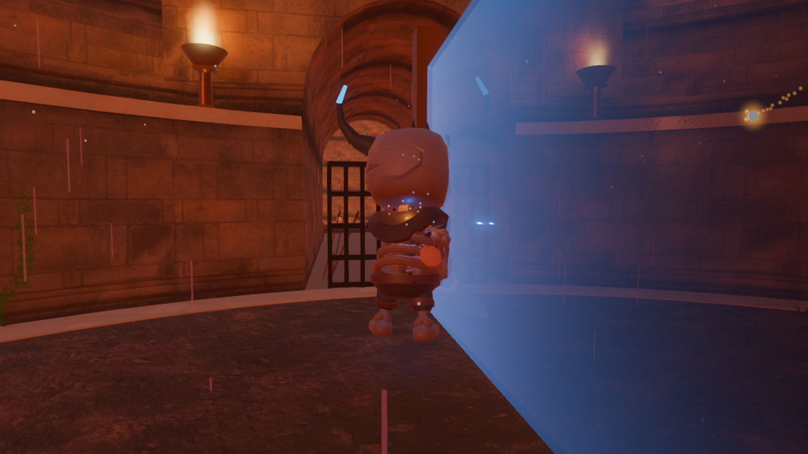</td>
    <td width="50%">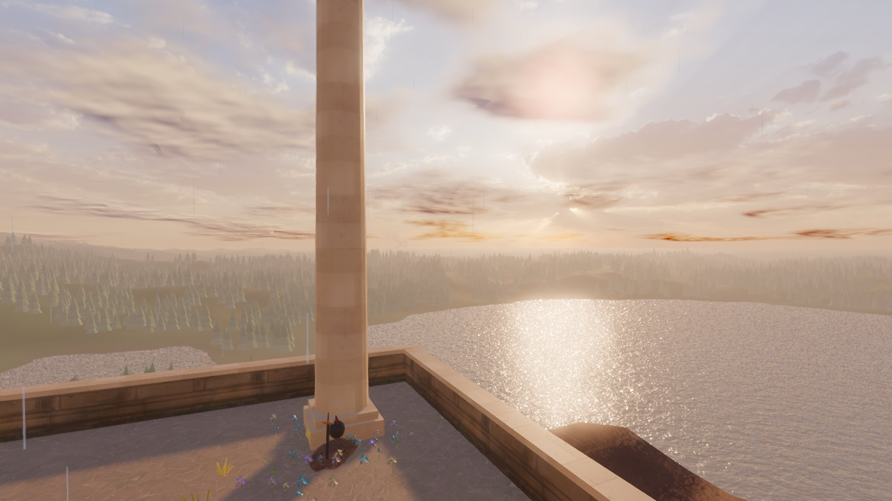</td>
  </tr>
  <tr>
    <td align="center"><sub><b>The Warden.</b> A bone colossus that steps through the glass.</sub></td>
    <td align="center"><sub><b>Sunset Summit.</b> Walk into the light.</sub></td>
  </tr>
</table>

## Features

**Realm shifting**
- One key swaps Reality and Mirror.
- The shift is checked against floor and overlap, so it never drops you into a wall or a void.
- Inactive-realm geometry and enemies lose their collision, not just their meshes.

**Melee combat**
- 5-move light chain, charged heavy, dodge with invulnerability frames, airborne landing slam.
- Contextual finishers on weakened or staggered enemies.
- Hit-stop and camera trauma for impact feel.

**Environmental kills**
- Every column in the Hall of Echoes can be toppled with a heavy attack.
- A column falls away from whoever struck it and crushes every enemy along its whole length.

**Wave encounters**
- The Hall of Echoes and the clock-tower chamber each fight in three escalating waves.
- The next wave bursts in a moment after the current one is cleared.

**AI squad**
- Three companions with distinct roles: vanguard, skirmisher, artillery.
- Natural-language orders by text or push-to-talk, including:
  - chained and multi-target commands;
  - taunts, baits, ambushes and flanking;
  - formations, holding the rear, ranged support and emotes.
- Companions auto-rally to protect anyone at low health.

**Voice**
- Companions speak their lines in distinct voices, and subtitles match the spoken text.
- Works with a cloud model (Gemini preferred, OpenAI supported).
- Without a key, typed orders still work through an offline command parser, and companion lines show as subtitles.
- System text-to-speech is disabled on Windows because of a SAPI deadlock.

**Handcrafted level**
- Winding bridges with fortified bastions.
- A 60 × 60 m Hall of Echoes and a 36 × 36 m clock-tower chamber.
- A collapsed aqueduct gallery and the Warden's colosseum.

**Presentation**
- Weather that changes by area.
- Adaptive music and room tone.
- Ambient wildlife.
- Stylised realm-reactive materials and sky.

**Performance**
- Static mesh batching, occlusion culling, distance-faded lights.
- Graphics presets with integrated-GPU auto-detection.
- FSR render scaling and an adaptive-resolution governor.
- D3D12 / OpenGL fallbacks.

**Persistence**
- Checkpoints, continue, settings and a local top-5 leaderboard.
- No account or server required.

## Controls

| Action | Keyboard / mouse | Notes |
| :-- | :-- | :-- |
| Move | `W` `A` `S` `D` | Camera-relative |
| Look | Mouse | Sensitivity and invert-Y in Options |
| Shift realm | `Q` | Reality ↔ Mirror, short cooldown |
| Light attack | `LMB` | Chains into a 5-move combo |
| Heavy attack | `RMB` | Breaks cracked props, topples hall columns, staggers |
| Dodge | `Shift` | Brief invulnerability |
| Jump | `Space` | |
| Landing attack | `F` while airborne | Area slam on landing; also solves the clock-tower puzzle |
| Interact | `E` | Switches and gates |
| Squad order (type) | `Enter` | Free-text command to the squad |
| Squad order (voice) | `V` (hold) | Push-to-talk; needs an API key |
| Mark enemy / clear marks | `T` or `MMB` / `X` | Focus-fire target for the squad |
| Command log | `L` | Hidden by default |
| Pause | `Esc` | Freezes the world and the run timer |

Bindings can be changed in **Options → Controls**.

## The Ascent

The level is one continuous climb north. Each area teaches one idea, and the final fight only tests what came before.

```mermaid
flowchart LR
    T["Start terrace"] --> R1(["Pilgrim's Causeway<br/>2 bastions"]) --> G["Gate of Reflections"]
    G --> R2(["Sunlit Bridges<br/>2 bastions"]) --> H["Hall of Echoes<br/>3 waves"]
    H --> R3(["Windswept Rampart<br/>2 bastions"]) --> C["Collapsed Gallery"]
    C --> M["Clock-Tower Chamber<br/>3 waves"]
    M --> R5(["Processional<br/>2 bastions"]) --> A["Mirror Colosseum<br/>The Warden"] --> S["Sunset Summit"]
```

| Area | What it asks of you |
| :-- | :-- |
| **Pilgrim's Causeway** | A long zig-zag bridge from the start terrace. Two bastions hold the first ambushes. |
| **Gate of Reflections** | Beat the gate guards. The stepping stones over the chasm only exist in the Mirror. Throw the Mirror Switch beside the gate. |
| **Sunlit Bridges** | Winding bridges and bastion fights up to the hall. |
| **Hall of Echoes** | A 60 m hall fought in three waves. Topple its columns onto crowds, and use the Mirror to reach the phantoms. |
| **Windswept Rampart** | Storm-lashed bridges and bastions toward the gallery. |
| **Collapsed Gallery** | The span over the gorge exists only in the Mirror. Cross it, then break the Shielded Guard on the wide north deck. His fall opens the gate and rebuilds the bridge in stone. |
| **Clock-Tower Chamber** | Three waves inside a 36 m tower. Jump from the dais, shift to the Mirror and slam the suspended weight onto the pressure plate. |
| **Processional** | The last bridges and bastions before the colosseum. |
| **Mirror Colosseum** | Two-phase duel with The Warden. In phase 2 the mirror plane shatters and the realms merge. |

## The Squad

| Companion | Role | Style |
| :-- | :-- | :-- |
| **Brannoc** | Vanguard | Holds the line, taunts, protects the weak |
| **Sera** | Skirmisher | Flanks, baits, sneak attacks |
| **Ivo** | Artillery | Staff caster: visible ranged bolts and area abilities |

**How orders work**
- Each order is parsed into structured commands that companions execute and follow through on. For example, a taunted enemy stays fixated on its taunter, and an ambush converts the bait into an attack.
- With a cloud model configured, a director model plans multi-step tactics. Without one, a deterministic offline parser handles the same vocabulary.
- See [`addons/parallax_squad_ai`](addons/parallax_squad_ai) for the implementation.

## Enemies

| Enemy | Realm rule | How to beat it |
| :-- | :-- | :-- |
| **Skeleton Guard** | Both realms | Fight head-on, or crush it with a toppled column |
| **Phantom Twin** | Can only be hit, and only hits you, in the Mirror | Shift, dodge the telegraphed lunge, strike |
| **Shielded Guard** | Its shield exists only in Reality | Fight its shieldless reflection in the Mirror |
| **Hollow Hexcaster** | Both realms | Ranged caster; close the distance or use cover |
| **Grave Brute** | Both realms | Slow ground slams; dodge the wind-up, punish the recovery |
| **Shade Stalker** | Both realms | Blinks behind its target; keep it in front of you |
| **The Warden** | Split, then merged | Phase 1: punish the chest rune in the Mirror during recovery. Phase 2: realms merge for a straight duel. |

**Mirror insight.** While you are in the Mirror, enemies reveal weak points and intel tags and take +25% damage.

Archetype enemies are data-driven resources in [`data/enemies`](data/enemies).

## Scoring

Every run is scored and ranked **S / A / B / C**. Points come from:

- kills;
- environmental and Mirror kills;
- finishers;
- no-hit encounters;
- defeating The Warden;
- a time bonus.

A combo multiplier rewards unbroken chains. It survives a realm shift and resets when you are hit.

The top five runs are saved locally with your initials in `user://leaderboard.cfg`. Run checkpoints are saved to `user://savegame.cfg`.

## Getting started

### Requirements

- **Godot 4.7** (standard build, Forward+ renderer).
- **OS:** Windows 10/11 64-bit (primary target).
- **GPU:** Vulkan-capable recommended; D3D12 and OpenGL 3 fallbacks are configured.
- **Input:** mouse and keyboard.

### Run from source

```bash
git clone https://github.com/th-efool/Parallax.git
cd Parallax
godot --editor project.godot
```

Press **F5** in the editor. The main scene is `res://scenes/main/main.tscn`. It opens the title screen, and the level is built under a loading screen when you start a run.

> The level is generated by code at run time ([`GrandJourneyBuilder`](scripts/environment/grand_journey_builder.gd)), so `main.tscn` looks empty in the editor. To inspect the whole level in the viewport, bake a preview scene:
>
> ```bash
> godot --path . -s res://scripts/tools/bake_map_preview.gd
> ```
>
> Then open `scenes/main/map_preview.scn`. It is gitignored; regenerate it any time.

### Optional: cloud AI for the squad

The game is fully playable offline. Typed orders use the offline parser, and companion lines appear as subtitles.

To enable language-model tactics, voice orders and cloud voices, provide a key through an environment variable or a `.env` file in the project root:

```bash
GEMINI_API_KEY=your-key      # preferred (GEMINI_KEY / GOOGLE_API_KEY also accepted)
OPENAI_API_KEY=your-key      # supported (OPENAI_KEY also accepted)
```

Keys are read at run time and never written into the project. Do not commit `.env`.

### Export

**Project → Export → Windows Desktop** (64-bit, Forward+).

## Architecture

Gameplay rules are deterministic and authored, not left to physics chance.

| System | Responsibility |
| :-- | :-- |
| `RealmManager` | Realm shift, safety validation, cooldown, merge state; named physics-layer helpers |
| `RealmReactive` | Contract for any prop, platform or decor group that reacts to the active realm |
| `EncounterDirector` | Sections, checkpoints, encounter sealing and clearing, death-respawn section resets |
| `WaveDirector` | Runs a room's garrison as consecutive waves (held enemies are hidden, inert and untargetable) |
| `GrandJourneyBuilder` | Builds the whole level at run time, progressively under the loading screen |
| `JourneyLayout` | Single source of truth for the macro layout and bridge routes; converts old "story" coordinates to world coordinates |
| `BreakableProp` | Authored breakables: topple timing, directional knock and fall-line hazard, mirror-plane shatter |
| `Hitbox3D` / `Hurtbox3D` | One hit per target per swing; realm-aware damage veto |
| `RunState` (autoload) | Score, combo, timer, rank |
| `LeaderboardStore` (autoload) | Leaderboard, save/continue, settings, graphics presets |
| `GameAudio` (autoload) | Music state machine, ducking, room tone, footstep surfaces |
| `parallax_squad_ai` (addon) | Squad manager, companion AI, command parser, comms director, text-to-speech pipeline |

**Physics layers:** Player 1, Enemy 2, World_Shared 3, World_Reality 4, World_Mirror 5, Interactable 6, Hitbox 7, Player_Blocker 8 (camera-ignored railing blockers).

### Project layout

```
addons/
  parallax_squad_ai/   squad AI, comms, voice
  godot_ai/            editor MCP bridge (development only)
assets/                models · textures (CC0 PBR) · shaders · audio · fonts · sky
data/                  ally profiles, enemy archetypes (.tres)
scenes/                main scene, player, UI, environment
scripts/
  core/                realm, encounters, waves, scoring, saves, audio, VFX
  player/              player controller and camera
  enemies/             enemy base, AI, archetypes, The Warden
  allies/              companion controllers and profiles
  environment/         level builder, layout, terrain, breakables, weather
  ambient/             wildlife and vegetation
  ui/                  HUD, menus, objective tracker, loading screen
  tools/               editor utilities (map preview bake)
tests/                 headless and windowed test scripts
MEMORY/                design documents (GDD, systems, combat, levels, UI, assets, changelog)
plan/                  implementation handoff guides
```

## Testing

Tests are plain `SceneTree` scripts that run with the Godot binary. Import once after pulling new assets:

```bash
godot --headless --path . --import --quit
```

| Test | Mode | Covers |
| :-- | :-- | :-- |
| `tests/boot_smoke.gd` | headless | Full boot, level build, enemy and ally spawn |
| `tests/level_props_test.gd` | headless | Gate guards, gallery duel deck, knockable columns, wave release |
| `tests/layout_rework_test.gd` | headless | Bridge lengths and bends, bastions, walkability, rails, 3× rooms |
| `tests/combat_rules_test.gd` | headless | Health scaling, Warden phases, Mirror-only enemies |
| `tests/restart_flow_test.gd` | headless | Title → run → results → restart flow |
| `tests/squad_ai_unit_test.gd` | headless | Command parser and squad logic |
| `tests/voice_pipeline_test.gd` | headless | Voice / subtitle pipeline |
| `tests/squad_ai_windowed_test.gd` | windowed | Live squad behaviour in the level |
| `tests/feel_and_movement_test.gd` | windowed | Movement, camera and formation feel |
| `tests/readme_showcase_shots.gd` | windowed | Regenerates the README screenshots in `docs/media/` |

Example:

```bash
godot --headless --path . -s res://tests/boot_smoke.gd
```

> Starting a run in a test clears `user://savegame.cfg` (`%APPDATA%\Godot\app_userdata\PARALLAX\` on Windows). Back it up first if you care about your save.

## Documentation

The design lives in [`MEMORY/`](MEMORY). Start at [`MEMORY/00_MEMORY_INDEX_AND_RULES.md`](MEMORY/00_MEMORY_INDEX_AND_RULES.md).

| File | Contents |
| :-- | :-- |
| `01_GDD_OVERVIEW_AND_SCOPE.md` | Pillars, narrative, scope lock |
| `02_CORE_SYSTEMS_AND_ARCHITECTURE.md` | Node contracts, realm and encounter systems, physics layers |
| `03_COMBAT_PLAYER_AND_ENEMIES.md` | Controls, combat tuning, enemy AI |
| `04_LEVEL_DESIGN_AND_ROOMS.md` | Level atlas and room logic |
| `05_UI_SCORING_AND_AUDIO.md` | HUD, menus, scoring, audio |
| `06_RESOURCES_AND_ASSET_CATALOG.md` | Asset sources and licences |
| `07_DEV_STATUS_AND_CHANGELOG.md` | Milestones and dated changelog |

For how the code works, see the developer documentation in [`docs/`](docs/README.md). It covers architecture, realms, combat, encounters and waves, level generation, environment, UI and audio, squad AI, voice and LLM, and testing.

Contributor and agent rules are in [`CLAUDE.md`](CLAUDE.md). Implementation handoff guides live in [`plan/`](plan).

## Credits

Built with the [Godot Engine](https://godotengine.org), using CC0 and free-to-use community assets from:

[Quaternius](https://quaternius.com) · [KayKit](https://kaylousberg.com) · [Kenney](https://kenney.nl) · [Poly Haven](https://polyhaven.com) · [ambientCG](https://ambientcg.com) · [Mixamo](https://www.mixamo.com)

The source and licence of every asset are recorded in [`MEMORY/06_RESOURCES_AND_ASSET_CATALOG.md`](MEMORY/06_RESOURCES_AND_ASSET_CATALOG.md).

Originally designed against the **IGDC 2023 Low-Prep Game-Dev Challenge** themes: everything's breakable, landing on things, misdirection, symmetry, puzzle.

<div align="center">
<sub>Made with Godot 4 by <a href="https://github.com/th-efool">th-efool</a></sub>
</div>
