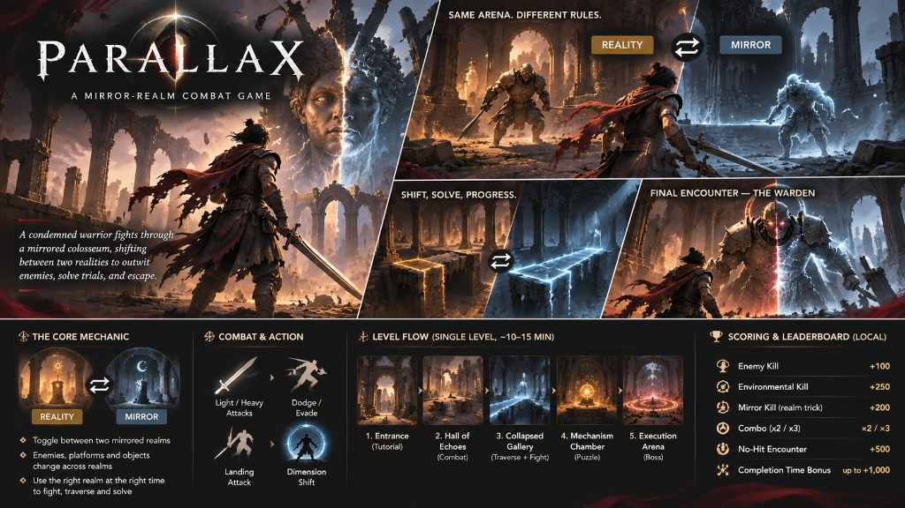
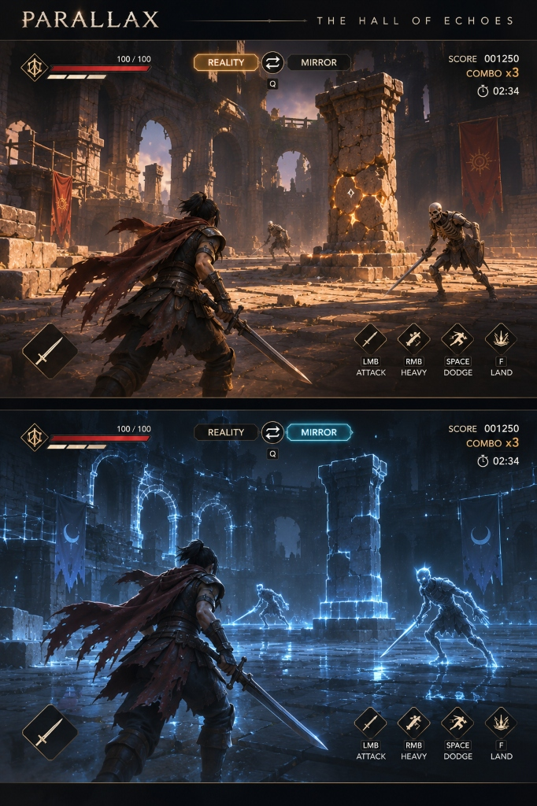
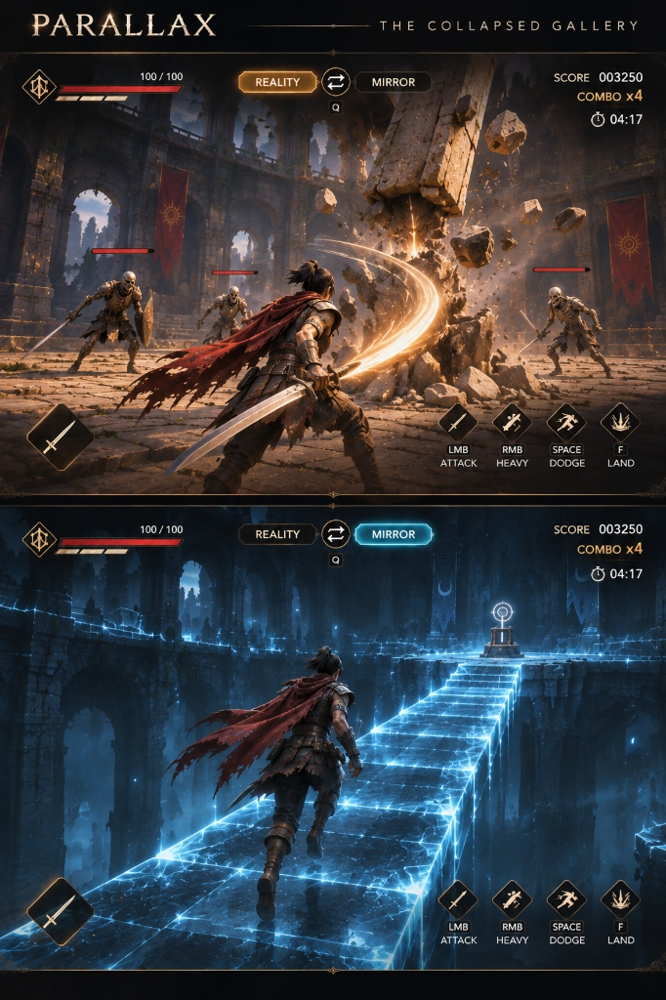
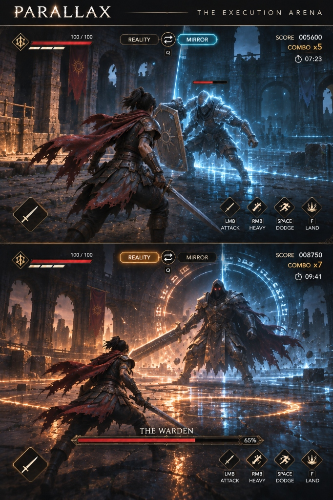
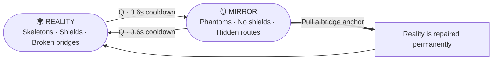
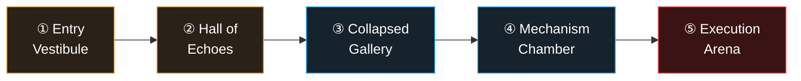

<div align="center">



<br>

# ◐&nbsp;&nbsp;P A R A L L A X&nbsp;&nbsp;◑

### *Same arena. Different rules.*

**A third-person action game where you survive by choosing which version of the world is real.**
<br>
One button. Two realities. One shot at escaping the mirror.

<br>

[](https://github.com/th-efool/Parallax/releases)
[](#-the-run)
[](#-score-chase)


[**Why PARALLAX**](#-why-parallax) ·
[**The Shift**](#%EF%B8%8F-the-core-mechanic-shift) ·
[**Controls**](#-controls) ·
[**The Run**](#-the-run) ·
[**Enemies**](#-bestiary) ·
[**Scoring**](#-score-chase) ·
[**Install**](#-install--play) ·
[**Build**](#%EF%B8%8F-build-from-source)

</div>

<br>

> *"They built a mirror to preserve champions. It learned to preserve their deaths."*

---

## 🪞 Why PARALLAX

You wake in the **Entry Vestibule** of an experimental mirror-colosseum. The gate is sealed. Across the hall stands a shattered mirror, and the thing that keeps you here is not a monster. It is a rule: **The Warden decides which version of the arena is real.**

PARALLAX is a compact, handcrafted action game with one big idea.

- 🔀 **One arena, two rulesets.** Reality and Mirror share the same space, but a bridge that's broken in one is whole in the other.
- ⚔️ **Combat that asks a question.** Every fight has a realm answer: shift to strip a shield, dodge a lunge, or drop a pillar on a crowd.
- 🧩 **Puzzles you solve with your hands.** Jump, shift and slam. No menus, no inventory, no hand-holding.
- 🏆 **A score worth chasing.** Combo multipliers, realm tricks, no-hit bonuses and a local Top 5.
- ⏱️ **Respects your time.** About 15 minutes from title screen to credits, and just as long when you try for rank **S**.

<div align="center">

| 🎯 Pillar | What it means for you |
| :-- | :-- |
| **One arena, two rulesets** | Learn the layout once, then re-read it in the other realm. |
| **Shift must matter** | Every major encounter demands a realm decision. |
| **Readable danger** | Wind-ups are telegraphed. Nothing kills you from an invisible rule. |
| **Short and complete** | One level that teaches, escalates, tests and resolves. |
| **Score rewards skill** | Fast, clean and clever beats slow and safe. |

</div>

---

## 🖼️ Screenshots

<div align="center">



*The Hall of Echoes. The same room in Reality (amber) and Mirror (cobalt).*

<br>




*The Collapsed Gallery bridge, then a Shielded Guard and The Warden's Execution Arena.*

</div>

---

## ⚔️ The Core Mechanic: Shift

Press **`Q`** and the world flips. **Reality** glows amber and **Mirror** glows cobalt. Your position, health and combo carry across. Everything else is up for grabs.

|  | 🌍 **Reality** | 🪞 **Mirror** |
| :-- | :-- | :-- |
| **Palette** | Warm amber `#E69938` | Cold cobalt `#33B5FF` |
| **Traversal** | Broken bridges, missing stepping stones | Hidden routes, restored bridges |
| **Enemies** | Skeleton Guards | Phantom Twins (spectral) |
| **Shields** | Frontal shields block and absorb | The reflection is shieldless |
| **Permanence** | Changes made in Mirror can repair Reality for good | |
| **Safety** | `Q` is validated against floor and overlap, so a shift can never drop you into a wall or a void. | |



> **Boss twist:** in the final fight the mirror itself **shatters**. The realms merge, `Q` locks, and it comes down to a pure duel.

---

## 🎮 Controls

<div align="center">

| Action | Input | Notes |
| :-- | :--: | :-- |
| **Move** | `W` `A` `S` `D` | Relative to the camera |
| **Look** | `Mouse` | Over-the-shoulder follow camera. Sensitivity and invert-Y in Options. |
| **Shift realm** | **`Q`** | Reality ↔ Mirror, 0.6 s cooldown |
| **Light attack** | `LMB` | 3-hit combo: 25 → 25 → 35 damage |
| **Heavy attack** | `RMB` | 60 damage. Breaks cracked props and staggers exposed enemies. |
| **Jump / Dodge** | `Space` | 0.55 s dodge with ~0.18 s of invulnerability |
| **Landing attack** | `F` *(airborne)* | Plunge and shockwave: 60 damage, 2.2 m radius |
| **Interact** | `E` | Switches, anchors and gates |
| **Pause** | `Esc` | Freezes the world and the run timer |

</div>

---

## 🏛️ The Run

One continuous level, five connected sections. Each teaches one idea. The boss tests only what you've already learned.



<details open>
<summary><b>① Entry Vestibule: <i>learn to shift</i></b></summary>

<br>

A shattered mirror and a sealed north gate. The floor ends in a chasm. Shift once and a line of **stepping stones** appears in the Mirror. Jump across, throw the switch, and the gate opens. A first lesson in traversal, with no combat and no failure state beyond a fall.

</details>

<details open>
<summary><b>② Hall of Echoes: <i>combat meets shifting</i></b></summary>

<br>

Two **Skeleton Guards** (Reality) and two **Phantom Twins** (Mirror) seal the doors. You can't win by staying in one world. A **cracked central pillar** glows at its fracture point. Hit it with a heavy attack, wait out the 0.6 s warning, and drop 150 damage on everything beneath it for a **+250 environmental kill**.

</details>

<details open>
<summary><b>③ Collapsed Gallery: <i>actions echo across realms</i></b></summary>

<br>

The Reality bridge is broken. In the Mirror it stands whole. Smash the **weak stone support** to reach the **bridge anchor** on the far side and pull the switch. The bridge is now repaired in Reality for good. A **Shielded Guard** waits on the far platform. Shift to its shieldless reflection and finish it with a heavy attack.

</details>

<details open>
<summary><b>④ Mechanism Chamber: <i>the verbs, combined</i></b></summary>

<br>

A raised dais, a suspended Mirror weight and a pressure plate far below. Jump from the dais, shift to Mirror, and use an airborne **Landing Attack (`F`)** on the weight to slam it onto the plate. Traversal and combat in a single move.

</details>

<details open>
<summary><b>⑤ Execution Arena: <i>The Warden</i></b></summary>

<br>

- **Phase 1:** Dodge the Warden's cleave and lunge in Reality. During its **1.4 s recovery**, a rune opens in its chest. Shift to Mirror and punish the exposed echo.
- **Phase 2 (50% HP):** The mirror plane **shatters**. The realms merge, `Q` locks, and the Warden chains attacks faster. Dodge, read the tells, and finish it in Reality.
- Beat it and the north gate rises into daylight. 🌅

</details>

---

## 👹 Bestiary

| Enemy | Realm | HP | Threat | How to beat it |
| :-- | :--: | :--: | :-- | :-- |
| 💀 **Skeleton Guard** | 🌍 | 100 | 15 melee | Fight it head-on, or bait it under the cracked pillar. |
| 👻 **Phantom Twin** | 🪞 | 80 | 20 lunge | Shift to Mirror, dodge the blue-telegraphed lunge, then strike (**+200 Mirror Kill**). |
| 🛡️ **Shielded Guard** | 🌍🪞 | 250 | 20 shield bash | The shield blocks you in Reality. Shift to its shieldless reflection and heavy-attack. |
| ⚖️ **The Warden** | 🌍🪞 → merged | 1,000 | 20 cleave / 25 lunge | Dodge, shift during recovery, then duel it in merged reality. |

---

## 🏆 Score Chase

Finishing is only the start. Every run is graded, and every point comes from skill.

<div align="center">

| Event | Points | Combo multiplier? |
| :-- | --: | :--: |
| Enemy kill | +100 | ✅ |
| Environmental kill | +250 | ✅ |
| **Mirror kill** (realm trick) | +200 | ✅ |
| No-hit encounter | +500 | ❌ |
| Warden defeated | +1,000 | ❌ |
| Time bonus | up to +1,000 (`1000 − seconds`) | ❌ |

| Combo hits | Multiplier |
| :--: | :--: |
| 0 – 2 | ×1 |
| 3 – 5 | ×2 |
| 6+ | ×3 |

| Rank | Score |
| :--: | :-- |
| 🥇 **S** | 5,000+ |
| 🥈 **A** | 4,000 – 4,999 |
| 🥉 **B** | 3,000 – 3,999 |
| **C** | below 3,000 |

</div>

- Your combo survives a realm shift. Getting hit resets it.
- Three encounters track no-hit bonuses: the Hall of Echoes, the Shielded Guard and the Warden.
- A **local Top 5 leaderboard** with your initials is saved on your machine. No account, no server and no internet needed.

> 💡 **Pro tip:** Drop the pillar on both skeletons, shift to Mirror, and chain six hits on the phantoms. Environmental and Mirror kills both stack with the ×3 multiplier.

---

## 🎛️ Interface

One shared HUD, identical in both realms, so you never hunt for information mid-fight.

```
┌───────────────────────────────────────────────────────────────────────┐
│ ♦ HEALTH ████████░░ 80/100          [ REALITY ⇄ MIRROR  Q ]   SCORE 001250 │
│   combo ◆◆◇                                                 COMBO x3  ⏱ 02:34 │
│                                                                       │
│                                                                       │
│                                                                       │
│                         ·  third-person view  ·                       │
│                                                                       │
│                         THE WARDEN  ██████████████░░░░                │
│ ◆ SWORD                                   LMB ATTACK · RMB HEAVY       │
│                                           SPACE DODGE · F LAND · E USE │
└───────────────────────────────────────────────────────────────────────┘
```

The active realm chip lights **amber** or **cobalt**, and a rejected shift pulses the chip so you always know why. Boss HP appears only in the Execution Arena.

---

## 📥 Install & Play

### Windows (recommended)

1. Open the [**Releases**](https://github.com/th-efool/Parallax/releases) page.
2. Download the latest `PARALLAX-windows-x64.zip`.
3. Unzip it and run `PARALLAX.exe`.

No installer, no launcher and no internet connection.

**Recommended:** Windows 10/11 64-bit · a GPU with Vulkan support · 1920×1080 · mouse and keyboard.

---

## 🛠️ Build from Source

**Requirements:** [Godot 4.7+](https://godotengine.org/download) (Forward+ renderer)

```bash
git clone https://github.com/th-efool/Parallax.git
cd Parallax
godot --editor project.godot     # open in the editor, then press F5
```

Check scripts and run headless imports:

```bash
godot --headless --import --quit
godot --headless --check-only -s scripts/core/realm_manager.gd
```

**Export:** `Project → Export → Windows Desktop`. Use the Forward+ preset, 64-bit.

---

## 🧱 Under the Hood

Built entirely in **Godot 4.7** with **GDScript**. Gameplay rules are deterministic and authored, not left to physics luck.

| System | What it does |
| :-- | :-- |
| **`RealmManager`** | Handles the `Q` shift, floor and overlap safety validation, and the cooldown. |
| **`RealmReactive`** | A tiny contract that any prop, enemy or surface implements to react to the active realm. |
| **`EncounterDirector`** | Gates seal, waves spawn, no-hit tracking starts and ends, doors open. |
| **`RunState`** | Autoload for score, combo multipliers, timer and rank. |
| **`LeaderboardStore`** | Autoload that saves a sorted local Top 5 to `user://leaderboard.cfg`. |
| **Hitbox / Hurtbox** | Each swing hits each target at most once, with no per-frame damage ticks. |
| **Authored breakables** | `AnimationPlayer`-driven collapses that fire once and behave identically every run. |

- **Performance:** Shader-based realm effects, no dynamic mirror viewports and bounded loops. It targets a locked 60 FPS at 1080p.
- **Camera:** A `SpringArm3D` over-the-shoulder rig that pushes in at walls, so geometry never clips the view.

```
assets/      models · textures · shaders · audio · fonts
scenes/      player · enemies · environment · props · UI
scripts/     core · player · enemies · environment · ui
MEMORY/      full design document and concept art
```

Read the full design in [**`MEMORY/01_GDD_OVERVIEW_AND_SCOPE.md`**](MEMORY/01_GDD_OVERVIEW_AND_SCOPE.md).

---

## 🗺️ Roadmap

- [x] Core realm shift with safety validation
- [x] Third-person combat: combo, heavy, dodge, landing attack
- [x] Four enemy classes and The Warden (two phases)
- [x] Five handcrafted stages with authored breakables and puzzles
- [x] Shared HUD, menus, leaderboard and ranks
- [x] Shaders, SFX and music pass
- [x] Windows 64-bit release
- [ ] Controller support
- [ ] Time-attack and no-shift challenge modes
- [ ] Additional stages and weapons

---

## 🎯 Born in a Game Jam

PARALLAX was designed against the **IGDC 2023 Low-Prep Game-Dev Challenge** brief, and each theme lives in the game:

| Theme | In PARALLAX |
| :-- | :-- |
| 💥 **Everything's breakable** | The cracked pillar, the weak stone support and the mirror plane itself |
| 🪂 **Landing on things** | The `F` landing attack and the weight-drop puzzle |
| 🎭 **Misdirection** | Routes, enemies and shields change with the realm |
| ⚖️ **Symmetry** | Two realms on identical coordinates with inverted rules |
| 🧩 **Puzzle** | Stepping stones, the bridge anchor and the pressure plate |

---

## 🙏 Credits & Acknowledgements

Built with **Godot Engine**, using community CC0 and free-to-use assets. Thanks to:

[Quaternius](https://quaternius.com) · [KayKit](https://kaylousberg.com) · [Kenney](https://kenney.nl) · [ambientCG](https://ambientcg.com) · [Poly Haven](https://polyhaven.com) · [Mixamo](https://www.mixamo.com)

The full source and license for every asset is tracked in [`MEMORY/06_RESOURCES_AND_ASSET_CATALOG.md`](MEMORY/06_RESOURCES_AND_ASSET_CATALOG.md).

---

<div align="center">

### ⭐ If you enjoyed PARALLAX, star the repo. It helps more than you'd think.

**Shift the world. Break the mirror. Walk into the light.**

<sub>Made with ❤️ and Godot 4 by [**th-efool**](https://github.com/th-efool)</sub>

</div>
