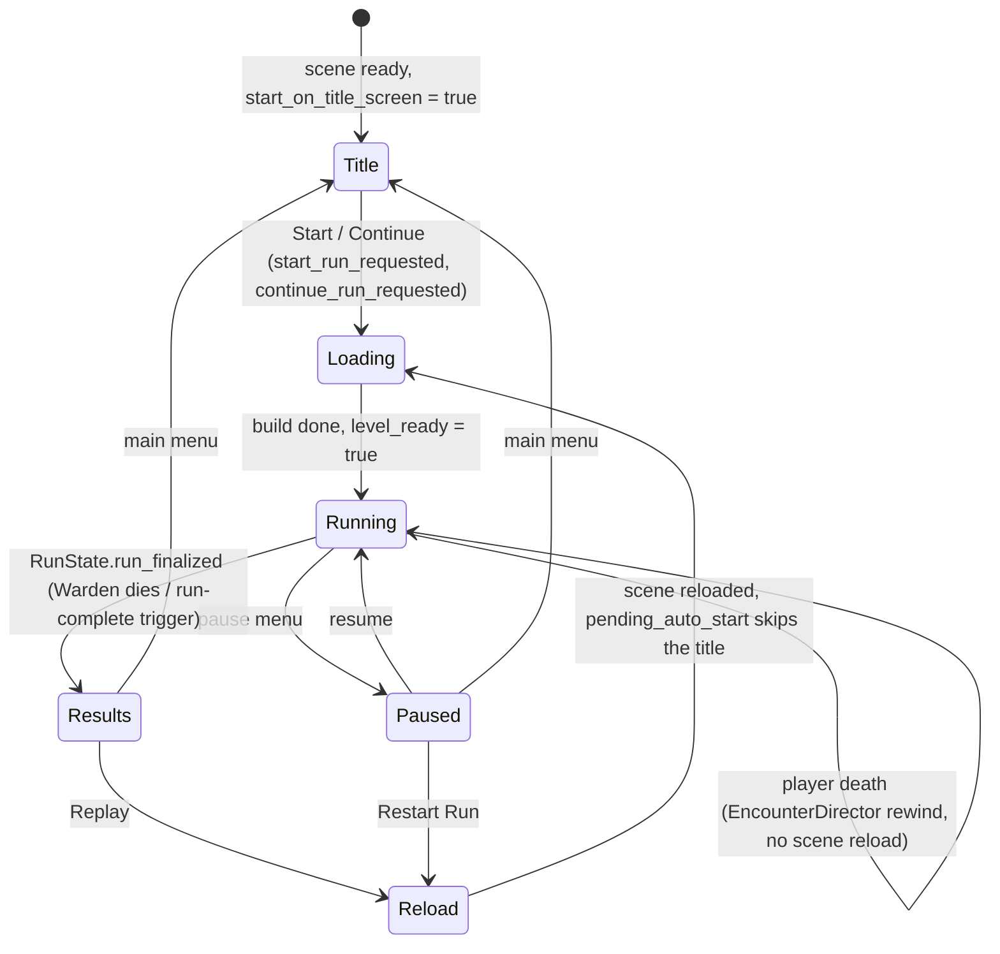
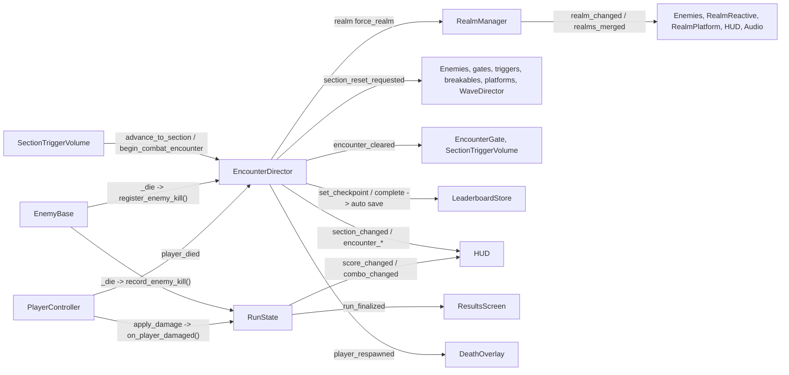

# 01. Architecture Overview

PARALLAX is a Godot 4.7 (GDScript, Forward+) third-person combat game built around two overlapping realms, Reality and Mirror. This document describes how the running game is assembled: the root scene, the run lifecycle, the autoloads, the group-based lookup conventions, the signal graph between systems, and the physics layer scheme.

Related documents:

- [02_realm_system.md](02_realm_system.md) - realm shifting and realm-reactive objects
- [03_combat_and_damage.md](03_combat_and_damage.md) - player, hit contract, enemies
- [04_encounters_waves_saves.md](04_encounters_waves_saves.md) - encounter flow, waves, scoring, saves

## 1. Purpose and key files

| Concern | File |
| --- | --- |
| Root orchestrator, run lifecycle | [main_controller.gd](../scripts/core/main_controller.gd) |
| Realm authority | [realm_manager.gd](../scripts/core/realm_manager.gd) |
| Section FSM, checkpoints, death rewind | [encounter_director.gd](../scripts/core/encounter_director.gd) |
| Score, combo, rank (autoload `RunState`) | [score_manager.gd](../scripts/core/score_manager.gd) |
| Leaderboard, settings, save game (autoload `LeaderboardStore`) | [leaderboard_store.gd](../scripts/core/leaderboard_store.gd) |
| Audio (autoload `GameAudio`) | [audio_manager.gd](../scripts/core/audio_manager.gd) |
| Hit routing | [hitbox_3d.gd](../scripts/core/hitbox_3d.gd), [hurtbox_3d.gd](../scripts/core/hurtbox_3d.gd) |
| Juice (hit-stop, camera trauma) | [game_feel.gd](../scripts/core/game_feel.gd) |

The project entry point is `run/main_scene="res://scenes/main/main.tscn"` in `project.godot`.

## 2. Runtime scene tree

`scenes/main/main.tscn` is the only gameplay scene. Its root `Main` is a plain `Node` carrying `MainController` (class_name `MainController`). Top-level children, in scene order:

```
Main                       (MainController)
  RealmManager             (RealmManager)
  EncounterDirector        (EncounterDirector)
  WorldEnvironment
  SunLight                 (DirectionalLight3D)
  RealmEnvironmentController
  RealmShiftFX             (CanvasLayer)  -> PulseOverlay (ColorRect)
  LevelRoot                (instanced level scene; builds the greybox world at runtime)
  AmbientLife              (instanced; progressive build)
  Player                   (instanced PlayerController scene)
  AllySquad                (Node; squad manager spawns allies here)
  HUD                      (instanced single shared HUD)
  MenusLayer               (CanvasLayer)
    TitleScreen, PauseMenu, ResultsScreen,
    LeaderboardScreen, OptionsScreen, DeathOverlay
```

Notes:

- `RealmManager` and `EncounterDirector` are scene nodes, not autoloads. They publish themselves through a static `instance` and a group (`realm_manager`, `encounter_director`) in `_enter_tree()`.
- The world itself (stages, enemies, gates, breakables, triggers) is generated by the level builder under `LevelRoot` through `build_greybox_progressive()` (see [grand_journey_builder.gd](../scripts/environment/grand_journey_builder.gd), which also creates the `WaveDirector` nodes). It does not exist in the scene file; it appears during the loading screen.
- `MainController` also creates a `PerformanceGovernor` child at `_ready()` if none exists.
- There is exactly one HUD ([hud_controller.gd](../scripts/ui/hud_controller.gd)). It binds to systems through signals; there are no per-room HUDs.

## 3. Run lifecycle (MainController)



Step by step ([main_controller.gd](../scripts/core/main_controller.gd)):

1. `_ready()` registers the `main_controller` group, hooks `SceneTree.process_frame` for mouse-capture management, and defers `_wire_all_subsystems()`.
2. `_wire_all_subsystems()` binds the HUD and death overlay to the player, applies stored settings (`LeaderboardStore.apply_settings()`), disables the player (`process_mode = DISABLED`), hides the HUD, shows the title screen and connects every menu signal (`start_run_requested`, `continue_run_requested`, `leaderboard_requested`, `options_requested`, `quit_requested`, `main_menu_requested`, `replay_requested`, `full_run_restarted`).
3. `_on_start_run_requested()` / `_on_continue_requested()` call `_begin_run_loading()`. If a run has already started in this scene (`_run_started_once`), they instead call `_reload_for_new_run(continue_saved)`, which sets the static flags `pending_auto_start` / `pending_continue` and defers `reload_current_scene`. The rebooted scene then skips the title and starts loading immediately. This guarantees enemies, gates, breakables and checkpoints are rebuilt fresh.
4. `_begin_run_loading()`:
   - turns off `EncounterDirector.auto_save_on_checkpoint` so the build does not write saves;
   - creates a `LoadingScreen` and awaits `LevelRoot.build_greybox_progressive()` (progress 0 to 0.85) then `AmbientLife.build_progressive()` (0.85 to 0.97), forwarding each `build_progress(frac, text)` signal;
   - calls `_wire_level_dependent()` (boss bar bound to `Stage05_ExecutionArena/Enemies/TheWarden`, interact prompts from the `interactable_switch` group, audio `bind_to_world`, weather director);
   - either applies the save (`LeaderboardStore.apply_saved_world_state()` when `_pending_continue`) or starts fresh (`EncounterDirector.restart_full_run()`), then spawns the squad (`squad_manager.spawn_squad()`);
   - re-enables the player, shows the HUD, sets `level_ready = true`, emits `level_ready_changed`, and finishes the loading screen.
5. `is_gameplay_active()` is the single gate other systems query ("is the player actually in control"): false while paused, building, loading, any menu in `MENU_GROUPS` is visible, or the player is `DEAD` / disabled. `RealmManager` and `SectionTriggerVolume` both consult `main_controller` for it.
6. Mouse capture is derived from `get_desired_mouse_mode()` every frame: captured only when gameplay is active (and `PlayerController.ui_input_locked` is false).
7. When the run ends, `RunState.finalize_run()` emits `run_finalized`; `ResultsScreenController` presents it and `MainController._on_results_presented()` pauses the tree, disables the player and hides the HUD.

Player death does not reload anything: `PlayerController._on_death()` calls `EncounterDirector.handle_player_death()` (see [04](04_encounters_waves_saves.md)).

## 4. Autoloads

Declared in the `[autoload]` section of `project.godot`:

| Name | Script | Role |
| --- | --- | --- |
| `RunState` | [score_manager.gd](../scripts/core/score_manager.gd) (`ScoreManager`) | Live score, banked score, combo, timer, no-hit flags, rank. |
| `LeaderboardStore` | [leaderboard_store.gd](../scripts/core/leaderboard_store.gd) (`LeaderboardManager`) | Top-5 leaderboard, settings, key rebinding, save game. |
| `GameAudio` | [audio_manager.gd](../scripts/core/audio_manager.gd) (`AudioManager`) | Music, SFX, realm-reactive audio. Also reachable via `AudioManager.instance`. |
| `_mcp_game_helper` | `addons/godot_ai/runtime/game_helper.gd` | Editor tooling helper, not game logic. |

Access convention: other scripts fetch autoloads with `get_tree().root.get_node_or_null("RunState")` (and `"LeaderboardStore"`) and then use `has_method()` / `call()`. This keeps scripts loadable in isolation (for `--check-only`) and tolerant of the autoload being absent in tests. Follow the same pattern in new code.

Two other singletons are not autoloads:

- `RealmManager.instance` and `EncounterDirector.instance` (static vars set in `_enter_tree`, cleared in `_exit_tree`).
- `GameFeel` is a lazy singleton: `GameFeel.get_instance(context)` creates a `PROCESS_MODE_ALWAYS` node under the root on first use. Its API is static (`hitstop`, `slowmo`, `add_trauma`, `play_sound`).

## 5. Groups used for lookup

| Group | Added by | Used for |
| --- | --- | --- |
| `main_controller` | `MainController` | `is_gameplay_active()`, `level_ready` checks. |
| `realm_manager` | `RealmManager` | `RealmReactive` finds the manager. |
| `realm_reactive` | `RealmReactive`, `RealmPlatform`, `EnemyBase`, `MechanismPuzzle` | `RealmManager._sync_all_realm_nodes()` calls `evaluate_for_realm()` on all of them. |
| `encounter_director` | `EncounterDirector` | Tooling and `MainController` lookup. |
| `section_trigger` | `SectionTriggerVolume` | Death-reset bookkeeping and save restore. |
| `encounter_gate` | `EncounterGate` | Death-reset bookkeeping. |
| `wave_director` | `WaveDirector` | HUD objective tracker. |
| `player` | `PlayerController` | Target resolution, triggers, saves. |
| `enemy` | `EnemyBase` | Target acquisition, hazards, kill-cam. |
| `hurtbox` | `Hurtbox3D` | Player sweep query in `_sweep_strike_targets()`. |
| `breakable` | `BreakableProp` | Landing slam candidates. |
| `mechanism_target` | `MechanismPuzzle` | Landing slam candidates. |
| `interactable_switch` | `InteractSwitch`, some allies | Interact prompts and `try_interact()`. |
| `feel_camera_rig` | `PlayerFeelRig` | `GameFeel.add_trauma()` broadcast. |
| `hud`, `squad_manager`, `weather_director`, menu groups (`title_screen`, `pause_menu`, ...) | respective controllers | Lookup and `MENU_GROUPS` visibility checks. |

## 6. Signals that connect systems



Key signals by owner:

- `RealmManager`: `realm_changed(new_realm)`, `shift_rejected(reason)`, `realms_merged()`, `shift_cooldown_updated(remaining, duration)`.
- `EncounterDirector`: `section_changed`, `encounter_started`, `encounter_cleared`, `checkpoint_updated`, `player_respawned`, `section_reset_requested(section_id)`.
- `ScoreManager`: `score_changed(new_score, delta, event_type)`, `combo_changed`, `no_hit_awarded`, `run_timer_updated`, `run_finalized(summary)`.
- `PlayerController`: `health_changed`, `player_damaged`, `player_died`, `state_changed`, `attack_started`, `attack_executed`, `hit_confirmed`, `dodge_started`, `perfect_dodge`, `finisher_window_opened/closed`, `finisher_executed`, `landing_slam_triggered`.
- `EnemyBase`: `health_changed`, `damaged`, `staggered`, `died(enemy, kill_context)`, `realm_activity_changed`.
- `Hitbox3D`: `hit_landed(target, damage, is_heavy, source_type)`. `Hurtbox3D`: `hit_received`, `hit_blocked_invulnerable`.

Many cross-system calls are intentionally duck-typed (`has_method` + `call`) rather than signals, for example enemies notifying `RunState`. When tracing a behaviour, search for the method name as well as the signal name.

## 7. Physics layers

Named in `project.godot` under `[layer_names]` (3D physics) and mirrored as bit constants in [realm_manager.gd](../scripts/core/realm_manager.gd):

| Layer | Name | Constant in `RealmManager` | Meaning |
| --- | --- | --- | --- |
| 1 | Player | `LAYER_PLAYER` (`1 << 0`) | The player body. Triggers mask this. |
| 2 | Enemy | `LAYER_ENEMY` (`1 << 1`) | Enemy bodies. |
| 3 | World_Shared | `LAYER_WORLD_SHARED` (`1 << 2`) | Geometry present in both realms. |
| 4 | World_Reality | `LAYER_WORLD_REALITY` (`1 << 3`) | Geometry that exists only in Reality. |
| 5 | World_Mirror | `LAYER_WORLD_MIRROR` (`1 << 4`) | Geometry that exists only in Mirror. |
| 6 | Interactable | `LAYER_INTERACTABLE` (`1 << 5`) | Switches and interact volumes. |
| 7 | Hitbox | `LAYER_HITBOX` (`1 << 6`) | Hit and hurt areas. |
| 8 | Player_Blocker | `LAYER_PLAYER_BLOCKER` (`1 << 7`) | Invisible movement blockers above low railings. Players and enemies collide with it; the camera spring arm (mask layers 3/4/5) does not. |

Helpers:

- `RealmManager.get_realm_world_mask(realm)` returns the world mask for a realm: Shared + Reality, Shared + Mirror, or all three when merged.
- `RealmManager.update_actor_collision_mask(body, realm)` clears the three world bits from a body's mask and ORs in the right set, leaving all other mask bits alone.

Rule of thumb: never write raw numeric masks; use the constants. See [02_realm_system.md](02_realm_system.md) for how masks and disabled collision shapes work together.

## 8. How to extend / common pitfalls

- New autoload-like services: prefer a static `instance` on a scene node (as `RealmManager`) if it belongs to the run, because the main scene is reloaded for every new run. Autoload state survives reloads and must be reset explicitly (`RunState.start_new_run()` is called from `EncounterDirector.restart_full_run()` for this reason).
- Anything that should run only when the player can act should ask `MainController.is_gameplay_active()` via the `main_controller` group instead of re-deriving it.
- Do not assume the level exists in `_ready()` of the main scene. It is built after the title screen; level-dependent wiring belongs in `_wire_level_dependent()` or in nodes created by the builder.
- `reload_current_scene` is the only supported "reset the world to the beginning". Static flags (`pending_auto_start`, `pending_continue`) carry intent across the reload; any new run-start state that must survive should follow that pattern.
- Autoload and scene scripts use `class_name` symbols (`PlayerController`, `EnemyBase`, ...). When verifying a single script with `--check-only -s`, cross-file `class_name` symbols may not resolve; preload siblings or type exports with engine base types (see `CLAUDE.md`).
- Section ids are plain ints that must agree across `EncounterDirector.Section`, `EnemyBase.section_id`, `BreakableProp.section_id`, `EncounterGate.section_id`, `SectionTriggerVolume.target_section` and `WaveDirector.section_id`. A mismatch silently breaks activation or reset.
