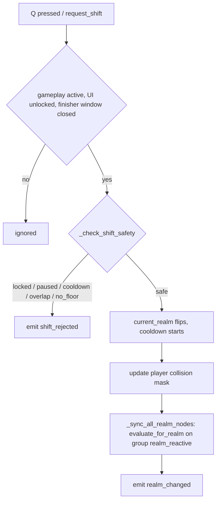
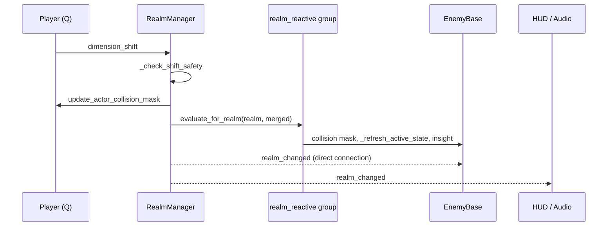

# 02. Realm System

The central mechanic of PARALLAX is the split between Reality and Mirror. At any moment exactly one realm is active (except after the Warden's Phase 2 merge, when both are). Geometry, props and enemies react to the active realm by enabling or disabling their collision, visibility and processing.

Related: [01_architecture_overview.md](01_architecture_overview.md), [03_combat_and_damage.md](03_combat_and_damage.md).

## 1. Purpose and key files

| Role | File |
| --- | --- |
| Authority over current realm, shift validation, merge | [realm_manager.gd](../scripts/core/realm_manager.gd) (`RealmManager`) |
| Reusable component/base for realm-reactive nodes | [realm_reactive.gd](../scripts/core/realm_reactive.gd) (`RealmReactive`) |
| Three-variant platform (Reality / Mirror / Repaired) | [realm_platform.gd](../scripts/environment/realm_platform.gd) (`RealmPlatform`) |
| Enemy realm behaviour | [enemy_base.gd](../scripts/enemies/enemy_base.gd), [phantom_twin.gd](../scripts/enemies/phantom_twin.gd) |
| Visual atmosphere per realm | [realm_environment_controller.gd](../scripts/environment/realm_environment_controller.gd), [realm_torch_light.gd](../scripts/environment/realm_torch_light.gd) |

## 2. RealmManager

`RealmManager` is a scene node (child of `Main`) that owns `current_realm` (`Realm.REALITY = 0`, `Realm.MIRROR = 1`), `is_merged`, `shift_locked` and `cooldown_timer`. It is reachable as `RealmManager.instance` and through the `realm_manager` group.

Exports: `shift_cooldown_duration` (0.60), `floor_check_distance` (1.60), `require_floor_support` (true), `handle_input_directly` (true), `player_capsule_radius` (0.38), `player_capsule_height` (1.75).

### Public API

| Function | Purpose |
| --- | --- |
| `request_shift() -> bool` | The Q-key shift. Validates, flips realm, starts cooldown, updates the player mask, syncs all reactive nodes, emits `realm_changed`. Emits `shift_rejected(reason)` and returns false when unsafe. |
| `can_shift_to_realm(target) -> bool` | Dry-run of the safety check (used by UI feedback). |
| `pass_through_mirror() -> bool` | Warden-arena Central Mirror Plane crossing. Same safety check, but ignores and preserves the Q cooldown. Refused when locked or merged. |
| `force_realm(target, lock_shift = false)` | Unconditional set, clears merge, resets cooldown. Used by `EncounterDirector` (death rewind, run restart) and by save restore. |
| `force_merge_realms()` | Sets `is_merged = true`, `shift_locked = true`, realm to Reality, emits `realms_merged`. Called by `WardenBoss` Phase 2 and by `BreakableProp.complete_break_now()` for the Central Mirror Plane. |
| `register_player(player)` | Called by `PlayerController._ready()`; applies the current realm mask to the player. |
| `get_realm_world_mask(realm) -> int` | World layers a body should collide with in a realm (all three when merged). |
| `update_actor_collision_mask(body, realm)` | Rewrites only the world bits of a body's `collision_mask`. |

Signals: `realm_changed(new_realm)`, `shift_rejected(reason)`, `realms_merged()`, `shift_cooldown_updated(remaining, duration)`.

### Input handling

`_unhandled_input` reacts to the `dimension_shift` action when `handle_input_directly` is true. It ignores the press if any of these hold:

- `MainController.is_gameplay_active()` is false;
- `PlayerController.ui_input_locked` is true;
- the player's finisher window is open (`is_finisher_window_open()`): Q is then the Mirror Break finisher (see [03](03_combat_and_damage.md)).

### Shift safety validation

`_check_shift_safety(target)` returns a dictionary `{safe: bool, reason: String}`. Checks, in order:

1. `locked` - `shift_locked` or `is_merged`.
2. `paused` - the tree is paused.
3. `cooldown` - `cooldown_timer > 0`.
4. If there is no player, no physics world or no space state, the shift is allowed.
5. `overlap` - a capsule (player dimensions, lifted by half its height) is tested with `intersect_shape` against only the destination realm's exclusive layer (`LAYER_WORLD_REALITY` or `LAYER_WORLD_MIRROR`). Any hit means the player would materialise inside destination geometry.
6. `no_floor` - if `require_floor_support`, a downward ray (from 0.25 m above the feet, `floor_check_distance` long) against the destination realm's full world mask must hit something, so the floor is never pulled from under the player.

The reason strings are what `shift_rejected` carries; `HUDController` and `AudioManager` both subscribe to the signal for feedback.



### Sync and merge

`_sync_all_realm_nodes()` iterates the `realm_reactive` group and calls `evaluate_for_realm(current_realm, is_merged)` on each. It runs after every shift or force, and once (deferred) in `_ready()`. Nodes that also connect to `realm_changed` directly (enemies, `RealmReactive`, `RealmPlatform`) are therefore evaluated twice per shift; this is harmless because evaluation is idempotent, but keep new implementations idempotent too.

Merge: `force_merge_realms()` makes every object active simultaneously. All world masks become Shared + Reality + Mirror, `evaluate_for_realm` receives `realms_merged = true`, and shifting is locked until `force_realm()` is called (which `EncounterDirector` does on death rewind or restart, and `WardenBoss._on_enemy_reset()` does on section reset).

## 3. RealmReactive

[realm_reactive.gd](../scripts/core/realm_reactive.gd) is both a standalone component and a base class. Drop it under a prop (default `target_node_path = ".."`) and set `realm_affinity`:

- `REALITY_ONLY` - active only when `active_realm == 0`
- `MIRROR_ONLY` - active only when `active_realm == 1`
- `BOTH_STATEFUL` - always active

`evaluate_for_realm(active_realm, realms_merged)`:

- `should_be_active` is forced true when `is_permanently_repaired`, when merged, or for `BOTH_STATEFUL`.
- It calls `set_realm_active(bool)` then the virtual `on_realm_changed(realm)`, and also calls `on_realm_changed` on the target node if it has one.

`set_realm_active(active)` applies, to the target:

- `visible` (if `manage_visibility` and target is a `Node3D`);
- collision (if `manage_collisions`): recursively sets `CollisionShape3D.disabled` (both immediately and via `set_deferred`), toggles `CSGShape3D.use_collision` (remembering the authored value in meta `_orig_use_collision`), and defers `monitoring` / `monitorable` on `Area3D`. Nested `RealmReactive` children are skipped so they manage themselves;
- processing (if `manage_processing` and the target is not self): `set_process` / `set_physics_process`.

`repair_for_reality()` sets `is_permanently_repaired` and forces activity; used for one-way world changes.

Why disable collision shapes rather than hide meshes: a hidden mesh with an enabled collider still blocks the player and still takes hits. The project rule (the "Golden Collision Rule") is that inactive-realm objects must disable colliders, area monitoring and processing.

## 4. RealmPlatform

[realm_platform.gd](../scripts/environment/realm_platform.gd) is a `Node3D` that swaps between up to three child subtrees, found by node path exports: `reality_node_path` (`RealityGeometry`), `mirror_node_path` (`MirrorGeometry`), `repaired_node_path` (`RepairedGeometry`).

`evaluate_for_realm(active_realm, realms_merged)`:

- Reality subtree active when repaired, merged or realm is Reality.
- Mirror subtree active when repaired, merged or realm is Mirror, except that if a repaired subtree exists and the platform is repaired, the Mirror copy is retired (avoids coplanar z-fighting).
- Repaired subtree active only when `is_permanently_repaired`.

`_set_subtree_active()` recursively sets `visible`, `CollisionShape3D.disabled`, and `CSGShape3D.use_collision`.

`repair_for_reality()` makes the platform permanent in both realms (the Collapsed Gallery bridge) and emits `platform_repaired`. It subscribes to `EncounterDirector.section_reset_requested` and, when the resolved section matches (`section_id`, or derived from a `StageNN` ancestor name, or a `Bridge` name fallback to section 2), calls `reset_platform()` so a death rewind un-repairs it.

Both `RealmReactive` and `RealmPlatform` join the `realm_reactive` group, so `RealmManager` drives them uniformly.

## 5. Enemies and realms

All enemies derive from [enemy_base.gd](../scripts/enemies/enemy_base.gd), which joins `enemy` and `realm_reactive`, connects to `realm_changed` and `realms_merged`, and implements `evaluate_for_realm(active_realm, realms_merged)` itself (it does not use a `RealmReactive` child).

Fields: `realm_affinity` (export, `RealmReactive.Affinity`), `is_realm_enabled`, `is_section_enabled`, `is_dead`, `is_wave_held`, and the derived `is_active`.

`evaluate_for_realm`:

1. Computes `is_realm_enabled` from affinity (merged or `BOTH_STATEFUL` is always true).
2. Updates the enemy's collision mask via `RealmManager.update_actor_collision_mask()` (or an equivalent local computation if the manager is missing), so an enemy walks on the active realm's floor.
3. Calls `_refresh_active_state()`.
4. Calls the virtual `on_realm_changed(realm)`.
5. Calls the virtual `_on_mirror_insight(bool)` with `active_realm == 1 and not realms_merged`.

`_refresh_active_state()` is the single place that applies activity:

```
should_be_active = is_section_enabled and is_realm_enabled and not is_dead and not is_wave_held
```

When it changes, the enemy sets `visible`, `VisualRoot.visible`, `set_process`, `set_physics_process`, disables its direct child `CollisionShape3D`s (deferred), sets `hurtbox.is_invulnerable = not active` and defers `hurtbox.monitorable`, ends any active attack hitbox swing, and emits `realm_activity_changed`. `EnemyAI` overrides it to also tell the squad coordinator to refresh its engaged peak.

### Current realm behaviour per archetype

The 2026-11-17 redesign made most enemies exist in both realms and use the Mirror as an "insight" view:

- `SkeletonGuard`, `ShieldedGuard`, `PhantomTwin`, `WardenBoss` set `realm_affinity = BOTH_STATEFUL` in `_init()`.
- Data-driven `ArchetypeEnemy` maps `EnemyArchetype.realm` (`"reality"`, `"mirror"`, `"both"`) to the affinity enum. All three shipped `.tres` files in `data/enemies/` (`grave_brute`, `hollow_hexcaster`, `shade_stalker`) currently use `"both"`.
- `REALITY_ONLY` and `MIRROR_ONLY` remain supported by the base class; a `MIRROR_ONLY` enemy is also reported as `is_spectral()` (cyan ichor).

### Mirror insight

`EnemyAI._on_mirror_insight(on)` sets `mirror_insight = on and mirror_damage_mult > 1.0` and shows a pulsing cyan weak-point glow. In `EnemyAI.apply_damage`, when `mirror_insight` is true and the source is not `"environmental"`, damage is multiplied by `mirror_damage_mult` (default 1.25). The Warden sets `mirror_damage_mult = 1.0` because it has its own mechanic.

### PhantomTwin: Mirror-only fighting

[phantom_twin.gd](../scripts/enemies/phantom_twin.gd) exists in both realms but only fights in the Mirror:

- `_mirror_now()` is true when there is no manager, when merged, or when the realm is Mirror.
- `is_hittable_now()` returns `_mirror_now()`. This is a virtual on `EnemyBase` (default true) used by the player's target acquisition and by allies to skip untouchable targets.
- `_modify_incoming_damage()` returns 0 in Reality (except for `"environmental"` damage) and plays a cyan shimmer; hits pass through.
- `can_attack_now()` and `start_windup()` refuse to attack in Reality, releasing the squad attack token.
- `can_damage_target()` is the veto that `Hitbox3D.try_hit_target()` consults on the attacker side: in Reality the phantom's hitbox damages nobody.
- `on_realm_changed()` re-applies the ghost look (`transparency` 0.6 on all `GeometryInstance3D` in Reality) and cancels a windup or attack in progress when the realm flips to Reality.

### WardenBoss

`WardenBoss.is_vulnerable_to_full_damage()` encodes the realm rules for the boss: always true in Phase 2 (merged); false during the transition; in Phase 1 true only when the player is in Mirror and the chest rune is exposed or the boss is staggered. Otherwise damage is capped by `phase1_reality_armor_cap`. See [03_combat_and_damage.md](03_combat_and_damage.md).

## 6. Data flow summary



## 7. How to extend / common pitfalls

Adding a realm-dependent prop:

1. Put the geometry under a `Node3D` (or use `RealmPlatform` with `RealityGeometry` / `MirrorGeometry` children).
2. For one-sided props add a `RealmReactive` child with the right affinity. Put the colliders on layers 4 (Reality) or 5 (Mirror) as appropriate and on layer 3 only for things that exist in both.
3. If the prop needs custom reactions, subclass `RealmReactive` and override `on_realm_changed()`, or define `on_realm_changed(realm)` on the target node.

Adding a realm-dependent enemy: subclass `EnemyAI`, set `realm_affinity` in `_init()`, override `is_hittable_now()` and `can_attack_now()` if the enemy cannot be touched or cannot attack in some realm, and override `can_damage_target()` if its hitbox must be vetoed. Always branch on `RealmManager.instance` being null (tests and tools run without it) and on `is_merged`.

Pitfalls:

- Hiding a mesh is never enough; disable `CollisionShape3D`s and area monitoring. Use `set_deferred` for anything that may run inside a physics callback (shifts can land inside a hit signal).
- Do not scatter numeric masks. Use `RealmManager.LAYER_*` and `get_realm_world_mask()`. Setting an actor's whole `collision_mask` directly will drop the realm bits; use `update_actor_collision_mask()`.
- `evaluate_for_realm` is called more than once per shift and also on reset; keep it idempotent and free of one-shot side effects (use `on_realm_changed` only for state derived from the realm).
- `CSGShape3D.use_collision` is restored from meta `_orig_use_collision`; if you author a CSG with `use_collision = false` it will remain false, by design.
- `pass_through_mirror()` is for the arena Mirror Plane only; it deliberately bypasses the cooldown. Do not use it for general shifting.
- After `force_merge_realms()` shifting is locked. Anything that restarts a fight must call `force_realm(REALITY, false)` to unlock (the Warden reset and `EncounterDirector` already do).
- `RealmPlatform` section resolution depends on ancestor node names starting with `Stage01`..`Stage05`. Renaming stage roots silently breaks death-reset for platforms unless `section_id` is set explicitly.
