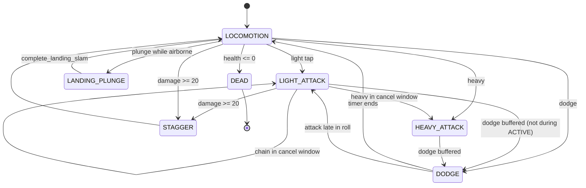
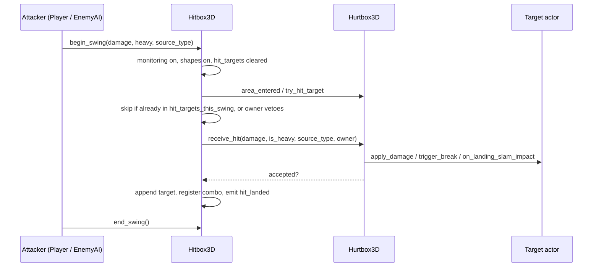
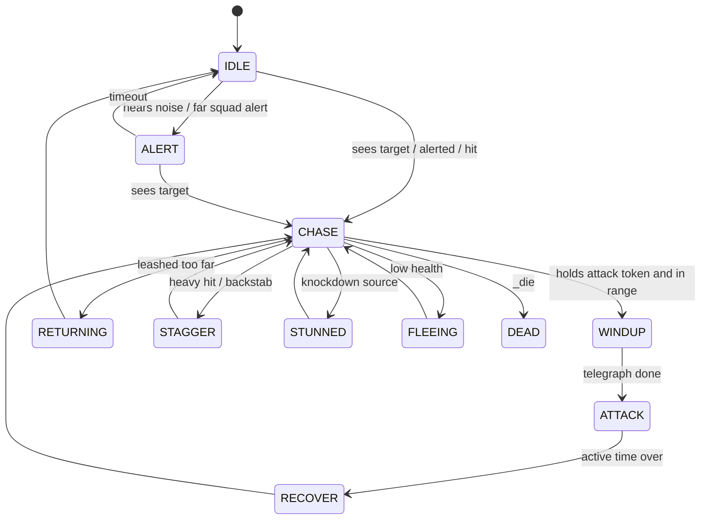

# 03. Combat and Damage

This document covers the player's combat state machine, the shared hit contract (`Hitbox3D` / `Hurtbox3D`), the enemy class hierarchy and the individual enemy types.

Related: [01_architecture_overview.md](01_architecture_overview.md), [02_realm_system.md](02_realm_system.md), [04_encounters_waves_saves.md](04_encounters_waves_saves.md).

## 1. Purpose and key files

| Role | File |
| --- | --- |
| Player movement and combat | [player_controller.gd](../scripts/player/player_controller.gd) (`PlayerController`) |
| Camera shake, FOV kick, sword trail | [player_feel_rig.gd](../scripts/player/player_feel_rig.gd), [sword_trail.gd](../scripts/player/sword_trail.gd) |
| Finisher VFX | [finisher_fx.gd](../scripts/player/finisher_fx.gd) |
| Hit-stop, slow motion, trauma, procedural SFX | [game_feel.gd](../scripts/core/game_feel.gd) (`GameFeel`) |
| Attack area | [hitbox_3d.gd](../scripts/core/hitbox_3d.gd) (`Hitbox3D`) |
| Damage receiver | [hurtbox_3d.gd](../scripts/core/hurtbox_3d.gd) (`Hurtbox3D`) |
| Enemy base | [enemy_base.gd](../scripts/enemies/enemy_base.gd) (`EnemyBase`) |
| Enemy AI | [enemy_ai.gd](../scripts/enemies/enemy_ai.gd) (`EnemyAI`), [squad_coordinator.gd](../scripts/enemies/squad_coordinator.gd) |
| Enemy types | [skeleton_guard.gd](../scripts/enemies/skeleton_guard.gd), [phantom_twin.gd](../scripts/enemies/phantom_twin.gd), [shielded_guard.gd](../scripts/enemies/shielded_guard.gd), [warden_boss.gd](../scripts/enemies/warden_boss.gd), [archetype_enemy.gd](../scripts/enemies/archetype_enemy.gd) |
| Archetype data | [enemy_archetype.gd](../scripts/enemies/enemy_archetype.gd), `data/enemies/*.tres` |
| Breakables | [breakable_prop.gd](../scripts/environment/breakable_prop.gd) |

## 2. PlayerController

`PlayerController` extends `CharacterBody3D` and joins group `player`. `_physics_process` runs a fixed pipeline each tick: update camera pivot, poll and buffer inputs, update the finisher window, regen health/stamina, tick dodge charges and the combo window, then dispatch on `current_state`.

### States

`enum State { LOCOMOTION, DODGE, LIGHT_ATTACK, HEAVY_ATTACK, LANDING_PLUNGE, STAGGER, DEAD }`, with `_set_state(state, duration)` as the single transition point (emits `state_changed`). Inside an attack, `attack_phase` is `WINDUP`, `ACTIVE` or `RECOVERY`.

### Attack data

Every attack is a row in the `ATTACK_DEFS` constant dictionary: animation clip and contact time, `windup` / `active` / `recovery` (seconds), `cancel` (fraction of recovery after which the next input is accepted), `lunge`, `reach`, `arc`, optional `line` and `ring`, `knockback`, `hitstop`, `trauma`, `fov_kick`, plus flags (`finisher`, `finisher_move`, `multi`, `execute`, `staggers`, `blink`, `crack`). To tune feel, edit these rows; damage numbers live in exports (below), not in the table, except finishers which carry `damage`.

Damage exports (see `@export` groups in the file): `light_combo_damages = [20, 22, 26, 30, 44]`, `heavy_attack_damage = 60`, `rising_arc_damage = 30`, `landing_attack_damage = 60`, `heavy_charge_max_damage_mult = 2.0`.

### Light chain

`start_light_attack()` picks `light_1` .. `light_5` from `combo_step`, wraps `combo_step` modulo the damage array size, and refreshes `_combo_window_timer` (`light_combo_reset_window`, 0.90 s). The chain resets when the window expires in LOCOMOTION or after `light_5` / any heavy.

- FLOW: one clean tap per swing landing inside the window around the cancel point (`_is_flow_timing()`, `flow_window_early/late`) gives faster wind-up (`flow_windup_scale`) and `flow_damage_mult` (1.15). Mashing still chains through the input buffer but without FLOW.
- Pause branch: if the player pauses at least `pause_branch_delay` mid-chain and taps, `light_rise` (Rising Arc, staggers) is used and the chain continues.
- Chaining is gated by `_can_start_attack()`: not airborne, and either in LOCOMOTION (and not in landing recovery) or inside an attack's cancel window (`_in_cancel_window()`).

### Heavy and charged heavy

`start_heavy_attack()` starts `heavy` from neutral, or `heavy_spin` (Whirlwind) when pressed mid-chain. For a plain `heavy`, `_update_heavy_hold()` freezes the attack at its raised pose (`heavy_hold_pose_u`) while the heavy button is held, accumulating `_heavy_charge_t` up to `heavy_charge_max_sec` (3.0). Releasing runs `_release_heavy_charge()`, which bakes the charge ratio into the swing: damage scales from 1x to `heavy_charge_max_damage_mult`, the crit chance rises from `heavy_charge_min_crit_chance` to 1.0, and crack, trauma, hit-stop and knockback are amplified. A full charge always crits and adds a ring. `ui_input_locked` aborts the charge.

### Dodge and i-frames

`start_dodge()` consumes one of `max_dodge_charges` (2), which regenerate every `dodge_cooldown`. Invulnerability is a window inside the dodge: `dodge_iframe_start` (0.03 s) to `dodge_iframe_start + dodge_iframe_duration` (0.26 s), applied each tick by `_process_dodge_state()` through `hurtbox.is_invulnerable`. `is_invulnerable()` also returns true during `_finisher_invuln_timer`. A hit received while the hurtbox is invulnerable during a dodge triggers `_on_hit_dodged()`, which fires a perfect dodge (slow motion via `GameFeel.slowmo`, `perfect_dodge` signal) once per dodge. Dodge can cancel attacks outside the ACTIVE phase and can be air-dashed once (`allow_air_dash`).

### Landing slam

`start_landing_attack()` (airborne, stamina at least 50) enters `LANDING_PLUNGE`. `_process_landing_plunge_state()` hangs briefly then plunges at `landing_plunge_speed`. On floor contact `complete_landing_slam(candidates)` calls `Hitbox3D.pulse_radial_targets(...)` with source type `"player_landing"` over groups `enemy`, `mechanism_target` and `breakable` (the Central Mirror Plane is excluded). It emits `landing_slam_triggered`. `"player_landing"` is also a knock-down source for enemies.

### Finishers

A hit can open a critical window (`_try_open_finisher_window()`): chain enders and charged heavies always crit; other hits crit with `crit_chance_light` (0.20) or `crit_chance_flow` (0.35). It is skipped if the swing was deflected, a window is open, the cooldown (`finisher_cooldown_sec`) is running, the swing was itself a finisher, or the option `finisher_window_enabled` is off. `open_finisher_window()` slows time (`finisher_slowmo_scale`) and emits `finisher_window_opened(duration, options)` for the HUD.

Inside the window, buffered inputs map through `FINISHER_BY_INPUT`:

| Input | Finisher | Notes |
| --- | --- | --- |
| light | `fin_rend` | 4 re-armed sweeps |
| heavy | `fin_sunder` | 120 damage, knock-down |
| dodge | `fin_phantom` | blink behind the target, 95 damage |
| dimension_shift (Q) | `fin_mirror_break` | 3 spinning AoE ticks, staggers |
| landing_attack | `fin_execution` | `execute: 0.35` kills anything at or below 35 percent HP unless `execute_immune` |

`start_finisher()` aborts the current attack, begins the finisher as a `HEAVY_ATTACK`, grants about 0.8 of its duration as invulnerability, and awards a `"finisher"` score event through `RunState.add_score_event`. Window timing is real time (hitches are credited back, capped), so slow motion does not shorten it.

### Damage taken and death

`apply_damage(amount, source)`:

1. Returns false if dead; if `is_invulnerable()` it calls `_on_hit_dodged(source)` and returns false.
2. The squad ally ward (`add_ally_ward`) soaks damage first.
3. Reduces `health`, emits `player_damaged` and `health_changed`, calls `RunState.on_player_damaged()` (resets combo, flags the encounter as damaged for no-hit bonuses).
4. Adds camera trauma and hit-stop through `GameFeel`.
5. If health reaches 0, `_on_death()`: abort attack, close finisher window, `State.DEAD`, emit `player_died`, then `EncounterDirector.handle_player_death(self)`. Otherwise damage of 20 or more (and not in a plunge) enters `STAGGER`.

Health also regenerates slowly (`health_regen_seconds_to_full`). `respawn_at(transform)` fully resets timers, charges, buffers, health and state, validating the position with a downward ray (falls back to `(0, 0.5, -136)`).

### Camera trauma and hit-stop (game_feel)

[game_feel.gd](../scripts/core/game_feel.gd) is a lazy singleton with a static API; callers pass any in-tree node as `context`:

- `GameFeel.hitstop(context, duration, time_scale = 0.03)` and `GameFeel.slowmo(context, time_scale, duration)` push a time effect. Effects stack: `Engine.time_scale` is the minimum of the active scales, each ending at a real-time deadline. Both are suppressed on a headless display and when the `hit_stop_enabled` setting is off. Pausing clears effects.
- `GameFeel.add_trauma(context, amount, world_pos = null, falloff_radius = 18.0)` broadcasts to every node in group `feel_camera_rig` (the `PlayerFeelRig`), attenuated by distance if a world position is given.
- `GameFeel.reset_time_scale()` is called by `EncounterDirector` on death and restart.
- `GameFeel.play_sound(context, key, pos, volume_db, pitch, jitter)` plays synthesised one-shots (`splat`, `bone_crunch`, `clang`, `whoosh_light`, ...).

`PlayerController` also exposes compatibility wrappers `add_camera_trauma()` and `trigger_hit_stop()` used by older callers such as the pillar collapse. Per-hit feel values come from the attack row (`hitstop`, `trauma`), applied in `_on_sword_hit_landed()`.

## 3. Hitbox3D and Hurtbox3D contract

### Hitbox3D (layer 7 area)

- `begin_swing(custom_damage = -1, heavy = false, custom_source_type = "")` clears `hit_targets_this_swing`, sets damage/heavy/source, enables monitoring and collision shapes. `end_swing()` disables them and clears the list. Both use `set_deferred` because they may be called inside physics callbacks.
- `try_hit_target(candidate)` is the single entry point (also called by the player's manual `_sweep_strike_targets()` so fast lunges never tunnel). In order it: requires an active swing; resolves a `Hurtbox3D` to its owner actor; rejects self/owner; rejects targets already in `hit_targets_this_swing` (the one-hit-per-target-per-swing rule); asks the owner's optional `can_damage_target(target)` veto (used by `PhantomTwin`); filters by `affects_player`, `affects_enemies`, `affects_breakables`; then routes damage.
- Routing priority when a `Hurtbox3D` is present: `hurtbox.receive_hit(damage, is_heavy, source_type, my_owner)`. Without a hurtbox it falls back to `on_landing_slam_impact` (for source `"player_landing"`), `trigger_break(is_heavy)`, player `apply_damage(damage, owner)`, `EnemyBase.apply_damage(...)`, or a generic `apply_damage`. The direct `trigger_break(is_heavy)` fallback does not pass the attacker, so directional breakables only aim correctly when reached through a hurtbox.
- On acceptance it appends the target, calls `RunState.register_hit()` for enemy hits from player sources (`player_light`, `player_heavy`, `player_execution`, or names starting `fin_`) if `register_combo_on_enemy_hit`, and emits `hit_landed`.
- `pulse_radial_targets(center, radius, candidates, damage, heavy, source)` runs a begin/hit/end cycle over a candidate list (used by the landing slam). Mechanism targets get extra horizontal tolerance.
- `AttackType` enum values (LIGHT, HEAVY, LANDING, HAZARD, ENEMY_*, BOSS_*) are labels; routing depends on `source_type` strings.

### Hurtbox3D

- Joins group `hurtbox` (scanned by the player sweep). Flags: `is_player_hurtbox`, `is_enemy_hurtbox` (default true), `is_breakable_hurtbox`. `is_invulnerable` blocks hits and emits `hit_blocked_invulnerable` (the player uses this for perfect dodge). A hurtbox with `monitorable = false` also rejects.
- `receive_hit(amount, is_heavy, source_type, attacker)` routes by priority: `"player_landing"` to `on_landing_slam_impact`; breakable flag or a `trigger_break` method to `trigger_break(is_heavy, attacker)`; player hurtbox to `apply_damage(amount, attacker)`; enemy to `apply_damage(amount, is_heavy, source_type, attacker)`. Emits `hit_received` on acceptance.

Common `source_type` strings: `player_light`, `player_heavy`, `player_execution`, `player_landing`, `fin_*`, `enemy_<attack_name>`, `environmental`, plus ally sources (`ally_charge`, `ally_nuke`, `ally_detonate`).

## 4. BreakableProp

[breakable_prop.gd](../scripts/environment/breakable_prop.gd): states `INTACT`, `BREAKING`, `BROKEN`; kinds `CRACKED_PILLAR`, `WEAK_STONE_SUPPORT`, `CENTRAL_MIRROR_PLANE`, `GENERIC_CRATE`.

- `trigger_break(by_heavy_attack, knocker)` is idempotent: it only acts while `INTACT` (so repeated hits never double-fire), requires a heavy hit if `require_heavy_attack`, and always refuses the Mirror Plane (that one breaks only through `complete_break_now()`). With `knock_directional` it aims the fall away from `knocker`.
- After `warning_duration` (0.60 s) `complete_break_now()` runs once: pillar hazard damage (`enemy_hazard_damage` to enemies, `player_hazard_damage` to the player, within `damage_radius` or along the fall line), feedback, `prop_broken` signal. For the Central Mirror Plane it spawns cosmetic shards and calls `RealmManager.force_merge_realms()`.
- Joins group `breakable`; listens to `section_reset_requested` to `reset_prop()`.

## 5. EnemyBase

All enemies extend `EnemyBase` (`CharacterBody3D`), which joins groups `enemy` and `realm_reactive`, registers with `EncounterDirector.register_section_enemy(section_id, self)` and subscribes to `section_reset_requested`.

Key exports: `enemy_id`, `section_id` (default 1), `encounter_id` (default `"hall_of_echoes"`), `realm_affinity`, `max_health`, `heavy_attack_staggers`, `execute_immune`, node path exports (`hurtbox_path`, `attack_hitbox_path`, `visual_root_path`), hit-feel exports.

Health scaling: `HEALTH_SCALE = 3.74` is applied once in `_ready()` (guarded by `_health_scaled`) to the authored `max_health`, covering both scripted and data-driven enemies. `WardenBoss` sets `_health_scaled = true` before `super._ready()` to opt out. `EnemyAI` separately applies `DAMAGE_SCALE = 1.4` to `attack_damage` once (`_damage_scaled`). When reading balance numbers in scripts, remember the authored value is not the in-game value.

### Damage pipeline

`apply_damage(amount, is_heavy, source_type, attacker)`:

1. Reject if dead, inactive (`is_active` false) or `amount <= 0`.
2. Record attacker and hit direction; call the virtual `_modify_incoming_damage()` (shields, caps, phantom immunity; returning 0 or less rejects the hit).
3. Subtract health, emit `damaged` and `health_changed`, call `_on_damage_taken()` (the Warden's phase hook may resolve a death here).
4. Play hit feedback, then `_die()` if lethal, else stagger on heavy hits (`_should_stagger_on_hit` then `_on_stagger_triggered`) or a light reaction (`_on_hit_reaction`).

### Death

`_die(source_type)` is guarded by `is_dead`. It ends any swing, spawns gore, then:

- awards score through `RunState.record_enemy_kill(unique_id, in_mirror, is_environmental)` (unless `award_standard_kill_score` is false);
- calls `EncounterDirector.register_enemy_kill(encounter_id)`;
- refreshes active state (collision, hurtbox off) and emits `died(enemy, kill_context)`.

### Active state, waves and resets

`_refresh_active_state()` computes `is_active = is_section_enabled and is_realm_enabled and not is_dead and not is_wave_held` and applies visibility, processing, collision, and hurtbox flags (details in [02_realm_system.md](02_realm_system.md)). `set_section_enabled()` is driven by `EncounterDirector._update_section_enemy_activation()` so only the current section's enemies run. `set_wave_held(held)` is driven by `WaveDirector` ([04](04_encounters_waves_saves.md)).

`reset_enemy()` (called from `_on_section_reset_requested` when the reset id equals `section_id`) restores health, transform and facing, clears FX, runs `_on_enemy_reset()` and re-evaluates realm state. Overrides must call `super._on_enemy_reset()`.

Virtual hooks worth knowing: `_modify_incoming_damage`, `is_hittable_now`, `_should_stagger_on_hit`, `_on_damage_taken`, `_on_stagger_triggered`, `_on_hit_reaction`, `_on_enemy_reset`, `_on_mirror_insight`, `on_realm_changed`.

## 6. EnemyAI state machine

[enemy_ai.gd](../scripts/enemies/enemy_ai.gd): `enum State { IDLE, CHASE, WINDUP, ATTACK, RECOVER, STAGGER, DEAD, ALERT, STUNNED, FLEEING, RETURNING }`. `_physics_process` runs timers, threat decay, `step_ai(delta)` (a `match` on state) and knockback. `_transition_to(state, duration)` is the single transition point.

- Targets are the player or squad allies, chosen from a threat table (`add_threat`, decay, `apply_taunt`, retarget hysteresis).
- Attack gating uses squad tokens: only enemies holding a token from `SquadCoordinator.request_attack_token()` wind up; others orbit a ring (`ring_margin`) and separate. `can_attack_now()` is a virtual veto (phantom uses it). Tokens must be released on every exit from the attack flow (`_release_token()`).
- Telegraph: `start_windup()` faces the target, emits `attack_telegraphed` and tints the model red (`telegraph_color`); the enemy tracks the target during the first 55 percent of the windup, then commits, making the swing dodgeable. `_begin_attack_strike()` calls `hitbox.begin_swing(attack_damage, false, "enemy_" + attack_name)` with `affects_player = true` and `affects_enemies = false`.
- `KNOCKDOWN_SOURCES` (`player_landing`, `fin_sunder`, `ally_*`) cause `STUNNED` (takes `stunned_damage_mult` more damage) unless `knockdown_immune`.
- `EnemyAI.apply_damage` layers extra rules over the base: Mirror insight multiplier, stunned multiplier, backstab multiplier and stagger, threat gain, squad alert, flee check.

## 7. Enemy types

### SkeletonGuard

Hall melee grunt (authored 100 HP, 15 damage). `BOTH_STATEFUL`, section HALL_COMBAT, encounter `hall_of_echoes`, flees at 15 percent HP. Its first death (unless environmental or execution) is a one-time revive at half health plus a 3 s stun; only the second death calls `super._die()`. It emits `mirror_hint_requested` on the first real hall death.

### PhantomTwin

Spectral lunging duelist, 80 HP. In Reality it is translucent, immune (damage 0, shimmer), cannot start attacks and its hitbox is vetoed; in the Mirror it is solid and lunges. Details in [02_realm_system.md](02_realm_system.md).

### ShieldedGuard

Collapsed Gallery elite (250 HP, shield bash). `is_shield_raised()` is true in Reality (not merged, not Mirror) unless staggered, stunned or dead. In `_modify_incoming_damage`, an attack coming from within `shield_block_half_angle_deg` (80 degrees) of its facing is blocked: light hits do 0 and emit `shield_deflected(false)`; heavy hits are capped at `reality_heavy_chip_damage` (10) and emit `shield_deflected(true)`. `execution` and `environmental` sources bypass the shield. `EnemyBase` listens to `shield_deflected` to spark and call the attacker's `on_attack_deflected()`, which makes the player recoil (`_was_deflected` also prevents a crit window). In the Mirror the shield is down and heavy hits stagger.

### Data-driven archetypes (ArchetypeEnemy)

`EnemyArchetype` ([enemy_archetype.gd](../scripts/enemies/enemy_archetype.gd)) is a `Resource`; `ArchetypeEnemy` ([archetype_enemy.gd](../scripts/enemies/archetype_enemy.gd)) copies it onto the `EnemyAI` exports in `apply_archetype()` (called before `super._ready()`), dresses a KayKit model (`_dress_model`, tint, props) and branches on `attack_kind`:

- `melee`: ordinary swing, optional blink behind the target (`blink_cooldown`) and `backstab_bonus_mult`.
- `bolt`: ranged caster holding `preferred_range`, fires a slow dodgeable `HexBolt` projectile.
- `slam`: telegraphed ground ring, damages everything within `aoe_radius`.

Shipped data: `grave_brute.tres` (slam, 260 HP), `hollow_hexcaster.tres` (bolt, 70 HP), `shade_stalker.tres` (melee, 90 HP). A new type is a new `.tres` plus, for a new `attack_name`, a row in `CharacterAnimationBridge`'s attack clip table.

### WardenBoss

Final boss, [warden_boss.gd](../scripts/enemies/warden_boss.gd): section EXECUTION_ARENA, encounter `the_warden`, 1500 authored max health (not scaled by `HEALTH_SCALE`), `execute_immune`, `knockdown_immune`, `award_standard_kill_score = false`.

Phases: `PHASE_1_SPLIT`, `PHASE_2_TRANSITION`, `PHASE_2_MERGED`.

- Phase 1: alternates `CLEAVE` and `LUNGE` (`_queue_next_move`). Damage is capped at `phase1_reality_armor_cap` (5) unless `is_vulnerable_to_full_damage()` (in Mirror with the chest rune exposed or staggered). After each attack the recovery exposes the chest rune (`chest_rune_exposed_changed`), the window to punish from the Mirror. A summon cast every `summon_interval` seconds raises thralls via `summon_factory` (set by the level builder).
- Transition: when health falls to `_phase2_threshold()` (`round(max_health * 0.666)` in the code; file header comments still say 500 HP / 50 percent, which is stale), `_on_damage_taken` clamps health and calls `_trigger_phase2_transition()`: stagger, shatter the Central Mirror Plane via `complete_break_now()`, `RealmManager.force_merge_realms()`, emit `mirror_plane_shattered` and `boss_phase_changed`. Damage is 0 during the transition (`_modify_incoming_damage`).
- Phase 2: directly vulnerable, per-hit damage capped at `phase2_max_hit` (120), faster wind-up, Cleave chains straight into Lunge (`phase2_chain_enabled`).
- `_die()` dismisses thralls, calls `super._die()` and, if `auto_finalize_run_on_death`, `RunState.finalize_run(true)`, then emits `boss_defeated`.
- `_on_enemy_reset()` restores Phase 1, resets the mirror plane prop and unlocks the realms.

## 8. How to extend / common pitfalls

Adding an attack to the player: add a row to `ATTACK_DEFS`, start it through `_begin_attack(name, damage, heavy, state, mods)`, and make sure `_current_swing_source_type()` yields a source string that `Hitbox3D` combo logic and enemy shields understand. Do not call `hitbox.begin_swing` from outside the attack state machine; `_enter_strike()` owns it.

Adding an enemy: prefer a new `EnemyArchetype` `.tres` for stat or kind variations. For new behaviour, subclass `EnemyAI`, set stats and `section_id` / `encounter_id` in `_init()`, and override hooks rather than `apply_damage`. If you override `_die` or `_on_enemy_reset`, call `super`.

Pitfalls:

- One hit per swing: `Hitbox3D` tracks hit targets per activation and `BreakableProp.trigger_break` is state-guarded. New damage sources must either use a `Hitbox3D` with `begin_swing` / `end_swing` or guard themselves; never apply damage from `_physics_process` ticks.
- `begin_swing()` while a swing is active clears the hit list, which allows a second hit. Multi-hit finishers do this on purpose (`multi`).
- `end_swing()` must run on every exit path (stagger, flee, death, inactivity). `EnemyBase._refresh_active_state()` and `_die()` already do this.
- Inactive enemies keep a `Hurtbox3D` node: it is made invulnerable and non-monitorable. Anything that searches the `hurtbox` group or `enemy` group must still check `is_active` / `is_dead` / `is_hittable_now()`.
- `Hurtbox3D.monitorable` is set with `set_deferred` inside physics flushes. Do not read it right after changing it.
- Squad tokens leak if you add a new state that exits the attack flow without `_release_token()`.
- Death rewind calls `reset_enemy()` for every enemy in the reset sections. Keep per-enemy runtime state (flags, revive, summons) resettable in `_on_enemy_reset()`.
- Balance numbers in `.tres` and `_init()` are base values: multiply by `HEALTH_SCALE` (health) and `DAMAGE_SCALE` (enemy damage) to get in-game values.
