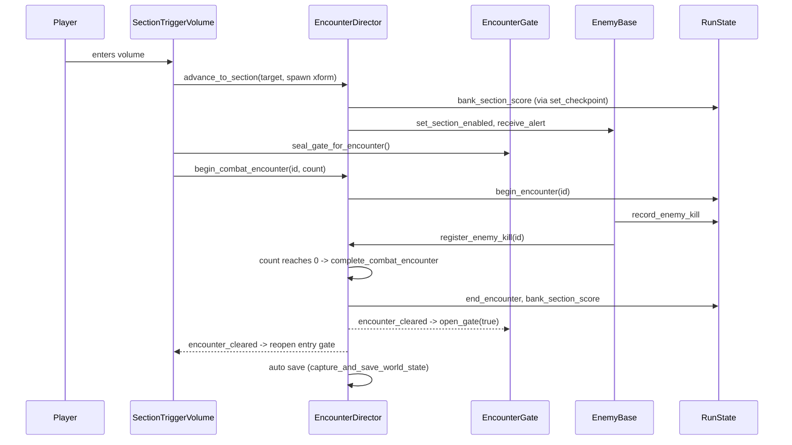

# 04. Encounters, Waves, Scoring and Saves

This document describes how a run progresses through the five stages (`EncounterDirector`), how rooms release enemies in waves (`WaveDirector`), how points and ranks are computed (`RunState`), and how progress is persisted (`LeaderboardStore`).

Related: [01_architecture_overview.md](01_architecture_overview.md), [02_realm_system.md](02_realm_system.md), [03_combat_and_damage.md](03_combat_and_damage.md).

## 1. Purpose and key files

| Role | File |
| --- | --- |
| Section FSM, checkpoints, encounters, death rewind | [encounter_director.gd](../scripts/core/encounter_director.gd) (`EncounterDirector`) |
| Entry volume that advances a section and starts an encounter | [section_trigger_volume.gd](../scripts/environment/section_trigger_volume.gd) (`SectionTriggerVolume`) |
| Gate that seals and opens | [encounter_gate.gd](../scripts/environment/encounter_gate.gd) (`EncounterGate`) |
| Wave sequencing of a room garrison | [wave_director.gd](../scripts/core/wave_director.gd) (`WaveDirector`) |
| Score, combo, rank (autoload `RunState`) | [score_manager.gd](../scripts/core/score_manager.gd) (`ScoreManager`) |
| Leaderboard, settings, saves (autoload `LeaderboardStore`) | [leaderboard_store.gd](../scripts/core/leaderboard_store.gd) (`LeaderboardManager`) |
| Layout version and coordinate conversion for old saves | [journey_layout.gd](../scripts/environment/journey_layout.gd) (`JourneyLayout.VERSION = 2`) |
| Where waves and triggers are built | [grand_journey_builder.gd](../scripts/environment/grand_journey_builder.gd) (`_add_waves`) |

## 2. EncounterDirector

`EncounterDirector` is a scene node (child of `Main`), reachable as `EncounterDirector.instance` and group `encounter_director`. In `_enter_tree()` it seeds the checkpoint at the start terrace: `Transform3D(rotation PI about Y, Vector3(0, 0, -136))`, section `ENTRY`, realm Reality.

### Sections

```
enum Section { ENTRY = 0, HALL_COMBAT = 1, COLLAPSED_GALLERY = 2, MECHANISM_CHAMBER = 3, EXECUTION_ARENA = 4, COMPLETE = 5 }
```

`get_section_name()` maps them to Entry Vestibule, Hall of Echoes, Collapsed Gallery, Mechanism Chamber, Execution Arena, Run Complete.

State: `current_section`, `active_enemy_count`, `current_encounter_id`, `completed_sections` and `completed_encounters` (dictionaries of id to true), `checkpoint_section`, `checkpoint_transform`, `checkpoint_realm`, plus a private `_checkpoint_history` (at most `MAX_HISTORY = 5` entries of `{section, transform, realm}`).

### Signals

`section_changed(section_id, section_name)`, `encounter_started(encounter_id, section_id)`, `encounter_cleared(encounter_id, section_id)`, `checkpoint_updated(section_id, spawn_transform)`, `player_respawned(section_id, spawn_transform)`, `section_reset_requested(section_id)`.

### Public API

| Function | Purpose |
| --- | --- |
| `register_section_enemy(section, enemy)` / `unregister_section_enemy` | Called by `EnemyBase._ready()`; builds `_section_enemies` and re-applies activation. Runtime-spawned enemies (thralls) must unregister when freed. |
| `advance_to_section(next, xform, save_checkpoint = true)` | Marks the previous section complete, switches `current_section`, optionally sets a checkpoint, updates enemy activation, alerts the new section's enemies (`receive_alert`), emits `section_changed`. |
| `set_checkpoint(section, xform, realm)` | Stores the checkpoint, maintains the history (replaces the last entry if the section is the same, else appends and trims to 5), calls `RunState.bank_section_score()`, emits `checkpoint_updated`, auto-saves. |
| `begin_combat_encounter(id, enemy_count)` | Starts an encounter unless it is already completed; sets `current_encounter_id` and `active_enemy_count`, calls `RunState.begin_encounter(id)`, emits `encounter_started`. |
| `register_enemy_kill(id = "")` | Decrements `active_enemy_count` for the current encounter; at 0 calls `complete_combat_encounter`. Ignored for mismatched or completed ids. |
| `complete_combat_encounter(id)` | Marks done, clears current id, calls `RunState.end_encounter(id)` (may award the no-hit bonus) and `bank_section_score()`, emits `encounter_cleared`, auto-saves. |
| `handle_player_death(player)` | The death rewind (below). Guarded by `_is_processing_death`. |
| `restart_full_run()` | Clears progress, resets checkpoint history to the start, calls `RunState.start_new_run()`, forces Reality, re-applies activation, regroups the squad, emits `section_changed`. |
| `restore_checkpoint_history(entries, fallback_section, fallback_xform, fallback_realm)` | Rebuilds history from a save; synthesises entries from `section_trigger` positions if the save has none. |
| `reset_triggers()` | Clears completed sections/encounters and emits a reset for the current section (test and tooling helper). |

Variable to know: `auto_save_on_checkpoint` (export, true). `MainController` turns it off during the level build so nothing is saved before the run begins.

### Section activation

`_update_section_enemy_activation()` calls `set_section_enabled(section == current_section)` on every registered enemy (or toggles processing if the enemy has no such method). Only the current section's enemies are processed, visible and collidable. It runs on registration, `advance_to_section`, `restart_full_run` and death.

### Encounter flow



Note that `encounter_enemy_count` on the trigger and each enemy's `encounter_id` must agree: the encounter completes when that many enemies sharing the id have died. Wave-held enemies are part of the count like any other enemy. Only a real `_die()` calls `register_enemy_kill`, so a `SkeletonGuard`'s first (reviving) death does not count; its second does.

### Death rewind (section_reset_requested)

`handle_player_death()` is called by `PlayerController._on_death()`. It:

1. Calls `RunState.revert_to_banked_score()` (unbanked section score is lost, combo resets, the timer keeps running).
2. Clears the active encounter.
3. Rewinds two checkpoints: target index `history.size() - 3` (clamped to 0). It sets `current_section`, `checkpoint_*` from that entry and truncates the history to it.
4. Computes the set of sections to reset: every section from the checkpoint section through the failed section, plus any completed section at or after the checkpoint. It erases them from `completed_sections` and clears their encounter ids from `completed_encounters` (a fixed map: section 1 -> `hall_of_echoes`, 2 -> `shielded_guard`, 4 -> `the_warden`, plus ids found on `section_trigger` nodes whose `target_section` is reset and `encounter_gate` nodes whose `section_id` is reset via `linked_encounter_id`).
5. Cleans transient FX (`GoreFX.cleanup_all_fx`), resets the squad coordinator and the time scale.
6. Emits `section_reset_requested(sec)` once per reset section. Listeners: enemies (`reset_enemy`), `EncounterGate` (re-lock to `starts_open`), `SectionTriggerVolume` (re-arm `has_triggered` unless its encounter is still completed), `BreakableProp` (`reset_prop`), `RealmPlatform` (`reset_platform`), `WaveDirector` (rewind to wave 1), and any other node that connects to the signal (for example puzzles and switches in the level scripts).
7. Forces the checkpoint realm (`force_realm(checkpoint_realm, false)`), after resets so the checkpoint realm is authoritative.
8. Respawns the player (`respawn_at`), re-applies section activation, alerts enemies, emits `section_changed` and `player_respawned`.

Anything that has runtime state and lives in a section must listen to `section_reset_requested` and compare the section id.

## 3. SectionTriggerVolume

An `Area3D` (group `section_trigger`) that masks only `LAYER_PLAYER`. Exports: `target_section`, `checkpoint_spawn_position` (zero means "use the volume's X/Z at y 0"), `save_checkpoint_on_enter`, `encounter_id`, `encounter_enemy_count`, `entry_gate_to_seal_path`, `reopen_entry_gate_on_clear`, `complete_run_on_enter`, `half_extents`, `check_position_bounds_each_frame`.

- Fires through `body_entered` (deferred) and, in parallel, a per-frame box test of every `player` against `half_extents` (so fast movement cannot skip the volume). Both go through `trigger_for_player()`, which is one-shot (`has_triggered`) and refuses until `MainController.level_ready` is true and the player is not disabled.
- On fire it builds a north-facing checkpoint transform, calls `advance_to_section`, seals the entry gate if the encounter is not already complete, and begins the encounter when `encounter_id` is set and `encounter_enemy_count > 0`.
- `complete_run_on_enter` instead advances to `COMPLETE` without a checkpoint and calls `RunState.finalize_run(true)`.
- On `encounter_cleared` for its id it reopens the entry gate (`open_gate(true)`). On `section_reset_requested` for its `target_section` it re-arms unless the encounter is still marked complete.

## 4. EncounterGate

`Node3D` in group `encounter_gate` with a mesh child (`gate_mesh_path`) and static bodies. Exports: `starts_open`, `linked_encounter_id`, `section_id`, plus cosmetic `animate_gate`, `lift_height`, `open_duration`, `close_duration`.

- `open_gate(permanent = true)`, `close_gate()` (refuses when permanently unlocked), `seal_gate_for_encounter()` (closes if open), `unlock_and_open()`.
- Opens automatically on `encounter_cleared` for `linked_encounter_id`; resets to `starts_open` on `section_reset_requested` for its `section_id`.
- `_apply_gate_state()` disables collision shapes (and CSG collision) when open and moves the mesh. It also keeps the static bodies on `LAYER_WORLD_SHARED | LAYER_PLAYER_BLOCKER` while closed (and layer 0 while open), so the gate blocks in both realms. The lift animation is purely cosmetic; colliders switch instantly. Animation is skipped for the first 250 ms after `_ready` so scene setup and save restores snap.

## 5. WaveDirector

[wave_director.gd](../scripts/core/wave_director.gd) (`WaveDirector`, `Node3D`, group `wave_director`) runs a room garrison as consecutive waves. It is created by `GrandJourneyBuilder._add_waves(root, name, section, waves_spec)` for the Hall of Echoes (`HallWaves`, three waves of eight) and the Mechanism Chamber (`ChamberWaves`). It skips missing enemies and does nothing when `spawn_enemies` is off.

- `waves` is an `Array` of `Array[NodePath]` (relative to the director) and must be set before the node enters the tree. Exports: `section_id`, `next_wave_delay` (2.0 s).
- `_restart()` (deferred from `_ready` and after a section reset): wave 0 fights normally; every enemy in later waves gets `set_wave_held(true)`, which makes `EnemyBase._refresh_active_state()` hide it, disable collision and processing, and make the hurtbox invulnerable.
- `_process()` polls every 0.25 s whether the current wave is down (`_wave_down`: all `is_dead`). When it is, it either finishes (`finished = true`, emits `waves_cleared`) or increments `current_wave` and waits `next_wave_delay`, then `_release()` un-holds the wave, spawns an impact burst on each enemy, plays a UI sound and emits `wave_started(index, total)`.
- `get_total()` and `get_display_wave()` (1-based, 0 when idle or finished) feed the objective tracker HUD.
- It listens to `section_reset_requested` for its `section_id` and rewinds after the enemies have reset themselves (the rewind is deferred so the order is correct).

The wave director does not touch `EncounterDirector` counts. Encounter completion still depends on every enemy of the encounter id dying, so the `encounter_enemy_count` on the trigger must equal the total across all waves.

## 6. Scoring (RunState / ScoreManager)

[score_manager.gd](../scripts/core/score_manager.gd) is the autoload `RunState`.

Signals: `score_changed(new_score, delta, event_type)`, `combo_changed(multiplier, hits, time_remaining)`, `no_hit_awarded(encounter_id, bonus_points)`, `run_timer_updated(elapsed)`, `run_finalized(summary)`.

### Events and points

Constants: enemy kill 100, mirror kill 200, environmental kill 250, no-hit encounter 500, Warden defeat 1000, finisher 150, max time bonus 1000.

`add_score_event(type, eligible_for_combo = true, unique_id = "")` awards `base_points * combo_multiplier` (multiplier is 1 when not combo-eligible). A non-empty `unique_id` makes the event idempotent through `awarded_event_ids`. Types: `enemy_kill`, `mirror_kill`, `environmental_kill`, `no_hit_encounter`, `warden_defeat`, `finisher`; any other type awards 0.

`record_enemy_kill(enemy_id, in_mirror, is_environmental)` awards `enemy_kill` plus `mirror_kill` (killed while the player is in Mirror and not merged) plus `environmental_kill` when applicable, each with unique ids `<id>:kill`, `<id>:mirror`, `<id>:env`, so a re-killed enemy after a rewind cannot double-score (banked ids are restored on revert).

### Combo

`register_hit()` (called from `Hitbox3D` on player hits against enemies) increments `combo_hits`, resets the 4.0 s decay timer and emits `combo_changed`. Multiplier: x1 below 3 hits, x2 from 3, x3 from 6. `_process` decays the combo to zero hits when the timer expires. `on_player_damaged()` resets the combo and flags the active encounter as damaged.

### No-hit bonus

`ELIGIBLE_NO_HIT_ENCOUNTERS = [hall_of_echoes, shielded_guard, the_warden]`. `begin_encounter(id)` clears the damaged flag; `end_encounter(id)` awards `no_hit_encounter` (not combo-scaled, unique id `no_hit:<id>`) if the encounter is eligible, undamaged and not yet awarded, and emits `no_hit_awarded`.

### Banking and rewind

`bank_section_score()` copies `score` into `banked_score` and snapshots `awarded_event_ids`; `EncounterDirector` calls it on checkpoint and encounter completion. `revert_to_banked_score()` restores both and clears combo and encounter state on death. The run timer is never reverted.

### Timer, ranks, finalization

`start_new_run()` zeroes everything and starts the timer; `pause_timer()` / `resume_timer()` control it. `calculate_time_bonus()` is `max(0, 1000 - seconds)`. `calculate_rank(score)`: S at 5000 or more, A at 4000, B at 3000, else C.

`finalize_run(award_warden_bonus = true)` is idempotent (cached `_final_summary`): stops the timer, awards the Warden bonus once, adds the time bonus once, banks the score, computes rank, updates the profile stat `total_runs_completed`, clears the saved run (`clear_saved_run(true)`), and emits `run_finalized(summary)` with `score`, `time_sec`, `time_bonus`, `warden_bonus`, `rank`, `max_combo`. It is triggered by `WardenBoss._die()` or a `complete_run_on_enter` trigger. `ResultsScreenController` listens, checks `LeaderboardStore.qualifies_for_top_five(score, time)` and submits via `save_run(initials, score, time, rank)`.

## 7. LeaderboardStore: leaderboard, settings and saves

[leaderboard_store.gd](../scripts/core/leaderboard_store.gd) (class `LeaderboardManager`, autoload `LeaderboardStore`) loads three `ConfigFile`s on `_ready`: leaderboard, settings, savegame, then calls `apply_settings()`.

| Path | Constant | Content |
| --- | --- | --- |
| `user://leaderboard.cfg` | `LEADERBOARD_PATH` | `[meta] count` and `[entry_N]` with `initials, score, time_sec, rank, timestamp`. Max `MAX_ENTRIES = 5`. |
| `user://settings.cfg` | `SETTINGS_PATH` | `[settings]` keys from `get_default_settings()` and `[keybindings]` (action to `KEY:<code>` style binding codes). |
| `user://savegame.cfg` | `SAVEGAME_PATH` | `[run]` (all run keys), `[profile]` (stats), `[custom]` (free-form key/value). |

Leaderboard: entries sort by score descending, then time ascending, then insertion order (`_sort_entries`). `save_run()` returns the 1-based placement (or -1 if it did not fit), `qualifies_for_top_five()` checks against the fifth entry, `sanitize_initials()` forces 3 alphanumeric characters (default `WAR`).

### savegame.cfg keys (`get_default_save_data()`)

Under `[run]`: `has_active_run`, `timestamp`, `current_section`, `checkpoint_section`, `checkpoint_position` (Vector3), `checkpoint_rotation_y`, `checkpoint_realm`, `completed_sections`, `completed_encounters`, `score`, `banked_score`, `elapsed_seconds`, `encounter_no_hit_awarded`, `awarded_event_ids`, `banked_event_ids`, `checkpoint_history` (array of `{section, position, rotation_y, realm}`), `player_health`, `layout_version`, `world_flags`, `dismissed_tutorials`.

Under `[profile]`: `total_runs_started`, `total_runs_completed`, `total_deaths`, `total_kills`, `best_score`, `fastest_time_sec`. In the current scripts only `total_runs_completed` is updated (by `finalize_run`); the others exist as keys but nothing increments them yet.

Under `[custom]`: arbitrary values via `set_custom_save_value` / `get_custom_save_value` (the dictionary is named `custom_claude_data` in memory).

Note the default `checkpoint_position` in the save defaults is `(0, 0, -3)` while `EncounterDirector` seeds `(0, 0, -136)`. A real save always overwrites it; the default only matters if a save is applied without being captured.

`world_flags` (booleans): `entry_switch_activated`, `hall_pillar_broken`, `gallery_support_broken`, `gallery_bridge_repaired`, `mechanism_puzzle_solved`.

### layout_version

`layout_version` stores `JourneyLayout.VERSION` (currently 2) at save time. On load, files with a lower version (or without the key, defaulting to 1) hold story coordinates from the old layout, so `apply_saved_world_state()` converts the checkpoint position and every history position with `JourneyLayout.to_world()`. If you change the world layout, bump `JourneyLayout.VERSION` and extend `to_world()` so old saves land correctly.

### Capture

`capture_and_save_world_state(root_node = null)` builds a snapshot and writes it through `save_run_checkpoint()`:

- from `EncounterDirector`: sections, checkpoint (position, yaw, realm), completed ids, serialised checkpoint history; if the current section is `COMPLETE`, `has_active_run` is set false;
- from `RunState`: score, banked score, elapsed seconds, no-hit and event id dictionaries;
- from the player: `max(1, health)`; from the HUD: `dismissed_tutorials`;
- `world_flags`, read from fixed node paths under `LevelRoot` (for example `Stage01_EntryVestibule/EntryMirrorSwitch`, `Stage02_HallOfEchoes/CrackedCentralPillar`, `Stage03_CollapsedGallery/GallerySpectralBridge`, `Stage04_MechanismChamber/ChamberMechanismPuzzle`).

`save_run_checkpoint(dict)` merges into `_save_data` (dict-merging for `world_flags`, `profile_stats`, `custom_claude_data`), stamps `timestamp`, writes the file and emits `game_saved`. It returns a copy with `_save_ok`. Auto-saves occur from `EncounterDirector.set_checkpoint()` and `complete_combat_encounter()` (when `auto_save_on_checkpoint` is true and the section is not `COMPLETE`).

### Apply (Continue)

`MainController` calls `apply_saved_world_state()` after the level is built when Continue was chosen. It re-reads the file and, if `has_saved_run()`:

1. restarts `RunState` then restores score, banked score, elapsed time, no-hit and event ids, and emits `score_changed(..., "loaded_save")`;
2. forces the saved realm;
3. converts coordinates if the layout is old, rebuilds the checkpoint history;
4. sets the director's completed dictionaries and checkpoint, calls `advance_to_section(saved_section, xform, false)` and `restore_checkpoint_history()`;
5. replays `world_flags` onto the world by node path (activates switches, unlocks gates with `unlock_and_open`, calls `complete_break_now(..., false)` on broken props, `repair_for_reality()` on the bridge, `force_solve_bypass()` on the puzzle);
6. marks the garrisons of completed encounters dead (`is_dead = true` then `_refresh_active_state()`), opens the matching gates, and for a completed Warden also breaks the Mirror Plane and flags audio/weather;
7. marks passed `section_trigger` volumes as triggered, and if the save was taken inside an unfinished encounter, seals the entry gate and calls `begin_combat_encounter` again;
8. respawns the player at the checkpoint with the saved health (clamped 1 to 100), regroups the squad, restores HUD tutorials, emits `game_loaded`.

`clear_saved_run(preserve_profile_and_custom = true)` resets the run keys (keeping the profile and custom data by default) and emits `save_cleared`.

## 8. How to extend / common pitfalls

Adding a stage or room:

1. Add the id to `EncounterDirector.Section` (and `get_section_name`). Keep the enum order matching the progression; several lookups use raw ints (the `SECTION_ENCOUNTER_MAP` in `_clear_completed_encounters_for_sections`, the `cur_sec == 5` COMPLETE check in the capture code, and the `StageNN` name prefixes in `RealmPlatform`).
2. Give the room a `SectionTriggerVolume` with `target_section`, `encounter_id`, `encounter_enemy_count` equal to the number of enemies sharing that id, and an entry gate.
3. Set each enemy's `section_id` and `encounter_id`; if you want waves, build a `WaveDirector` (see `_add_waves`) with the same `section_id`.
4. If the encounter should give a no-hit bonus, add the id to `ELIGIBLE_NO_HIT_ENCOUNTERS`.
5. Add a `SECTION_ENCOUNTER_MAP` entry (or rely on trigger/gate `linked_encounter_id` discovery) so a death rewind clears the encounter's completion.
6. If the room has persistent world state (broken props, solved puzzles), add a flag to `world_flags`, capture it in `capture_and_save_world_state()` and replay it in `apply_saved_world_state()`.

Pitfalls:

- Anything with runtime state in a section must handle `section_reset_requested`; the rewind goes up to two checkpoints back, so sections ahead of the checkpoint that were already cleared are also reset.
- `section_reset_requested` is emitted once per section; listeners must compare the id, and handlers run inside the death call, so avoid awaiting inside them.
- Encounter completion counts deaths. If `encounter_enemy_count` is larger than the number of enemies that can die, the gate never opens; if smaller, it opens early. Wave-held enemies count.
- Do not change `current_section` directly. Use `advance_to_section` so activation, alerts, checkpoint banking and signals stay consistent.
- Auto-save is suppressed during the loading build and at `COMPLETE`. If you add new auto-save call sites, route them through `capture_and_save_world_state()` and respect `auto_save_on_checkpoint`.
- Saves refer to world objects by node path. Renaming `Stage0N_*` nodes or their children breaks capture and restore silently (the lookups return null and are skipped).
- `finalize_run()` clears the saved run. Calling it from new places ends the Continue option.
- Score events must carry a `unique_id` whenever the same source can fire again after a rewind; otherwise points can be farmed. `record_enemy_kill` already does this for enemies.
- `RunState` is an autoload and survives scene reloads; `start_new_run()` is the only reset. The scene reload path calls it via `EncounterDirector.restart_full_run()`, but the Continue path calls it from `apply_saved_world_state()`.
