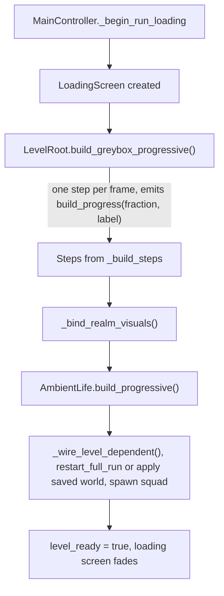

# 05. Level Generation

The playable level ("The Ascent") is not authored in the editor. `scenes/main/main.tscn` holds a nearly empty `LevelRoot` node, and a script builds every floor, wall, gate, enemy and decoration at run time, one step per frame, under the loading screen. This page explains how that builder is organised, how its two coordinate systems relate, and how to change the layout without breaking objectives, saves, weather or music.

Related: [01_architecture_overview.md](01_architecture_overview.md), [02_realm_system.md](02_realm_system.md), [06_environment_and_world.md](06_environment_and_world.md), [07_ui_hud_and_audio.md](07_ui_hud_and_audio.md).

## 1. Purpose and key files

| Role | File |
| --- | --- |
| Builds the whole level (`GrandJourneyBuilder`, extends `ColosseumGreyboxBuilder`) | [grand_journey_builder.gd](../scripts/environment/grand_journey_builder.gd) |
| Base class: gates, switches, pillars, section triggers, enemy setup, realm decor groups | [colosseum_greybox_builder.gd](../scripts/environment/colosseum_greybox_builder.gd) |
| Story vs world coordinates and the winding-bridge definitions (`JourneyLayout`) | [journey_layout.gd](../scripts/environment/journey_layout.gd) |
| Procedural meshes (arches, columns, rocks, cavea, gears) | [procedural_mesh_kit.gd](../scripts/environment/procedural_mesh_kit.gd) |
| Decoration pass authored in story coordinates | [journey_set_dressing.gd](../scripts/environment/journey_set_dressing.gd) |
| Landscape under the route | [journey_terrain.gd](../scripts/environment/journey_terrain.gd) |
| Drives the build and the loading screen | [main_controller.gd](../scripts/core/main_controller.gd) (`_begin_run_loading`) |
| Editor preview baker | [bake_map_preview.gd](../scripts/tools/bake_map_preview.gd) |

`GrandJourneyBuilder` overrides all five `_build_stage_0X_*` methods of the base class and inherits the helpers (`_make_gate`, `_make_switch`, `_make_breakable_pillar`, `_make_pit_kill_zone`, `_make_section_trigger`, `_configure_enemy_actor`, `_make_realm_group`). The base class `build_greybox()` is the original flat layout; it is not used by the game.

## 2. Build pipeline and data flow



The builder sets `build_on_ready = false` in `_init()`, so nothing is built when the scene loads. `MainController` connects to the `build_progress(fraction, label)` signal and maps the level to the first 85 percent of the loading bar (ambient life takes 85 to 97 percent). The loading screen is described in [07_ui_hud_and_audio.md](07_ui_hud_and_audio.md).

### 2.1 The step list

`_build_steps()` returns an array of `[label, Callable]` pairs. Both entry points iterate it:

- `build_greybox_progressive()` awaits one `process_frame` per step and emits `build_progress`. This is what the game and the bake tool use.
- `build_greybox()` runs the same steps synchronously (tools, headless tests).

Both are guarded by `_is_built`, so a second call does nothing.

| # | Label shown | What it does |
| --: | --- | --- |
| 1 | Stepping through the mirror | `_step_containers`: creates the `Scenery` and `Decor` nodes (not yet in the tree) |
| 2 | Raising the Sundering Entry | `_build_stage_01_entry()` |
| 3 | Building the Hall of Echoes | `_build_stage_02_hall()` |
| 4 | Laying the Collapsed Gallery | `_build_stage_03_gallery()` |
| 5 | Assembling the Mechanism | `_build_stage_04_mechanism()` |
| 6 | Raising the Execution Arena | `_build_stage_05_arena()` |
| 7 | Spanning the winding bridges | `_build_routes()` |
| 8 | Hanging the banners | adds `Decor` to the tree (all `_zone()` groups live under it) |
| 9 | Dressing the ruins | `_step_dressing`: runs `JourneySetDressing`, then remaps its `Dress_*` zones with `JourneyLayout.remap_subtree()` |
| 10 | Planting the scenery | `_step_scenery`: adds `Scenery`, then `_build_world_scenery()` |
| 11 | Placing shadow casters | `_build_occluders()` |
| 12 | Batching meshes | `_step_batch`: `_static_batch(self)` when `enable_static_batching` is true |

Order matters. Step 8 must follow all stage builders because they call `_zone()`, which parents each zone under `_decor`. Step 12 must be last because it merges meshes that earlier steps created.

### 2.2 What the finished tree looks like

Under `LevelRoot`: `Stage01_EntryVestibule`, `Stage02_HallOfEchoes`, `Stage03_CollapsedGallery`, `Stage04_MechanismChamber`, `Stage05_ExecutionArena`, `Journey_Routes` (one child per route, `R1_PilgrimCauseway` and so on), `Decor`, `Scenery` (terrain, massifs, sky isles, the world kill plane) and `Occluders`.

Gameplay node names under each stage root are a contract. The objective tracker, save system, `MainController` and audio look them up by path (for example `Stage02_HallOfEchoes/HallWaves`, `Stage05_ExecutionArena/Enemies/TheWarden`). Do not rename them.

## 3. Coordinates: story versus world

The level was first authored in a compact layout (story z about -61 to 202). In the 2026-11-18 rework the connectors became long winding bridges and two rooms tripled in size, so the level grew to world z about -141 to 362. Rather than rewrite every stage, the code keeps two coordinate systems and converts between them in [journey_layout.gd](../scripts/environment/journey_layout.gd) (`JourneyLayout`, `VERSION = 2`).

- **Story coordinates**: the old compact layout. Still used by Stage 03, Stage 05, the decor authored in `JourneySetDressing`, the ambient-life layout, and every system that compares progress (objectives, weather, music).
- **World coordinates**: the actual position in the scene. Used by Stage 01's terrace, the hall, the chamber, the bridges and all physics.

### 3.1 The mapping

`JourneyLayout.ZMAP` is a list of `[story z, world z]` breakpoints. Conversion is piecewise linear and has slope 1 beyond both ends:

| Story z | World z |
| --: | --: |
| -50.5 | -130.5 |
| -15.2 | -15.2 |
| 7.6 | 7.6 |
| 24.0 | 56.0 |
| 44.0 | 116.0 |
| 58.0 | 162.0 |
| 87.4 | 191.4 |
| 100.6 | 228.6 |
| 116.0 | 276.0 |

Reading the table: between story 24 and 44 (the old 20 m hall) the world gains 60 m, so the hall is three times as long. The two segments with slope 1 that matter most are story 58 to 87.4 (the gallery, shifted by +104) and story 116 onward (the esplanade, colosseum and summit, shifted by +160).

| Function | Purpose |
| --- | --- |
| `to_world_z(story)` / `story_z(world)` | Convert z in either direction through `ZMAP` |
| `to_world(p: Vector3)` | Story point to world point; also widens x by `SCALE_X = 3.0` inside the `SCALED` ranges (the two tripled rooms) |
| `is_scaled(story_z)` | True inside story 24 to 44 and 87.4 to 100.6 |
| `is_dropped(story_z)` | True inside `DROPPED` ranges whose old floors were replaced by bridges |
| `remap_subtree(node)` | Moves story-authored decor onto the world layout (see 3.3) |
| `guide_target(world_pos, fallback)` | Objective waypoint on a bridge (see 3.4) |

Layout constants: `OFF_S1_TERRACE = -80`, `OFF_S3 = 104`, `OFF_S5 = 160`, `HALL_CENTER = (0, 4, 86)`, `HALL_HALF = 30`, `CHAMBER_CENTER = (0, 6, 210)`, `CHAMBER_HALF = 18`, `BRIDGE_WIDTH = 6`.

### 3.2 Why some stages use stage-root offsets and others use world coordinates

Each stage uses whichever approach costs the least change for the shape it ended up with:

| Stage | Approach | Reason |
| --- | --- | --- |
| 01 Gate of Reflections | Identity (story equals world for z -15.2 to 7.6); the start terrace uses `-56 + OFF_S1_TERRACE` by hand | The gate core is unchanged and sits inside the identity part of `ZMAP`. Only the terrace moved 80 m south. |
| 02 Hall of Echoes | Built directly in world coordinates around `HALL_CENTER` | The room tripled (20 m to 60 m), so its geometry is regenerated from `HALL_CENTER` and `HALL_HALF` instead of being scaled. |
| 03 Collapsed Gallery | Authored in story coordinates; `root.position.z = OFF_S3` | The gallery did not change size. It lies in a slope-1 part of `ZMAP`, so a pure translation by +104 is exact. |
| 04 Mechanism Chamber | Built directly in world coordinates around `CHAMBER_CENTER` | The room tripled (12 m to 36 m). The puzzle keeps its original dimensions at the centre. |
| 05 Execution Arena | Authored in story coordinates; `root.position.z = OFF_S5` | Unchanged size; slope 1 beyond story 116, so a translation by +160 is exact. |
| Bridges (`Journey_Routes`) | World coordinates from `JourneyLayout.ROUTES` | New content with no story equivalent. |

For stages 03 and 05 the builder also shifts the decor zone that `_zone()` created: `(g[0].get_parent() as Node3D).position.z = JourneyLayout.OFF_S3` (or `OFF_S5`). Zones for stages 02 and 04 and for the bridges stay at the origin because their children already use world positions.

### 3.3 Decor and the `Dress_*` zones

`JourneySetDressing` (props, banners, decals) is authored in story coordinates and places nodes inside zones named `Dress_*`. After it runs, `_step_dressing` calls `JourneyLayout.remap_subtree()` on each one:

- A child with an identity transform and its own children is treated as a container and recursed into.
- An identity `MultiMeshInstance3D` has its instance transforms moved, not the node.
- Any node whose z lies in a `DROPPED` range is freed, because it would float in empty air above a gap that is now a bridge or a chasm.
- Every other node moves with `to_world()`.

The ambient-life layout ([ambient_life_layout.gd](../scripts/ambient/ambient_life_layout.gd)) uses the same functions in its `_habitat`, `_veg`, `_flora`, `_ivy` and `_marker` helpers: skip if `is_dropped(pos.z)`, otherwise `global_position = to_world(pos)`.

### 3.4 The rule: never hard-code world z; compare `story_z()`

Anything that decides "where is the player in the journey" must convert first:

```gdscript
var pz: float = JourneyLayout.story_z(player.global_position.z)
if pz > 44.0:   # past the hall's north gate (world z 116)
    ...
```

The existing consumers already follow this rule, which is why they survived the rework unchanged:

| Consumer | File | What it compares |
| --- | --- | --- |
| Objective chain and bypass auto-clear | [objective_tracker.gd](../scripts/ui/objective_tracker.gd) | `story_z` against thresholds such as 24, 64, 85.2, 101.5, 169.5 |
| Weather profile zones | [weather_director.gd](../scripts/environment/weather_director.gd) | `ZONES` keyed on story z |
| Music and room tone, sand footsteps | [audio_manager.gd](../scripts/core/audio_manager.gd) | `story_z` against 44, 52, 104, -40 |
| Save migration | [leaderboard_store.gd](../scripts/core/leaderboard_store.gd) | Saves without `layout_version >= JourneyLayout.VERSION` convert positions with `to_world()` |

When you add a new consumer, write thresholds in story z and convert the player position. When you need a world position from a story one (a waypoint, a spawn), call `to_world()`. If you instead paste a world number, the next layout change silently breaks it, and the old-save migration will not cover it.

Targets on the bridges are the exception: `guide_target(world_pos, fallback)` works directly in world coordinates. It finds the route whose z span contains the player (from six metres before its first node to its last) and returns the next node more than 3 m north of the player, falling back to `fallback` when the player is on none or has passed the last node. This relies on every route being z-monotonic.

### 3.5 Save compatibility

`LeaderboardStore` writes `layout_version` (currently `JourneyLayout.VERSION`). When it loads an older save it converts the saved player and checkpoint positions with `to_world()`. If you change `ZMAP`, `OFF_*` or any bridge geometry in a way that moves existing content, increment `VERSION` and extend the migration; otherwise Continue will drop players in the wrong place.

## 4. The routes: world z ranges

Values are taken from the builder and `JourneyLayout`. All z values are world coordinates; y is the floor height in metres.

| Area | Built by | World z | Floor y | Notes |
| --- | --- | --- | --- | --- |
| Start terrace | `_build_stage_01_entry` | -141 to -131 | 0 | 12 x 10 m; `Prologue_StartTerrace`, centre z -136 |
| R1 Pilgrim's Causeway | `_build_routes` | -131 to -15 | 0 | Bastions at z -97 (x 34, r 8), -49 (x -34, r 8), -27 (x 0, r 6) |
| Gate forecourt | `_build_stage_01_entry` | -15 to -5 | 0 | `Gate_Forecourt`, 14 x 10 m |
| Gate of Reflections core | `_build_stage_01_entry` | -5 to 8.5 | 0 | Entry floors, stepping-stone gap z -0.5 to 2.5, `Gate01_EntryToHall` at z 5, gatehouse z 4.5 to 7.5 |
| R2 Sunlit Bridges | `_build_routes` | 8 to 56 | 0 rising to 4 | Bastions at z 24 (x 16, y 1.1) and z 40 (x -16, y 2.9), r 8 |
| Hall of Echoes | `_build_stage_02_hall` | 56 to 116 | 4 | 60 x 60 m around `HALL_CENTER`; south seal gate at z 56, exit gate at z 116 |
| R3 Windswept Rampart | `_build_routes` | 116.5 to 164 | 4 rising to 6 | Bastions at z 132 (y 4.55) and z 148 (y 5.45), x +-16, r 8 |
| Collapsed Gallery | `_build_stage_03_gallery` | 164 to 192 | 6 | South deck 164 to 174, chasm 174 to 178 (spectral bridge), north deck 178 to 188, `Gate03` at z 188, corridor to 192 |
| Mechanism Chamber | `_build_stage_04_mechanism` | 192 to 228 | 6 | 36 x 36 m around `CHAMBER_CENTER`; `Gate04` at z 228 |
| R5 Processional | `_build_routes` | 229.2 to 276 | 6 rising to 10 | Bastions at z 244 (y 7.1) and z 260 (y 8.9), x +-16, r 8 |
| Esplanade | `_build_stage_05_arena` | 276 to 280 | 10 | 18 x 4 m; gatekeeper, skeleton, brute and hexcaster |
| Colosseum tunnels and arena | `_build_stage_05_arena` | 280 to 346 | 10 | South tunnel 280 to 300.5, arena floor centre z 314 (28 x 28 m), north tunnel 327.5 to 346 |
| Sunset summit | `_build_stage_05_arena` | 346 to 362 | 10 | `Trigger_RunComplete` at z 349; grave and monuments at the north end |

The route numbering skips R4 (there is no R4 in `ROUTES`; the names are R1, R2, R3, R5). The terrain and music code uses these same ranges: [journey_terrain.gd](../scripts/environment/journey_terrain.gd) hard-codes the route band half-width per z band in `_half_width()`, so it must be updated if rooms move.

## 5. Stage and route builders

### 5.1 Stage builders

Each `_build_stage_0X_*` returns a `Node3D` root that the step list adds as a child. Inside, a builder typically creates, in this order: floors with `_solid()`, railings with `_parapet()`, realm-specific geometry (`RealmPlatform`), gates and switches, the `PitKillZone`, the `SectionTriggerVolume` (entry trigger with respawn position), art meshes into the three decor groups, and enemies.

Notes per stage:

- **Stage 01** keeps the proven greybox gate core (entry floors, stepping stones, Mirror Switch, two enlarged shielded guards, a brute and a hexcaster). The terrace and forecourt rails close the open ends of the R1 bridge.
- **Stage 02** builds `HallFloor`, eight 4 m wide arcade bays per side via `MultiMeshInstance3D`, corner towers, nine `HallColumn_*`/`CrackedCentralPillar` columns and the garrison (18 enemies in `Enemies/`, six roamers in `Roamers/`). The hall's exit gate is linked to the `hall_of_echoes` encounter, which counts the 18 garrison enemies. See 5.4.
- **Stage 03** is the Collapsed Gallery: a `RealmPlatform` spectral bridge over the chasm and a `ShieldedGuard` whose death calls `bridge.repair_for_reality()` and opens `Gate03`.
- **Stage 04** hosts `MechanismPuzzle` (see [06_environment_and_world.md](06_environment_and_world.md)), eight tweened gears and 16 roamers in three waves.
- **Stage 05** builds the esplanade, arena disc, podium wall, 44-bay facade, the `CentralMirrorPlane` `BreakableProp` with a `MirrorGate`, `TheWarden`, and the summit. It also wires `warden.summon_factory = _spawn_warden_thrall`.

### 5.2 Winding bridges

`_build_routes()` loops over `JourneyLayout.ROUTES`. Each route is `[name, nodes]`. A node is either a bastion `[position, radius]` or an end node `[position, 0.0, edge_z, edge_half_width]` that meets a floor edge.


- `_build_bastion(...)`: round walkable disc on a masonry drum and a rock spur, a ring parapet with openings exactly where legs arrive (opening half-angle `asin(off / rr)`), merlons, two braziers on the outer side, and a garrison of roamers taken from `ROUTE_ENEMIES` (kinds per bastion).
- `_build_bridge_leg(...)`: a sloped `_ramp()` deck from edge to edge, optional flat aprons tucked into a floor edge, side parapets, join rails along a floor edge (`_JoinW`/`_JoinE`, closing the gap between the angled bridge and the straight floor edge) and masonry piers every 16 m (visual only).
- `_route_section()` maps a route to the `EncounterDirector.Section` that is active while the player walks it; roamers wake only in their section.
- R1 has three bastion nodes but `ROUTE_ENEMIES` lists garrisons for two, so the third bastion (z -27) is empty. This is the behaviour of the current code.

Heights are feet heights: each leg is a straight ramp, so keep slopes walkable when you change y values.

### 5.3 Hall walls

`_build_hall_walls(root, g, y)` makes four invisible collision walls (each with a 4 m opening for the south and north gates) plus the visual arcade. Arcade bays are `MultiMeshInstance3D`s: 15 modules per long side and eight bays each side of the central gate arch on the short sides, so the whole wall is a handful of draw calls. Corner towers and a cornice finish it.

### 5.4 Roamers, waves and the encounter count

`_add_roamer(parent, kind, name, pos, section, face_toward)` creates one of `phantom`, `shield`, `hexcaster`, `brute`, `stalker` or the default skeleton. Archetype kinds load a data resource from `ARCHETYPE_PATHS` (`res://data/enemies/*.tres`). Roamers set `encounter_id = ""`, so they never hold a gate; `section_id` makes `EncounterDirector` wake them only while the player is in that section and reset them on respawn. `_roamer_group(root)` returns (and creates) the `Roamers` child of a stage root; waves refer to enemies by path under it.

`_enlarge_enemy(enemy, k)` scales model, capsule, hurtbox, HP-bar height and melee reach by `k` without scaling the `CharacterBody3D`. Call it before the enemy enters the tree.

`_add_waves(root, name, section, waves_spec)` creates a [wave_director.gd](../scripts/core/wave_director.gd) (`WaveDirector`) with `waves` as arrays of node paths relative to `root`. Missing paths are skipped. The director holds later waves with `set_wave_held(true)` (hidden, inert, untargetable) and releases the next wave 2 s after the current wave is dead. The hall uses three waves of eight (all 18 garrison enemies plus six roamers); the chamber uses 6, 6 and 4 roamers.

Gate logic differs: the hall exit gate (`Gate02_HallToGallery`) opens when `hall_of_echoes` clears, which counts only the 18 `Enemies/` children (`hall_specs.size()` in the section trigger). Roamers and waves do not affect that count.

### 5.5 Hall columns as weapons

`_make_breakable_pillar(...)` (base class) builds the `BreakableProp` shell: intact visual with a fracture seam, rubble, a solid body and a hurtbox. For the hall, `_restyle_pillar(prop, height, radius, broken_dir)` swaps in a fluted `ProcMesh.column_mesh`, a base-plus-shaft collider, three fallen drums with real colliders under `BrokenVisual/DebrisBody`, and a stump. `_make_knockable(prop, height)` then sets `knock_directional = true`, `knock_fall_length = height`, `damage_radius = 1.8` and `enemy_hazard_damage = 600`, so a heavy hit topples the column away from the striker. Hazard behaviour is explained in [06_environment_and_world.md](06_environment_and_world.md).

## 6. Realm groups, zones and decor

`_zone(name)` creates a node under `Decor` and returns three groups: `[shared, reality_only, mirror_only]` named `Shared`, `RealityDressing`, `MirrorDressing`. The second and third carry a `RealmReactive` child, created by `_make_realm_group`, with `target_node_path = ".."` and `manage_collisions = false`: they toggle visibility only. Collision for realm-specific geometry belongs in `RealmPlatform` or in nodes that disable their own colliders ([02_realm_system.md](02_realm_system.md)).

Conventions used throughout the builder:

- `g[0]` is shared art, `g[1]` Reality-only, `g[2]` Mirror-only (banners, crystal clusters, ambient particles).
- `_brazier(g, pos)` adds a stand, bowl, flame particles and an `OmniLight3D` named `BrazierLight*` whose `distance_fade` begins at 45 m. `AudioManager` finds those names to attach a fire crackle.
- `_solid(parent, name, pos, size, mat, layer, rot, show_mesh)` creates a `StaticBody3D` with a box collider and an optional batchable mesh. `_invisible_wall()` is the collider-only variant. `_prop_collider()` places a collider shape on a body for props.
- `_parapet(parent, name, a, b, mat)` creates a low visible balustrade plus two colliders: a low `RailBody` on the world layer and a 2.7 m `Blocker` on `RealmManager.LAYER_PLAYER_BLOCKER`, which the camera ignores. Enemies are given the blocker bit in `_configure_enemy_actor` so they cannot be lured off ledges.
- `_ramp(parent, name, from, to, width, mat)` builds a sloped walkable slab whose top surface passes exactly through `from` and `to`.

## 7. Static art, batching and scenery

### 7.1 `StaticArt` and `_static_batch`

Draw-call reduction happens in two ways:

- **MultiMesh** for repeated modules (`_multimesh()`), such as arcade bays, merlons, pilasters and masts.
- **Mesh merging**. `_mesh()` tags a `MeshInstance3D` with the meta `gj_batch` when it has a material override and `batch = true`. `_static_batch(root)` collects tagged meshes, groups them by batch host, material and shadow mode, merges each group with `SurfaceTool.append_from` and frees the originals.

A batch host is the nearest ancestor named `Shared`, `RealityDressing`, `MirrorDressing`, `Scenery` or `StaticArt` (`_batch_host`). That is why realm toggling still works on merged meshes: the host is the realm group itself. For purely visual meshes that live under a gameplay stage root, `_static_art(parent)` creates a per-parent `StaticArt` node (used by `_parapet`) so those meshes can be merged without touching gameplay nodes.

Pass `batch = false` to `_mesh()` for anything animated, toggled by gameplay or realm-specific outside a decor group (the stepping stones, gears, plate, deck cylinders). Rocks call `remove_meta("gj_batch")` and use mesh LODs instead (`_with_lods()`), because merging discards LODs. Toggle `enable_static_batching` off to audit raw geometry.

### 7.2 World scenery

`_build_world_scenery()` places rock massifs under every walkable region (tops clamped just under the floors so nothing pokes through), then builds the landscape with `JourneyTerrain(get_route_waypoints(), SUN_HEADING).build(_scenery, _with_lods)`, then ten Mirror-only floating isles and a single `PitKillZone_World`. A bridge is air between its bastions, and each bastion stands on its own rock spur. Details of the terrain are in [06_environment_and_world.md](06_environment_and_world.md).

### 7.3 Occluders

`_build_occluders()` places `OccluderInstance3D` boxes strictly inside solid geometry: gatehouse piers, hall towers, tower walls, portal piers, facade chords and massif cores. Occlusion culling must be enabled in project settings (`occlusion_culling/use_occlusion_culling=true`). An occluder that pokes outside solid art can hide visible geometry, so keep them conservatively smaller than the walls they sit in.

### 7.4 Atmosphere

`_ready()` defers `_configure_atmosphere()`, which sets up the sky shader and HDRI (rotated so the baked sun sits on `SUN_HEADING`), fog, SSAO, glow and tone mapping, creates the `WeatherDirector` if absent, and re-applies user graphics settings through `LeaderboardStore.apply_settings()`.

## 8. Anchors and waypoints

- `get_key_anchors()` returns a dictionary of named world positions (`player_spawn`, `entry_gap_center`, `hall_pillar`, `gallery_bridge_center`, `warden_spawn`, `summit`, and so on), computed from `JourneyLayout`. Tests and tools use them instead of hard-coded coordinates.
- `get_route_waypoints()` returns the ordered critical path as `[Vector3, realm]` pairs. The realm value is the realm required to stand there (the stepping stones need 1, Mirror). Bridge waypoints come from `JourneyLayout.ROUTES`; `JourneyTerrain` uses the list to keep the landscape below the route band.

## 9. Viewing the level in the editor: the bake tool

Because the level is code, the editor shows an empty scene. [bake_map_preview.gd](../scripts/tools/bake_map_preview.gd) builds it once and saves a read-only snapshot you can open and fly around in:

```powershell
godot --path . -s res://scripts/tools/bake_map_preview.gd
```

What it does:

1. Instantiates `main.tscn`, waits five frames, then awaits `LevelRoot.build_greybox_progressive()` and `AmbientLife.build_progressive()`.
2. Duplicates `WorldEnvironment` and `SunLight`, reparents `LevelRoot`, `AmbientLife` and any `Weather*` node under a new `MapPreview` node.
3. Gives every generated node the preview root as owner (`_claim`), strips gameplay scripts from generated nodes so nothing runs in the editor, and packs the result to `res://scenes/main/map_preview.scn` (compressed).

Notes:

- The header comment says the file is gitignored; at the time of writing `.gitignore` lists `scenes/main/map_preview.scn`. Regenerate it any time you change the builder.
- Instanced sub-scenes (character models, enemy scenes) are saved as instances; only their roots are claimed.
- Because gameplay scripts are stripped, gates, switches and realm toggling do nothing in the preview; use it to look at geometry, materials and scale.

## 10. How to extend and common pitfalls

### Add a new decorated area or prop

1. If it belongs to an existing stage, add it inside that stage builder; use `_zone()` groups for realm art.
2. If it uses story coordinates (anything in a `Dress_*` zone, ambient layout), place it by story z and let `remap_subtree` or `to_world()` convert.
3. Use `_mesh(..., batch = true)` for static art so it merges, and `_multimesh()` for repeats.
4. Keep colliders out of decor groups; a decor group hides meshes only.

### Move or resize a room

1. Change the centre or size constants in `JourneyLayout` (`HALL_CENTER`, `CHAMBER_CENTER`, `HALF` values) or `ROUTES`.
2. Update `ZMAP` so story z still maps to the new world z (every consumer that compares `story_z` depends on this), and `SCALED`/`DROPPED` if ranges moved.
3. Check the hard-coded ranges that mirror the layout: `JourneyTerrain._half_width()`, `_build_occluders()`, `_build_world_scenery()` massif list, and the thresholds in `objective_tracker.gd` and `weather_director.gd`.
4. Increment `JourneyLayout.VERSION` if existing saves would land in the wrong place.
5. Rebuild the preview with the bake tool and walk the route.

### Add or reshape a bridge

- Edit `ROUTES`. Keep each route z-monotonic (the guidance code assumes it), start and end with an edge node whose `edge_z` and half-width match the neighbouring floor's edge, and give each leg a walkable slope.
- Add a garrison entry in `ROUTE_ENEMIES` for each bastion you want populated. A bastion with no entry is empty.
- Roamers on a bridge need a section from `_route_section`.

### Add an enemy to a room

Use `_add_roamer` and, if the room uses waves, add its path to `_add_waves`. If it must hold a gate, give it a real `encounter_id` and update the count passed to the section trigger.

### Pitfalls

- **Hard-coded world z.** The rule in 3.4 exists because every earlier hard-coded z broke on the rework.
- **Respawn positions are world positions.** `_make_section_trigger` takes the trigger position in the stage root's local space but the respawn position in world space. Stage 03 and 05 therefore pass `... + JourneyLayout.OFF_S3/OFF_S5` explicitly. Forgetting the offset drops the player 104 or 160 m south of the room.
- **Story-built stages are translated.** Anything you add under the Stage 03 or 05 root is in story space; `global_position` is world. Convert when comparing with player position.
- **Merging breaks anything animated or toggled.** Use `batch = false` for meshes that move, hide on their own or belong to a gameplay node.
- **Node renames.** The objective tracker, save system and audio find nodes by path and by class (`BreakableProp`, `EncounterGate`, `BrazierLight*`).
- **Build order.** `_zone()` needs `_decor` to exist (created in step 1) and the `Decor` node is added in step 8; do not call `_zone()` after step 8 without adding the returned zone yourself.
- **Never scale a physics body.** `_enlarge_enemy` exists for that reason.
