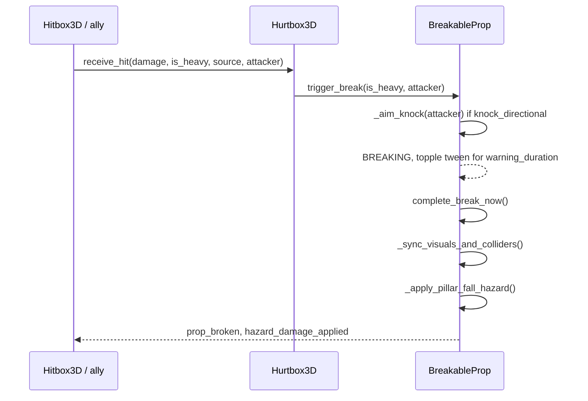
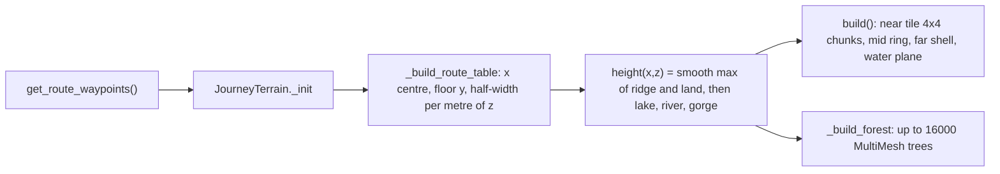
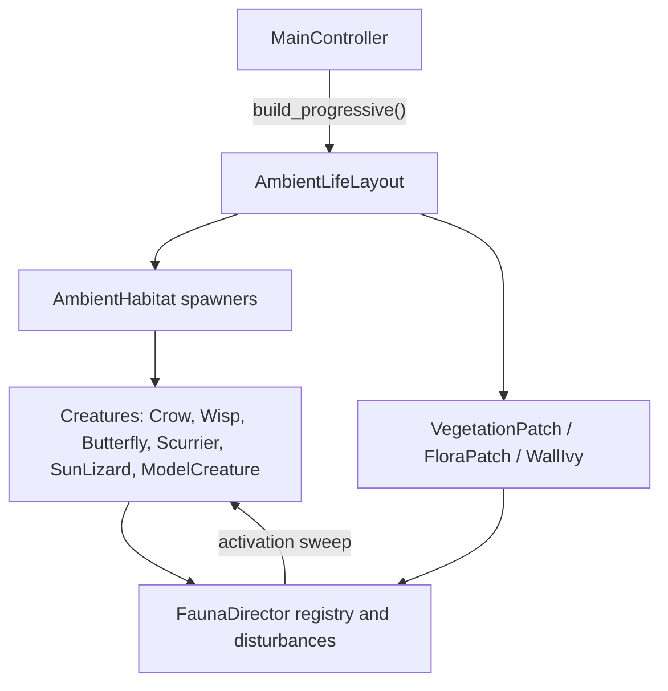

# 06. Environment and World

This page covers the interactive and atmospheric parts of the level: breakable props, gates, switches and the mechanism puzzle, the terrain under the route, the set-dressing pass, weather, ambient wildlife and the performance features that keep it all running. How these are placed is described in [05_level_generation.md](05_level_generation.md); how realms toggle them is in [02_realm_system.md](02_realm_system.md).

## 1. Key files

| System | File |
| --- | --- |
| Breakable props | [breakable_prop.gd](../scripts/environment/breakable_prop.gd) (`BreakableProp`) |
| Gates | [encounter_gate.gd](../scripts/environment/encounter_gate.gd) (`EncounterGate`) |
| Switches | [interact_switch.gd](../scripts/environment/interact_switch.gd) (`InteractSwitch`) |
| Mechanism puzzle | [mechanism_puzzle.gd](../scripts/environment/mechanism_puzzle.gd) (`MechanismPuzzle`) |
| Realm platforms | [realm_platform.gd](../scripts/environment/realm_platform.gd) (`RealmPlatform`) |
| Mirror plane walk-through | [mirror_gate.gd](../scripts/environment/mirror_gate.gd) (`MirrorGate`) |
| Section entry triggers | [section_trigger_volume.gd](../scripts/environment/section_trigger_volume.gd) |
| Fall kill volumes | [pit_kill_zone.gd](../scripts/environment/pit_kill_zone.gd) |
| Landscape | [journey_terrain.gd](../scripts/environment/journey_terrain.gd) (`JourneyTerrain`) |
| Decoration | [journey_set_dressing.gd](../scripts/environment/journey_set_dressing.gd) (`JourneySetDressing`) |
| Weather | [weather_director.gd](../scripts/environment/weather_director.gd) (`WeatherDirector`) |
| Wildlife and flora | [scripts/ambient/](../scripts/ambient/), layout in [ambient_life_layout.gd](../scripts/ambient/ambient_life_layout.gd) |
| Adaptive resolution | [performance_governor.gd](../scripts/core/performance_governor.gd) (`PerformanceGovernor`) |
| Graphics presets | [leaderboard_store.gd](../scripts/core/leaderboard_store.gd) (`apply_graphics_preset`, `apply_settings`) |

## 2. Breakable props

[breakable_prop.gd](../scripts/environment/breakable_prop.gd) is a `Node3D` that owns an intact visual, a broken visual, colliders and a hurtbox. It joins the `breakable` group on `_ready`.

### 2.1 Kinds and state

| `PropKind` | Behaviour | Used by |
| --- | --- | --- |
| `CRACKED_PILLAR` | Heavy hit starts a warning, then topples and applies a fall hazard | Hall columns and central pillar |
| `WEAK_STONE_SUPPORT` | Same break flow, no pillar hazard or topple | The base greybox builder only |
| `CENTRAL_MIRROR_PLANE` | `trigger_break()` always returns false; only `complete_break_now()` shatters it, spawning shards and forcing a realm merge | Stage 05, called by `WardenBoss` (`mirror_plane_prop_path`) |
| `GENERIC_CRATE` | Defined, no special behaviour in `complete_break_now` | Nothing in the journey |

State machine (`current_state`): `INTACT` to `BREAKING` (warning) to `BROKEN`. `reset_prop()` returns to `INTACT`.

### 2.2 Public API

| Member | Purpose |
| --- | --- |
| `trigger_break(by_heavy_attack = true, knocker = null) -> bool` | Entry point for hits. Returns false if not intact, or if `require_heavy_attack` is set and the hit was light. Starts the warning timer; with `warning_duration <= 0` breaks immediately |
| `complete_break_now(explicit_candidates = [], apply_hazard = true)` | Skips the warning. Syncs visuals, applies the hazard (pillars), shatters the plane |
| `reset_prop()` | Restores visuals, colliders and clears the topple copy and shards |
| `get_fall_zone_center()` | `global_position + fall_zone_offset` |
| Signals | `break_warning_started(sec)`, `prop_broken(prop)`, `hazard_damage_applied(enemies_hit, player_hit)` |
| Exports | `section_id`, `warning_duration`, `enemy_hazard_damage`, `player_hazard_damage`, `damage_radius`, `fall_zone_offset`, `knock_directional`, `knock_fall_length`, shatter settings |

### 2.3 Data flow

`Hurtbox3D.receive_hit` routes to `trigger_break` when `is_breakable_hurtbox` is set or the actor has the method, passing the attacker as `knocker`. `Hitbox3D` also calls `trigger_break` directly when it has no hurtbox (without a knocker, so the fall defaults to +Z). Squad allies call `prop.trigger_break(true, self)` for the "smash" command.

### 2.4 Warning, topple and fall line

- During the warning (`warning_duration`, 0.6 s for pillars) a cosmetic copy of the intact visual tips over around an axis perpendicular to `fall_zone_offset`, landing as the hazard resolves (`_start_topple`). This is cosmetic only; timing is unchanged. The real intact node is hidden for the duration.
- The hazard is evaluated once, in `complete_break_now`. A hit that finds the prop already `BREAKING` or `BROKEN` is rejected, so a swing cannot double-fire the break (this is the project's "one hit per swing" rule for breakables).
- **Fixed-circle hazard** (default): every node in the `enemy` and `player` groups within `damage_radius` of `get_fall_zone_center()` is damaged.
- **Directional knock** (`knock_directional = true`, set by `_make_knockable` in the builder): `_aim_knock(knocker)` points the fall away from the striker: `fall_zone_offset = dir * knock_fall_length * 0.5`, and the `BrokenVisual` is rotated to match (it is authored falling toward +Z). `_in_fall_line(p)` then tests a segment from the prop base along `fall_zone_offset * 2` with half-width `damage_radius` and a vertical tolerance of 4 m. Enemies take `enemy_hazard_damage` (600 for hall columns, enough to kill at the current enemy health), the player takes `player_hazard_damage` only if standing in the line.
- Feedback: `_emit_collapse_feedback` adds camera trauma (`PILLAR_COLLAPSE_TRAUMA`, attenuated by distance) and a debris burst. `AudioManager` plays `pillar_crack` on the warning and `pillar_collapse` on break.
- Colliders: `_sync_visuals_and_colliders` disables the prop's own collision shapes and hurtbox when broken and enables colliders under `BrokenVisual` (debris), recursively, using deferred property sets so it is safe inside physics callbacks.

### 2.5 Reset

The prop connects to `EncounterDirector.section_reset_requested` and resets when `section_id` matches. Hall columns use `section_id = 1`, so dying in the hall restores every column.

### 2.6 Extending

- To make a new pillar-like prop, call `_make_breakable_pillar(...)` in a builder, then `_restyle_pillar` and `_make_knockable` if you want the hall behaviour.
- Add new break outcomes in `complete_break_now`; keep the `current_state` guard first so it stays idempotent.
- If you add a visual with its own collider, put it under `BrokenVisual` if it should appear only after breaking (it is toggled with the state), or under the prop root if it should vanish.

## 3. Gates, switches and the mechanism puzzle

### 3.1 Gates

`EncounterGate` is the portcullis at every stage connector. It joins `encounter_gate`.

- `is_open`, `is_permanently_unlocked`, `starts_open`, `linked_encounter_id`, `section_id`.
- `open_gate(permanent = true)`, `close_gate()` (refuses when permanently unlocked), `seal_gate_for_encounter()` (closes even if it was open, used by section triggers) and `unlock_and_open()`.
- Opens automatically when `EncounterDirector.encounter_cleared` fires for `linked_encounter_id`.
- On `section_reset_requested` for its `section_id` it clears the permanent unlock and returns to `starts_open`.
- Colliders switch instantly; the mesh slides up over `open_duration` (0.7 s) and drops in `close_duration` (0.28 s). `_sync_blocker_layer` clears or restores the body's collision layer so open gates never block the player or enemies. Animation is skipped during the first 250 ms after `_ready` so scene setup and save restore snap.

Signals `gate_opened` and `gate_closed` are used by `AudioManager` (the `gate_open` cue).

### 3.2 Switches

`InteractSwitch` is an `Area3D` that shows an `E` prompt to the player.

- Roles: `GATE_OPENER`, `BRIDGE_ANCHOR`, `BOTH`. `required_realm` is 1 (Mirror), 0 (Reality) or -1 (any); when the realms are merged any realm works.
- `can_interact()` is false once activated, while a linked `blocking_prop_path` is not `BROKEN`, or in the wrong realm.
- `interact()` calls `repair_for_reality()` on `linked_platform_path` and `unlock_and_open()` on `linked_gate_path`, then emits `switch_activated`.
- `prompt_changed(show, text)` is connected to `HUDController.set_interact_prompt` by `MainController._wire_level_dependent`. The key label comes from `LeaderboardStore.get_action_display_label("interact")`, so remapped keys show correctly.
- Section id is inferred from the ancestor's name (`Stage01` to `Stage05`), which is another reason not to rename stage roots.

The Mirror Switch at the first gate (`EntryMirrorSwitch`) is the only `GATE_OPENER` in the journey. The gallery no longer has a bridge-anchor switch; the shielded guard's death repairs the bridge.

### 3.3 Realm platforms

`RealmPlatform` swaps `RealityGeometry`, `MirrorGeometry` and `RepairedGeometry` children by realm and disables colliders in the inactive subtree. `repair_for_reality()` makes the repaired span permanent in both realms and retires the spectral copy to avoid z-fighting. It resets on `section_reset_requested`.

### 3.4 The mechanism puzzle

[mechanism_puzzle.gd](../scripts/environment/mechanism_puzzle.gd) (`MechanismPuzzle`) controls the Stage 04 puzzle:

- A suspended weight is visible only in Mirror (or when solved or merged). Its `Hurtbox3D` is invulnerable and not monitorable otherwise (`evaluate_for_realm`).
- `on_landing_slam_impact(damage, source_type)` is called by `Hurtbox3D.receive_hit` when `source_type == "player_landing"`. It requires `"player_landing"` and, unless merged, the Mirror realm. On success it drops the weight with a tween, emits `weight_slammed`, `pressure_plate_depressed` and `mechanism_solved`, and calls `unlock_and_open()` on the linked gate.
- `reset_puzzle()` runs on `section_reset_requested` for `section_id` (3).
- `force_solve_bypass()` solves and opens the gate without the slam. `ObjectiveTracker._auto_clear_bypassed_stages` calls it when the player gets past the chamber some other way.

### 3.5 Triggers, kill zones and the Mirror plane

- `SectionTriggerVolume` advances `EncounterDirector` to a section, sets the respawn checkpoint transform (facing north), optionally seals the rear gate, starts the room's combat encounter, and re-opens that gate when the encounter clears. It ignores the player until `MainController.level_ready` is true. It re-arms itself on a section reset unless its encounter is complete. `Trigger_RunComplete` finalises the run.
- `PitKillZone` kills the player (clearing dodge invulnerability), kills enemies, and returns the Warden to its home position instead of killing it. Each stage has a local pit; `Scenery/PitKillZone_World` at y -25 with `kill_y_threshold = -6` catches every fall off the cliffs.
- `MirrorGate` is a thin trigger on the Warden's `CentralMirrorPlane`. Passing through the glass calls `RealmManager.pass_through_mirror()` for an instant, cooldown-free shift. It ignores teleports (respawn or rewind) and does nothing once the plane has shattered.

## 4. Terrain: route band and height field

[journey_terrain.gd](../scripts/environment/journey_terrain.gd) builds the landscape (mountains, forest, river canyon, lake, mirror-calm water) beneath the route. It is cosmetic only; the world kill plane still catches falls.

### 4.1 Height contract

Along the route band the ground is at least 3.5 m below the floor top (`height()` clamps to `yr - 3.5` when the horizontal distance to the band is under 1 m), so geometry never pokes into gameplay space.

### 4.2 Data flow

- `_build_route_table(waypoints)` samples the route once per metre from `Z_MIN = -144` to `Z_MAX = 370`. The centre line follows the waypoints (so it swings with the bridges); floor height takes the lowest floor within 6 m; the half-width comes from `_half_width(z)`.
- `_half_width(z)` is a hard-coded list of z bands that mirror the level layout (for example 36 m for the hall and 38 m for the colosseum). It must be updated whenever a room moves or grows.
- `route_distance(x, z)` returns `Vector2(distance outside the band, band floor y)`.
- `height(x, z)` combines a ridge carrying the route, a valley floor, a ring of ridged-noise mountains (flattened on the sun side so the sunset stays open), a lake basin on the sun side, a river canyon under the gate chasm (z about 1) and a dry gorge under the gallery (z about 178), blended with smooth min and max.
- `slope_normal(x, z)` samples the field for forest placement.
- `build(parent, lod_fn)` creates a detailed 720 x 760 m tile (4 x 4 chunks, only the two central columns cast shadows), a 2.4 km mid ring at 12 m resolution (sunk under the tile) and a 7 km far shell at 35 m resolution, each in its own `MeshInstance3D` with a shared material. `lod_fn` is the builder's `_with_lods` for the first two tiers. A single 6 km water plane sits at `WATER_Y = -52`.
- `_build_forest(root)` rejects candidate points inside the route band (16 m margin), outside the forest noise, near water, too high or too steep, and bins trees into 70 m cells with near (GLB) and far (procedural cone pine) variants.

### 4.3 Extending

Move a room, change `_half_width`, `ROUTE_CENTER` or the lake and river constants together. If you add a gameplay platform off the route (for example a side area), widen the band there or terrain peaks may rise through it.

## 5. Set dressing

[journey_set_dressing.gd](../scripts/environment/journey_set_dressing.gd) is a `RefCounted` that receives the builder (`JourneySetDressing.new(builder).build()`) and calls back into it for materials and zones (`b.call("_zone", ...)`, `_std`, `_m_marble`). Its art direction: Reality is the abandoned fortress, Mirror is the moon's memory of it at its height, with the same props broken or whole, dim or lit.

- `build()` runs one `_dress_*` function per area: pilgrim road, overlook shrine, forecourt siege, sunlit stair, hall feast, rampart watch, aqueduct, clock workshop, processional, colosseum, summit grave, then `_flush_lanterns()`.
- Each function calls `zone("Dress_X")` and gets `[shared, reality, mirror]` groups. Props: `crate`, `barrel`, `cairn`, `candles`, `long_table`, `bench`, `execution_post`, `ghost_figure`, `lantern`, `tattered_banner`, and so on.
- Materials are cached in `_mats`; Mirror pieces use an additive spectral shader (`spectral()`); wood has a triplanar noise grain.
- Lanterns are collected and flushed as MultiMeshes by `_flush_lanterns`.
- Everything is cosmetic. Pieces are authored in story coordinates and moved afterwards by `JourneyLayout.remap_subtree` (see [05_level_generation.md](05_level_generation.md)); pieces in a dropped range are removed.
- Static pieces are merged by `_static_batch`. Animated Mirror pieces pass `batch = false`.

To add dressing: add a `_dress_*` function, call it from `build()`, use story z, keep colliders off or low and outside walk lanes, and verify with the bake tool.

## 6. Weather

[weather_director.gd](../scripts/environment/weather_director.gd) (`WeatherDirector`, group `weather_director`) is created by `GrandJourneyBuilder._configure_atmosphere` if absent. It picks a profile from the player's story z, blends to it, and drives the sky shader, fog, sun, ambient light, rain particles, lightning and weather audio. It runs at `process_priority = 100`, after `RealmEnvironmentController`, and layers on top of the realm palette using `current_fog_color`, `current_sun_energy` and `current_light_color`.

| Profile | Story z start | Approximate world z | Character |
| --- | --: | --- | --- |
| `golden` | below 8 | up to 8 | Clear, dust |
| `haze` | 8 | 8 to 116 | Warm haze (bridges R1 end, R2, hall) |
| `storm` | 44 | 116 to about 192 | Overcast, light rain, wind, lightning |
| `tempest` | 88 | about 192 to 297 | Heavy rain, frequent lightning (chamber, R5, esplanade) |
| `blood` | 137 | 297 to 346 | Crimson sky and rain (colosseum while the Warden lives) |
| `aftermath` | 186 | 346 onward | Rain stops, sky clears |

`get_profile_for(story_z)` maps `ZONES`; inside `blood` it substitutes `blood_frenzy` when the Warden is in phase 2 and `aftermath` once he is dead. World z values are derived from `JourneyLayout.ZMAP`.

Public API:

- `get_profile_for(z)`, `get_wetness() -> float` (0 to 1, same value pushed to the `realm_wetness` shader global; `AudioManager` uses it for wet footsteps).
- `bind_warden(warden_override = null)`: connects `boss_defeated`, `boss_phase_changed` and `health_changed`. `MainController._wire_level_dependent` calls it once the level exists.
- `forced_profile`: set by tests or scripted moments to override the zone.
- `strike()`: one double-pulse lightning flash with thunder delayed by distance (speed of sound).
- Signals `profile_changed(name)` and `lightning_struck(distance_m)`.

Details: every profile is a dictionary of numeric and colour keys that `_process` lerps toward at `blend_speed` (about four seconds to settle); sky uniforms are pushed only when they change by more than 0.01 (each change re-renders the sky radiance); rain is one `GPUParticles3D` following the camera with a `GPUParticlesCollisionHeightField3D` so rain stops on roofs; audio loops load from `assets/audio/ambience/` when present (`rain_light_loop`, `rain_heavy_loop`, `wind_cliff_loop`, `thunder_1` to `thunder_6`) and are silently skipped otherwise.

To add a profile: copy an existing entry in `PROFILES` and change the values (keep the same keys), then add a row to `ZONES` with a story z.

## 7. Ambient life

Ambient wildlife and flora are cosmetic: no collision, no damage, never counted in encounters.

| File | Role |
| --- | --- |
| [ambient_life_layout.gd](../scripts/ambient/ambient_life_layout.gd) | Places habitats along the route (`AmbientLifeLayout`, instanced in `main.tscn` as `AmbientLife`). Sections: prologue, hall, rampart and gallery, arena and summit. Uses story coordinates and `JourneyLayout.to_world` / `is_dropped`. The cliff garden is built only if `build_garden` is true (it is off by default since 2026-11-17) |
| [ambient_habitat.gd](../scripts/ambient/ambient_habitat.gd) | Drop-in spawner: species, count, radius, group mode; `Marker3D` children named `Perch*` or `Cover*` register as `fauna_perch` / `fauna_cover` |
| [ambient_creature.gd](../scripts/ambient/ambient_creature.gd) | Base utility-AI brain (about 8 Hz, staggered), personalities, behaviours, `lod_distance` |
| [creatures/](../scripts/ambient/creatures/) | Species: `ruin_crow`, `spirit_wisp`, `butterfly`, `scurrier`, `sun_lizard`, `model_creature` (animated GLB, one script with `species_key`) |
| [ambient_flora.gd](../scripts/ambient/ambient_flora.gd), [vegetation.gd](../scripts/ambient/vegetation.gd), [vegetation_patch.gd](../scripts/ambient/vegetation_patch.gd), [flora_patch.gd](../scripts/ambient/flora_patch.gd), [wall_ivy.gd](../scripts/ambient/wall_ivy.gd) | Plants, reactive flora, ivy |
| [fauna_director.gd](../scripts/ambient/fauna_director.gd) | Lazy singleton (`FaunaDirector.get_for(context)`), never an autoload |
| [realm_look.gd](../scripts/ambient/realm_look.gd) | Per-profile material swaps so animals and plants read in Mirror; follows `realm_mirror_blend` |
| [fauna_mesh_kit.gd](../scripts/ambient/fauna_mesh_kit.gd) | Procedural creature meshes and textures |

How it works:

- **Build.** `AmbientLifeLayout.build_progressive()` runs one section per frame and emits `build_progress` for the loading bar. It does not build on ready (`build_on_ready = false`).
- **Habitats.** `AmbientHabitat` is an editor-friendly node (`@tool`) with a `Species` enum (append-only; saved scenes store ints), counts, a group mode and a home-radius scale. At runtime it scatters creatures onto the floor using a raycast against the world mask and gives them a shared home.
- **FaunaDirector** keeps the creature and flora registry, species lookups, play matchmaking, a light budget (`MAX_LIGHTS = 10`) and disturbances (position, radius, strength, kind) that it raises by itself from player attacks, slams, dodges, damage, enemy deaths, footsteps while sprinting, realm shifts and thunder. Gameplay scripts need no hooks.
- **Realm look.** `RealmLook.apply(root, profile)` swaps materials for managed duplicates; the director updates the blend every 0.3 s. Mirror-only species (wisps, moths, spectral stag, spirit fox) use the spectral look. Reality-only species such as sun lizards disappear in Mirror.
- **Weather interaction.** Butterflies and lizards react to `get_wetness()`; thunder startles everything.

To add a habitat: add a `_habitat(parent, name, story_pos, species, count, radius, group_mode, home_scale)` call in the right `_populate_*` function. It returns early if the position falls in a dropped range, so a story position that now lies over a gap silently does nothing.

## 8. Performance features

| Feature | Where | Notes |
| --- | --- | --- |
| Static mesh merging | `GrandJourneyBuilder._static_batch` | One merged mesh per (host, material, shadow mode); preserves realm toggling by using decor groups as hosts |
| MultiMesh repeats | `_multimesh`, `_flush_lanterns`, forest | Arcades, merlons, gears, pilasters, trees |
| Mesh LODs | `_with_lods` (meshoptimizer), `JourneyTerrain.build(lod_fn)` | Applied to rocks, massifs and terrain tiles; skipped for merged meshes |
| Visibility ranges | `_mesh(vis_range)`, creatures' `visibility_range_end = lod_distance` | Fades small props with distance |
| Light budget | `_brazier` (`distance_fade` from 45 m), `FaunaDirector.MAX_LIGHTS` | Limits dynamic lights |
| Occlusion culling | `_build_occluders`, project setting `use_occlusion_culling` | Box occluders inside solid architecture |
| Ambient culling | `FaunaDirector._activation_sweep` (every 0.3 s) | Creatures and flora beyond `lod_distance * 1.1` get `PROCESS_MODE_DISABLED` |
| Shadow budget | Terrain: only central chunks cast shadows; many decor meshes pass `shadows = false`; sun shadow distance from preset | Cuts shadow draw calls |
| Incremental sky | `Sky.PROCESS_MODE_INCREMENTAL`, `_set_sky` thresholds | Avoids per-frame radiance updates |
| Adaptive resolution | [performance_governor.gd](../scripts/core/performance_governor.gd) | See below |
| Graphics presets | `LeaderboardStore.apply_graphics_preset` | See below |

### 8.1 PerformanceGovernor

Created by `MainController._ready` if the scene has none (group `performance_governor`). It samples the average frame rate every 1.5 s after a 3 s warm-up. Below 45 fps it lowers the root viewport's `scaling_3d_scale` by 0.08 (down to 0.55), above 75 fps it raises it by 0.04 up to the user's chosen render scale, and never exceeds that scale. It switches the scaling mode between FSR 1 (below 0.99) and bilinear. It is disabled in headless mode and when the `adaptive_resolution` setting is false.

### 8.2 Graphics presets

Presets are set in [leaderboard_store.gd](../scripts/core/leaderboard_store.gd) `apply_graphics_preset(name)` and mirrored in the options screen (`set_graphics_preset`), which marks the preset `custom` when you edit an individual option.

| Setting | low | medium | high | ultra |
| --- | --- | --- | --- | --- |
| MSAA 3D | off | 2x | 2x | 4x |
| Screen-space AA | off | off | FXAA | FXAA |
| Shadow quality | 0 (off) | 1 | 2 | 3 |
| Glow | off | on | on | on |
| Fog | off | on | on | on |
| Render scale | 0.70 | 0.85 | 1.00 | 1.00 |

`apply_settings()` picks Low automatically on first launch when `is_low_end_gpu()` detects an integrated, virtual or software GPU. `_apply_scene_graphics_and_camera()` applies the settings to the root viewport and to the sun and environment nodes found by group `main_controller`: shadow mode and distance (65 m at quality 0 to 1, 120 m above), SSAO from quality 1, glow, fog, exposure, and FOV on the player camera. Volumetric fog is always disabled (stylised look). The Low preset also sets `mesh_lod_threshold` to 4 (more aggressive LOD) and shortens `lod_distance` for ambient creatures to 22 m.

## 9. Common pitfalls

- **Realm toggles need colliders.** `RealmReactive` groups under `_zone()` toggle visibility only. Anything that must also stop colliding in the inactive realm belongs in a `RealmPlatform` or must disable its own colliders (the golden collision rule in [02_realm_system.md](02_realm_system.md)).
- **Break guard.** Keep the `current_state` check in `trigger_break` and `complete_break_now`. Removing it makes pillars damage and score twice.
- **Reset coverage.** New gates, switches, breakables and platforms must listen to `section_reset_requested` (use the section id of their stage) or they stay broken after death.
- **Prop paths.** Switches and puzzles reference gates by `NodePath` relative to themselves (`../Gate01_EntryToHall`); moving a node in the builder changes the relative path.
- **Terrain bands.** Changing a room without changing `_half_width` produces hills inside the room or a wall of ground at its edge.
- **Weather and audio thresholds are story z.** Do not edit them to world numbers; see the rule in [05_level_generation.md](05_level_generation.md).
- **Adding weather keys.** The working dictionary starts as a copy of `golden`, and `_process` iterates the target profile's keys against it. A new key must therefore exist in `golden` too (otherwise the lookup fails), and a profile that omits a key simply keeps its previous value instead of blending to a default.
- **Ambient `Species` enum is append-only** because saved scenes store the integers.
- **Performance regressions.** New static meshes should go through `_mesh(batch = true)`; new lights should use distance fade; new always-processing scripts under `AmbientLife` should respect `lod_distance` or they will keep running when far away.
