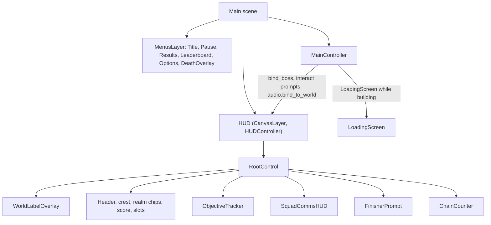

# 07. UI, HUD and Audio

This page covers everything the player sees and hears outside the 3D world: the single shared HUD and the layers hosted inside it (objective tracker, world labels, squad comms, finisher prompt), the menus and screens, the loading screen, and the audio router. Related: [01_architecture_overview.md](01_architecture_overview.md), [05_level_generation.md](05_level_generation.md), [08_squad_ai.md](08_squad_ai.md).

## 1. Key files

| System | File |
| --- | --- |
| HUD | [hud_controller.gd](../scripts/ui/hud_controller.gd) (`HUDController`) |
| Objectives and waypoint | [objective_tracker.gd](../scripts/ui/objective_tracker.gd) (`ObjectiveTracker`) |
| In-world text as 2D | [world_label_overlay.gd](../scripts/ui/world_label_overlay.gd) (`WorldLabelOverlay`) |
| Squad roster, chat, mic, subtitles | [squad_comms_hud.gd](../scripts/ui/squad_comms_hud.gd) (`SquadCommsHUD`) |
| Critical-hit finisher prompt, chain readout | [finisher_prompt.gd](../scripts/ui/finisher_prompt.gd), [chain_counter.gd](../scripts/ui/chain_counter.gd) |
| Loading screen | [loading_screen.gd](../scripts/ui/loading_screen.gd) (`LoadingScreen`) |
| Title, pause, options, leaderboard, results, death, outro | [title_screen_controller.gd](../scripts/ui/title_screen_controller.gd), [pause_menu_controller.gd](../scripts/ui/pause_menu_controller.gd), [options_screen_controller.gd](../scripts/ui/options_screen_controller.gd), [leaderboard_screen_controller.gd](../scripts/ui/leaderboard_screen_controller.gd), [results_screen_controller.gd](../scripts/ui/results_screen_controller.gd), [death_overlay_controller.gd](../scripts/ui/death_overlay_controller.gd), [victory_outro.gd](../scripts/ui/victory_outro.gd) |
| Shared look | [ui_theme.gd](../scripts/ui/ui_theme.gd) (`UITheme`), [menu_style.gd](../scripts/ui/menu_style.gd) (`MenuStyle`), [ui_frame.gd](../scripts/ui/ui_frame.gd), [ui_fx.gd](../scripts/ui/ui_fx.gd), [hud_diamond_badge.gd](../scripts/ui/hud_diamond_badge.gd), [ui_divider.gd](../scripts/ui/ui_divider.gd) |
| Audio | [audio_manager.gd](../scripts/core/audio_manager.gd) (`AudioManager`, autoload `GameAudio`) |
| Run orchestration | [main_controller.gd](../scripts/core/main_controller.gd) |

## 2. How the pieces are wired

The HUD follows the project rule of exactly one shared `HUD.tscn` instance: nothing builds a per-room HUD. It is bound by signals from `Player`, `RealmManager`, `EncounterDirector`, `RunState` and `LeaderboardStore`. `MainController` hides it until the run starts (`hud.visible = false` in `_wire_all_subsystems`; set to true at the end of `_begin_run_loading`) and again on results or return to title.

## 3. HUD (`HUDController`)

### 3.1 Construction

`_ready()` adds the node to group `hud`. With `build_default_ui_if_empty` true and no `RootControl/TopHeaderBand`, `_build_styled_hud_tree()` creates the whole layout in code; otherwise `_discover_styled_nodes()` binds an authored layout through the exported `*_path` properties. Either way `_wire_visuals()` then applies fonts, frames and the readability pass, then `bind_singletons()`, `refresh_input_prompts()` and `_sync_ui_nodes()` run.

`_apply_readability_pass()` (idempotent, guarded by a `hud_readability` meta) adds the child layers to `RootControl`: `FinisherPrompt`, `SquadCommsHUD`, `ChainCounter`, `ObjectiveTracker` and `WorldLabelOverlay`. The overlay is inserted at index 0 and the corner scrims are moved just above it, so world labels draw above the scrims and below every HUD panel.

Layout (built tree): top header band with the section title, top-left crest plus HP bar and stamina bar, top-centre Reality and Mirror pills with a swap badge and the shift key hint, top-right score, combo and timer, bottom-left weapon badge, bottom-right action slots (light, heavy, dodge, jump, landing) with live key labels, an interact prompt panel, a toast banner and a full-screen realm pulse overlay driven by `realm_shift_pulse.gdshader`.

### 3.2 Data flow

| Source | Signal | HUD reaction |
| --- | --- | --- |
| `Player` (`bind_player`) | `health_changed`, `player_died` | HP text and bar, ghost bar, red flash |
| `RealmManager` | `realm_changed`, `shift_rejected`, `realms_merged` | Realm chip, sweep, pulse, `SHIFT LOCKED` or `REALMS MERGED` toast, shake of the pills |
| `EncounterDirector` | `section_changed`, `encounter_started`, `encounter_cleared` | Section title (`_format_section_title`), boss bar visibility |
| `RunState` | `score_changed`, `combo_changed`, `no_hit_awarded`, `run_timer_updated` | Score with pop and floating `+N`, combo bar, timer, `+N NO-HIT ENCOUNTER` toast |
| Boss (`bind_boss`) | `health_changed`, `boss_defeated` | Boss bar, ghost bar |
| `LeaderboardStore` | `controls_rebound`, `settings_changed` | Re-label every key prompt |
| `InteractSwitch` | `prompt_changed` | `set_interact_prompt(visible, text)` |

`MainController._wire_level_dependent()` connects the boss and the interact prompts after the level exists, because neither exists before then.

Rules worth knowing:

- The boss bar appears only while `EncounterDirector.current_section` is `EXECUTION_ARENA`. Boss `health_changed` alone never reveals it (`_boss_in_play()`), because the starting HP is sent at level load.
- Prompts never hard-code keys. `refresh_input_prompts()` reads each action's label from `LeaderboardStore.get_action_display_label(...)`, and `get_tutorial_prompt_text(id)` does the same for the tutorial lines (`move`, `q_shift`, `e_interact`, `f_landing`).
- `_sync_ui_nodes()` pushes the state fields (`hp_text`, `score_text`, `active_realm_chip`, `section_name_text`, and so on) into whatever nodes exist, which makes the same controller work with either the built or an authored tree. Update the state field first, then call `_sync_ui_nodes()`.
- Section titles are hard-coded by section id in `_format_section_title` (`THE SUNDERING ENTRY` through `SANCTUM CLEARED`); other ids use the director's name upper-cased.

Public API: `bind_singletons()`, `bind_player(node)`, `bind_boss(node)`, `set_interact_prompt(visible, text)`, `refresh_input_prompts()`, `get_tutorial_prompt_text(id)`, `mark_tutorial_completed(id)`, `is_tutorial_visible(id)`.

## 4. Objective tracker (`ObjectiveTracker`)

A `Control` under the HUD that answers "what do I do next?". It derives the objective from live world state, shows it under the realm chips with a one-line hint, draws an on-screen waypoint marker, and floats a Mirror-only inscription over the target.

### 4.1 Refresh and lookup

- `_process` calls `_refresh()` every 0.25 s (real time, so slow motion does not slow it) and redraws every frame.
- `_refresh()` does nothing until `MainController.level_ready` is true, and needs the player and `LevelRoot`.
- The first successful refresh calls `_label_props()` to attach world labels (`MIRROR SWITCH`, `MIRROR STONES`) to the entry props.
- All lookups go through `_n(path)`, a path relative to `LevelRoot` (for example `Stage02_HallOfEchoes/HallWaves`). Renaming a stage child silently disables its objective.

### 4.2 The objective chain (`_compute`)

`_compute(player)` converts the player's z with `JourneyLayout.story_z()` and walks a priority list; the first matching condition wins. Thresholds below are story z; targets are world positions.

| Order | Condition | Title shown |
| --: | --- | --- |
| 1 | `Gate01` closed and `pz < -16` | Follow the Pilgrim's Causeway to the gate (target from `guide_target`) |
| 2 | `Gate01` closed | Open the Gate of Reflections (target: the Mirror Switch) |
| 3 | `Gate02` closed and `pz < 24` | Cross the Sunlit Bridges to the Hall of Echoes |
| 4 | `Gate02` closed and hall enemies alive | Clear the Hall of Echoes (wave tag, count of enemies left) |
| 5 | `pz < 64` and player y below 5.5 | Cross the Windswept Rampart |
| 6 | Gallery guard alive, `pz <= 85.2`, `Gate03` closed | Cross the broken bridge (`pz < 74`, bridge not repaired) or Defeat the Shielded Guard |
| 7 | Puzzle unsolved and `pz <= 101.5` | Enter the Clock-Tower Mechanism Chamber (`pz < 87`) or Drop the Mirror weight onto the plate (wave tag) |
| 8 | Warden alive, `pz <= 169.5`, `Gate05` closed | Cross the Processional to the Colosseum (`pz < 139`), Defeat The Warden (phase 1) or Finish The Warden (merged) |
| 9 | otherwise | Walk into the light |

Each result is a dictionary `{title, hint, target}`; `get_objective()` returns the current one. A title change pops the text and plays `ui_confirm`.

Helper behaviour:

- `_wave_tag(path)`: returns ` - Wave N/M` while a `WaveDirector` at that path has a non-zero `get_display_wave()`, empty otherwise. During the hall objective, enemies that are still wave-held are excluded from the count and from the nearest-target choice.
- `_alive_in(path)`: living `EnemyBase` children of a node.
- `_nearest(list, player)`: nearest enemy for the waypoint.

### 4.3 Bypass auto-clear

`_auto_clear_bypassed_stages(pz)` runs first. If the player has got past a gate by other means (jumped, rewound, loaded a save), it opens the gate, repairs the bridge, completes the encounter (`complete_combat_encounter`), force-solves the puzzle (`force_solve_bypass`) or completes the Warden encounter so the objective chain does not stay stuck. Thresholds: past 6.5, 45.2, 85.2, 101.5 and 169.5 story z.

### 4.4 Marker, labels and inscription

- `_draw_marker` projects the target (plus 1.2 m) to the screen; on screen it draws a pulsing diamond with distance in metres, off screen it clamps an arrow to the edge. Gold in Reality, cyan in Mirror. It hides inside 2.2 m.
- `_draw` renders the title and a wrapped two-line hint with fractured gold separators, below the realm chips (y = 156).
- `_update_inscription`: in Mirror (not merged) a `Label3D` named `MirrorInscription` is attached to `LevelRoot` over the target, adopted by the `WorldLabelOverlay` and shown only in Mirror.

### 4.5 Extending

To add or reorder objectives, edit `_compute` and keep conditions ordered from earliest to latest. Write thresholds in story z. Use `JourneyLayout.to_world(...)` for fixed targets and `JourneyLayout.guide_target(...)` on bridges. If a new gate can be bypassed, add its clearing to `_auto_clear_bypassed_stages`.

## 5. World labels (`WorldLabelOverlay`)

`Label3D` text was hard to read in this game (tiny at fixed size, bloomed, fogged, depth-sorted with VFX), so labels are drawn as crisp 2D text over the 3D view. The overlay is a `Control` under the HUD's `RootControl` that redraws every frame.

API: `WorldLabelOverlay.adopt(label: Label3D, opts: Dictionary)`. Adoption keeps the node's `text`, `modulate`, `visible` and `position` usable by existing scripts, adds it to group `world_label_2d`, stores the options as meta and sets `transparency = 1.0` so it no longer renders in 3D.

| Option | Meaning | Default |
| --- | --- | --- |
| `px` | Font size in HUD pixels | 18 |
| `offset` | Extra screen offset (`Vector2`) | zero |
| `font` | `"body"`, `"display"` or `"flavor"` | `"body"` |
| `max_dist` | Metres from the camera beyond which it is hidden | 40 |
| `kind` | `"text"`, `"bar"` (HP bar using the `hp_ratio` meta), `"mark"` (diamond pin), `"mark_nearby"` (small pip) | `"text"` |

Each frame it gathers visible adopted labels in front of the camera within range, sorts far-to-near, fades them over the last 4 m (20 m for labels with `max_dist > 80`), and draws outlined text on a dark backing. Users include enemy state icons and HP bars, ally name labels, squad enemy marks and the objective tracker's prop labels.

Pitfall: after adopting a `Label3D`, never set `transparency` back, and remember that the screen position comes from the 3D position, so move the `Label3D` node, not the overlay.

## 6. Loading screen

[loading_screen.gd](../scripts/ui/loading_screen.gd) (`LoadingScreen`, a `CanvasLayer` at layer 120, `PROCESS_MODE_ALWAYS`) covers the screen while the level is generated. It draws a shader backdrop, the `PARALLAX` logo, a rotating tip card (`TIPS`, 5.5 s each, fade 0.45 s) and a bottom rail with a status label, percent and a thin gold bar.

API:

- `set_progress(fraction, text = "")`: sets the target 0 to 1 and, if text is given, the status label. The visible bar eases toward the target at 2.5 per second, so it never looks frozen.
- `finish()`: awaitable; snaps to 100 percent, waits 0.25 s, fades out over `FADE_SECONDS` and frees itself.

`MainController._begin_run_loading()` drives it:

| Progress | Source |
| --- | --- |
| 0 to 0.85 | `GrandJourneyBuilder.build_progress` (fraction scaled by 0.85, label from `_build_steps`) |
| 0.85 to 0.97 | `AmbientLifeLayout.build_progress` (scaled by 0.12) |
| 0.97 | "Gathering your squad": restore the save or `restart_full_run`, spawn the squad |
| 1.0 | `level_ready = true`, then `await _loading.finish()` |

While `_loading` exists, `is_gameplay_active()` is false and the mouse stays visible. `SquadCommsHUD._blocked_by_menu` also treats the loading screen as blocking.

To add a tip, append a `[heading, body]` pair to `TIPS` (one or two short sentences).

## 7. Menus and screens

All screens are `Control`s under `MenusLayer`, run with `PROCESS_MODE_ALWAYS`, join a group for lookup (`title_screen`, `pause_menu`, `options_screen`, `leaderboard_screen`, `results_screen`), and build their own UI in code when empty (`build_default_ui_if_empty`). Common patterns: public `press_*` methods that the buttons call (and tests call directly), signals instead of direct coupling (`MainController` connects them), `_sync_ui_nodes()` to push state into labels, and `UITheme` / `MenuStyle` for the obsidian-and-gold look.

| Screen | Behaviour |
| --- | --- |
| Title | `press_start` clears the saved run and plays an opening quote card (up to 5 s, any key dismisses), then `_complete_start_sequence` emits `start_run_requested`. `press_continue` emits `continue_run_requested` when `has_saved_run()` is true. Also `leaderboard_requested`, `options_requested`, `quit_requested`. Pressing Q toggles a realm glimpse on the backdrop |
| Pause | `pause` action toggles; sets `SceneTree.paused` and pauses the run timer. Actions: resume, save checkpoint (`capture_and_save_world_state`), restart section (`handle_player_death`), restart run (confirm), options, main menu (confirm). It will not toggle while a subscreen, title, loading, results or death screen is up |
| Options | Tabs for audio, display, graphics, gameplay and camera, controls (live rebinding with conflict validation), squad comms rows, and data (restore defaults, reset leaderboard and clear saved run, both two-step confirm). Edits go to `working_settings`; `press_apply` calls `LeaderboardStore.save_settings`. Choosing a graphics preset fills the individual fields; editing one field switches the preset to `custom` (see [06_environment_and_world.md](06_environment_and_world.md)) |
| Leaderboard | Offline top five table from `LeaderboardStore` |
| Results | Listens to `RunState.run_finalized`, plays `VictoryOutro` (slow motion, letterbox, "THE WARDEN FALLS") then `populate_from_summary` shows score, time, time bonus and rank. If the run places, a three-slot initials picker appears; `submit_score` saves via `LeaderboardStore.save_run`. Emits `results_presented` (MainController pauses and hides the HUD), `replay_requested` and `main_menu_requested`. Sets `PlayerController.ui_input_locked` while visible |
| Death overlay | Brief fade on `player_died` and `player_respawned`, no clicks required |

Starting a new run when one already exists reloads the scene (`MainController._reload_for_new_run`) with static flags `pending_auto_start` and `pending_continue`, so the world is rebuilt from scratch and the title is skipped.

`PlayerController.ui_input_locked` is the shared flag that stops gameplay input while a text field, chat bar or results screen needs the keyboard; set it when you open any UI that takes typing and clear it on close and in `_exit_tree`.

## 8. Squad comms HUD (`SquadCommsHUD`)

[squad_comms_hud.gd](../scripts/ui/squad_comms_hud.gd) is added to the shared HUD by `HUDController` (never separately). It owns a `SquadComms` node from the squad AI system ([08_squad_ai.md](08_squad_ai.md)) and draws:

- a roster under the player's health cluster (name, role glyph, HP, state; downed allies pulse red with a revive hint), refreshed every 0.2 s from `AllySquadManager.get_roster()`;
- subtitles (speaker-coloured, streaming), up to three notifications (5 s), and an optional command log (toggle with L, remembered in `SquadAIConfig`);
- a chat bar (Enter opens and sends, Esc closes) that calls `comms.submit_utterance(text, "chat")`, the same path as voice;
- a mic button and push-to-talk (hold V) with a level ring, shown only when `SquadAIConfig.voice_allowed()`;
- enemy marking: T or middle mouse marks the enemy under the reticle (`WorldIntel.mark_enemy_at_aim`), X clears marks; a reticle and a marks summary bar are drawn.

Input actions (`squad_chat`, `push_to_talk`, `toggle_command_log`, `cinematic_mode`, `mark_enemy`, `clear_marks`) are created on demand in `_ensure_actions()` if missing. `_blocked_by_menu()` suppresses input while paused, while any menu or loading screen is visible, or before the level is ready.

Cinematic mode (F10, `set_cinematic`) hides the whole HUD layer, enemy overhead labels (`FloatingHPBar`, `StateIcon`, `IntelTag`, marks) and ally labels, and restores them on exit. Opening the chat bar exits cinematic mode.

## 9. Audio (`AudioManager`, autoload `GameAudio`)

[audio_manager.gd](../scripts/core/audio_manager.gd) is a signal-driven router registered as the autoload `GameAudio` (`project.godot`) and exposed as the static `AudioManager.instance`. `MainController` resolves it through `audio_manager_path`, then `/root/GameAudio`, then the static instance. `_ready()` returns immediately if another instance already exists, so a stray second copy in a scene is inert.

### 9.1 Buses, banks and cues

- `_ensure_buses()` creates `Music`, `SFX` and `Ambience` sending to `Master` if missing; `LeaderboardStore` applies the saved volumes.
- **Banks.** `_load_streams()` turns every folder `assets/audio/sfx/<group>/<bank>/` into an `AudioStreamRandomizer` (random, no repeats, small pitch and volume jitter; enemy voices vary less). Drop new `.ogg`, `.wav` or `.mp3` files in a bank folder and they join it.
- **Cues.** `play_sfx(key, volume_offset_db)` finds a stream by `CUE_BANKS[key]` (bank first), then a bank named `key`, then `SFX_PATHS[key]` (legacy wav), and plays it round-robin on a pool of `sfx_pool_size` (14) `AudioStreamPlayer`s with the per-cue trim `CUE_DB`. Unknown keys return false. A few cues (`jump`, `dodge`, `player_hurt`, `ui_click`, `footstep`) fall back to synthesized waveforms.
- `play_at(bank_or_cue, world_pos, volume_db, max_distance)`: one-shot positional `AudioStreamPlayer3D`, auto-freed.
- Debug state: `last_played_sfx`, `played_sfx_history` (last 64) and the `sfx_played` signal, which tests use.

### 9.2 Binding

`bind_to_world(root)` and the `SceneTree.node_added` hook run `_bind_recursive` over nodes. It connects: player attack, slam, jump, dodge, damage, death, landing and health signals; every `BaseButton.pressed` (UI click); every `EnemyBase` (damage, a positional `Voice` player, alerts, deaths); `ShieldedGuard.shield_deflected`; `WardenBoss` (phase roars, defeat, mirror shatter); `BreakableProp` (`pillar_crack` on warning, `pillar_collapse` or shatter on break); `EncounterGate.gate_opened`; and any `OmniLight3D` named `BrazierLight*` (a 3D fire crackle). Realm changes trigger `shift_to_mirror` and `mirror_whisper` or `shift_to_reality`; a merge plays the shatter pair.

### 9.3 Music selection and ducking

Two `AudioStreamPlayer`s crossfade with equal-power curves (`music_crossfade_sec` 2.5). `_pick_track()` is re-evaluated every 0.5 s and returns, in priority order:

1. `ending` if the Warden is dead.
2. `boss` while `EncounterDirector.current_section` is `EXECUTION_ARENA`.
3. `combat` while `EncounterDirector.current_encounter_id` is non-empty (`is_in_combat()`).
4. `interior` if `story_z >= 44`, which is world z 116 and beyond, past the hall's north gate.
5. `explore` otherwise.

Tracks come from `MUSIC_TRACKS` with a per-track trim in `MUSIC_TRIM`; a missing file falls back to the legacy drone. While in combat, non-combat music is ducked by `combat_duck_db` (-4 dB). `_update_dynamic_mix` also drives a Master low-pass filter (`ParallaxDynamicLowPass`): 700 Hz while paused, 1400 Hz below `low_hp_threshold` (25 HP), fully open otherwise, smoothed in log frequency.

### 9.4 Room tone and footsteps

- `_update_room_tone`: a looping `interior_room_tone.ogg` on the `Ambience` bus fades in while `52 < story_z < 104`. In world terms that is about z 142 to 232 (the upper rampart, gallery and chamber), not the hall.
- Footsteps are driven from `_process`: while the player is on the floor in locomotion above 2.2 m/s, the cadence follows speed (0.27 to 0.46 s) and alternates armour foley. `_footstep_cue` returns `footstep_wet` when `WeatherDirector.get_wetness() > 0.45`, `footstep_sand` when `story_z < -40` (world z below about -96, the start terrace and first causeway), and `footstep` otherwise.
- Landing sounds play only above an impact speed of 7.

Weather loops (rain, wind, thunder) belong to `WeatherDirector`, not to this manager.

### 9.5 Extending

- **New cue:** add the stream folder under `assets/audio/sfx/<group>/<bank>/`, map it in `CUE_BANKS`, optionally add a `CUE_DB` trim, and call `AudioManager.instance.play_sfx("key")` (guard for null in headless tests).
- **New music state:** add the path to `MUSIC_TRACKS`, a trim to `MUSIC_TRIM`, and a branch in `_pick_track`. Use `JourneyLayout.story_z`, never raw world z.
- **New bound object type:** add a branch in `_bind_recursive` and keep connections guarded by `is_connected`, as the existing ones are.

## 10. Common pitfalls

- **One HUD.** Add widgets inside `HUDController`'s `RootControl` (as `_apply_readability_pass` does), not as new HUD scenes.
- **State then sync.** Set the HUD state field, then call `_sync_ui_nodes()`; setting a label directly is overwritten on the next sync.
- **Path-based lookups.** `ObjectiveTracker`, `MainController._wire_level_dependent` and `AudioManager` locate nodes by path, group or class name. Renaming stage nodes or `BrazierLight*` lights disables objectives, the boss bar and fire audio without an error.
- **Story z everywhere.** Objective, music, room tone, weather and footstep thresholds compare `JourneyLayout.story_z`. See [05_level_generation.md](05_level_generation.md).
- **Input lock.** Anything that opens a text field must set and clear `PlayerController.ui_input_locked`, and `SquadCommsHUD._exit_tree` clears it if it is freed while the chat bar is open.
- **Pause and timing.** Menus use `PROCESS_MODE_ALWAYS`; HUD effects use real time (`delta / Engine.time_scale`) so slow-motion finishers do not stretch UI timing.
- **Headless runs.** Audio players only `play()` when the display server is not `headless`; check `played_sfx_history` in tests instead of listening.
