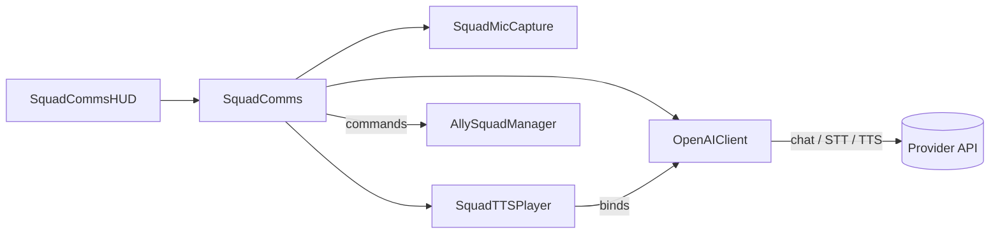

# 09. Voice and LLM

This page covers the optional online layer of the squad: provider and key configuration, the HTTP client, text-to-speech (TTS), subtitles, push-to-talk and speech-to-text (STT), and failure handling. The command semantics that the LLM drives are in [08_squad_ai.md](08_squad_ai.md).

## 1. Two guarantees

- API keys are never committed. They are read from the environment, a git-ignored `.env`, or the per-user `user://squad_ai.cfg`. `.gitignore` excludes `.env`, `.env.*` and `*.key`. Nothing in the repository contains a key.
- The game is fully playable offline. With no key, typed orders use the offline keyword parser, allies speak canned lines from their profiles, and lines show as subtitles. Voice orders (push-to-talk) need a key; everything else does not.

## 2. Key files

| File | Role |
| :-- | :-- |
| [squad_ai_config.gd](../addons/parallax_squad_ai/squad_ai_config.gd) | `SquadAIConfig`: static settings, provider and key resolution, model names |
| [openai_client.gd](../addons/parallax_squad_ai/openai_client.gd) | `OpenAIClient`: non-blocking HTTP client for chat, STT and TTS |
| [squad_comms.gd](../addons/parallax_squad_ai/squad_comms.gd) | `SquadComms`: hub that owns the client, microphone and TTS player |
| [tts_player.gd](../addons/parallax_squad_ai/tts_player.gd) | `SquadTTSPlayer`: one-line-at-a-time voice queue |
| [mic_capture.gd](../addons/parallax_squad_ai/mic_capture.gd) | `SquadMicCapture`: push-to-talk recording to a 16 kHz WAV |
| [plugin.gd](../addons/parallax_squad_ai/plugin.gd) | Editor plugin: registers node types, enables audio input |
| [squad_comms_hud.gd](../scripts/ui/squad_comms_hud.gd) | Creates `SquadComms`; chat bar, `V` key, on-screen mic button, subtitles |

There is no autoload for the addon runtime. `SquadCommsHUD` (added by the shared HUD) instantiates one `SquadComms`, which in turn creates the `OpenAIClient`, `SquadMicCapture` and `SquadTTSPlayer` as children.

## 3. Configuration (`SquadAIConfig`)

`SquadAIConfig` is a class of static variables. `ensure_loaded()` runs once, reads `user://squad_ai.cfg`, validates values, and resolves keys. Settings are written back by `save()`.

### 3.1 Provider selection

`provider_pref` is `auto`, `gemini` or `openai`.
- `gemini` / `openai`: used only if a key for that provider exists; otherwise the result is `""` (offline).
- `auto`: Gemini if a Gemini key exists, else OpenAI if an OpenAI key exists, else offline.

`provider()` returns the resolved provider, `is_online()` is `not provider().is_empty()`, and `describe()` gives the text shown on startup ("offline - keyword orders" or provider, model, key source).

Defaults (`DEFAULTS`) per provider: `base_url`, `native_url`, `model`, `stt_model`, `tts_model`. Gemini uses its OpenAI-compatible endpoint for chat and the native Gemini API for STT and TTS. OpenAI uses `/chat/completions`, `/audio/transcriptions` and `/audio/speech`. Overrides: `base_url_override` and `model_override` (in the config file), and the `PARALLAX_AI_MODEL` environment variable for the model. Any OpenAI-compatible chat endpoint works by setting `base_url_override`.

### 3.2 Key lookup order

Keys are resolved by `key_for(provider)`:
1. Environment variables (checked first): `GEMINI_API_KEY`, `GEMINI_KEY`, `GOOGLE_API_KEY` for Gemini; `OPENAI_API_KEY`, `OPENAI_KEY` for OpenAI.
2. A `.env` file (parsed by `_parse_dotenv()`, supports `export ` prefixes, quotes and comments). Locations searched, first definition wins: the project folder (`res://.env`), `user://.env`, and next to the executable. For each variable name, a real environment variable beats `.env`.
3. Keys pasted in Options, stored in `user://squad_ai.cfg` through `set_file_key()` (the only place a key can be written to disk by the game, and it is outside the project).

`key_source()` reports where the active key came from, for display only. Never print or log a key.

### 3.3 Other settings

| Setting | Values / meaning |
| :-- | :-- |
| `mode` | `both`, `chat`, `voice`. Gates `chat_allowed()` and `voice_allowed()` |
| `tts_enabled` | Master switch for voiced lines |
| `voice_engine` | `auto`, `cloud`, `system`, `off` (see section 5) |
| `voice_min_event_priority` | Lines at or above this priority are voiced; lower are subtitle-only (default 1) |
| `ambient_chatter` | Off by default. When off, priority-0 lines (idle, banter, kill/engage barks) are not even shown |
| `show_subtitles`, `show_command_log` | HUD toggles (command log is `L`, hidden by default) |
| `request_timeout_sec` | 25 s request timeout before the body starts |
| `tts_per_minute` | Legacy and unused |

On Windows, a stored `voice_engine = "system"` is reset to `auto` at load (see section 5.2).

### 3.4 Test hook

`SquadAIConfig.force_offline()` blanks the OpenAI key sources, forces `provider_pref = "openai"` and sets `voice_engine = "off"`, so automated tests never reach the network and never speak. It affects the current process only.

## 4. The client (`OpenAIClient`)

`OpenAIClient` is a `Node` that uses `HTTPClient` and polls each job in `_process()`; there are no threads and no blocking calls. Each request is a `Job` with a numeric id, a `kind` and a stage (`connect`, `response`, `body`).

Public API:

| Method | Kind | Wire format |
| :-- | :-- | :-- |
| `chat_stream(messages, tools, temperature)` | `chat` | `POST {base_url}/chat/completions`, `stream: true`, SSE |
| `transcribe(wav_bytes, prompt_hint)` | `stt_gemini` or `stt` | Gemini `generateContent` with inline WAV, or OpenAI multipart upload |
| `speak_stream(text, voice, style)` | `tts_gemini` or `tts` | Gemini `streamGenerateContent?alt=sse` (base64 PCM events), or OpenAI `/audio/speech` with `pcm` response |
| `cancel(id)`, `cancel_kind(kind)` | | Marks jobs cancelled; they are dropped silently |

Signals: `text_delta`, `tool_call_received`, `chat_completed(id, text, tool_calls)`, `transcribed`, `tts_chunk(id, pcm)`, `tts_finished`, and `request_failed(id, kind, message)`.

Details worth knowing:
- Authentication is `Authorization: Bearer ...` (OpenAI and the Gemini compatible chat endpoint) or `x-goog-api-key` (native Gemini endpoints). The key is attached per request and never stored in the job body.
- Chat SSE parsing accumulates parallel tool calls by `index` (`_sse_data()`); servers that omit `index` are handled by slot order. Gemini thought signatures (`extra_content`) are stored and must be echoed in history, which `SquadComms` does. `parallel_tool_calls` is sent only for non-Gemini providers because Gemini rejects unknown parameters.
- TTS arrives as 24 kHz signed 16-bit mono PCM. `_emit_pcm()` keeps a carry byte so odd-sized chunks never split a sample.
- Gemini TTS quota handling: HTTP 429 on a TTS model marks that model exhausted for the session (`SquadAIConfig.mark_tts_exhausted()`) and the error message is prefixed `QUOTA`. `tts_model()` walks `GEMINI_TTS_FALLBACKS` and returns the first model not exhausted; when all are exhausted `tts_available()` becomes false.
- No exceptions: every failure goes through `request_failed`. Reasons include no key, bad URL, connect timeout (8 s, `CONNECT_TIMEOUT_SEC`), request timeout (`request_timeout_sec`), a stream longer than 90 s, dropped connection, and any HTTP status of 400 or higher (message extracted from the error body by `_error_message()`).

## 5. Text-to-speech and subtitles

### 5.1 The queue

`SquadComms._voice(ally, text, prio)` picks the provider voice (`gemini_voice` when the provider is Gemini, else `tts_voice`), sanitises the line, and calls `SquadTTSPlayer.speak(speaker, text, voice, instructions, prio, pitch, rate, slot)`. Lines are queued sorted by priority; a higher-priority line interrupts the current one; the queue holds at most `MAX_QUEUE` (4) and drops the lowest-priority overflow. A line that waited longer than `STALE_SEC` (4 s) is skipped silently unless its priority is 3 or more, so speech never lags the action.

Sources of lines: allies call `SquadAlly.say()` (which has per-ally cooldowns by priority) and the manager forwards each to `SquadComms._on_ally_spoke()`; the LLM `say` tool calls `_voice()` directly. Priority 0 is chatter, 1 is an ordinary line, 2 and above are important.

### 5.2 Engines

`SquadTTSPlayer.engine()` returns `"cloud"`, `"system"` or `""` for the next line:

| `voice_engine` | Behaviour |
| :-- | :-- |
| `off` | Never speaks (lines are dropped and shown as subtitles) |
| `cloud` | Provider TTS only, if `_cloud_ok()`; else no voice |
| `system` | OS text-to-speech (`DisplayServer.tts_*`) only |
| `auto` | Cloud while it works; after the first cloud failure the rest of the session uses system voices |

Cloud playback streams PCM into an `AudioStreamGenerator` (`RATE` 24000 Hz, 2 s buffer, `SFX` bus if present). `_on_chunk()` decodes PCM into `_pending`, and `_process()` pushes frames as buffer room appears, finishing a line after the stream is done and the generator has drained.

System voices need the project setting `audio/general/text_to_speech`, which is currently `false` in `project.godot`. On Windows, the system engine is disabled in code (`_system_ok()` returns false, `_start()` drops the line) because Godot's SAPI implementation was observed to deadlock the main thread during combat. In practice on Windows: cloud voice with a key, otherwise subtitles only. On other platforms system voices work only if the project setting is enabled; each ally gets a distinct OS voice slot, with pitch and rate by role (`SYS_PITCH`, `SYS_RATE` in `SquadComms`).

### 5.3 Fallback and failure

`_on_failed()` in the TTS player handles TTS failures:
1. A `QUOTA` failure triggers one retry of the same line on the next model in the Gemini fallback chain.
2. Any other cloud failure, in `auto` mode, sets `_cloud_failed`, so later lines use the system engine if available. The failed line is replayed on the system engine if possible, otherwise dropped (its subtitle is shown).
3. `SquadComms._on_request_failed()` notifies the player at most once per 30 s ("switched to system voices", "hit today's free TTS quota - subtitles only", or "Ally voice unavailable") and never interrupts gameplay.

### 5.4 Subtitles synced to speech

The TTS player guarantees every line emits exactly one of two signals: `line_started(speaker, text)` when audio is actually audible (the first cloud chunk, or system speech start), or `line_dropped(speaker, text)` when it will not be voiced (no engine, queue overflow, no audio produced, failure). `SquadComms` connects both to `_on_voice_line()`, which emits `subtitle(speaker, text, color, true)`. As a result the subtitle appears when the voice starts, or immediately if there is no voice, so text always matches what is heard. Stale lines are the exception: they are skipped with no subtitle.

Other subtitle paths: the player's own utterance (`"YOU"`) is emitted immediately in `submit_utterance()`; priority-0 allies lines show only when `ambient_chatter` is on; lines below `voice_min_event_priority` bypass TTS and show as subtitles immediately.

## 6. Push-to-talk and speech-to-text

Flow: hold `V` (or the on-screen mic button) then release.

1. `SquadCommsHUD` calls `SquadComms.begin_voice()`. It refuses with a notification when voice is disabled by `mode`, when offline ("Voice orders need an API key"), or when a transcription is already running.
2. `SquadMicCapture.start()` creates a muted `SquadMic` audio bus with an `AudioEffectCapture`, plays an `AudioStreamMicrophone` into it, and records frames. It requires the project setting `audio/driver/enable_input` (currently true; the editor plugin sets it) and is unsupported in headless mode. The current TTS line is interrupted so the player can talk over the squad. `level_changed` drives the HUD mic meter.
3. On release, `end_voice()` calls `stop_and_encode()`: captures up to `MAX_SECONDS` (20 s), rejects clips shorter than 0.3 s, then downmixes and resamples to a 16 kHz mono 16-bit WAV.
4. `client.transcribe(wav, hint)` sends the WAV; the hint lists the ally names to improve recognition. The Gemini prompt tells the model to return empty text for silence and not to invent words.
5. `_on_transcribed()` ignores empty text and known hallucinations (strings echoing the prompt hint), then calls `submit_utterance(text, "voice")`, the same entry point as typed chat.

Mic states emitted by `mic_state_changed`: `idle`, `recording`, `transcribing`, `unavailable`. If transcription fails, `_on_request_failed()` resets to `idle` and shows an error notification.

## 7. Rate limits and failure handling summary

| Situation | What happens |
| :-- | :-- |
| No key | `is_online()` false; parser handles orders; voice orders refused with a hint; TTS is `off` or subtitles only |
| Chat request fails (network, 4xx/5xx, timeout, bad JSON) | Notification "Squad AI error - using offline orders", and the same text is parsed offline |
| Slow chat | Connect timeout 8 s, response timeout 25 s, absolute stream limit 90 s |
| TTS quota (429) | Model marked exhausted; retry on next model; when none remain, subtitles only for the session |
| TTS other failure in `auto` | Switch to system voices for the session (where supported), else subtitles only |
| STT failure | Mic returns to idle, error notification, no order issued |
| LLM returns unknown tool or verb | `tool_to_command()` returns `{}` ("invalid tool call"), or `issue()` returns `unknown verb` and the leader says it is confused. No crash |

The free Gemini tier has tight quotas, which is why the TTS fallback chain exists, the default chat model is a fast lite model, and ambient chatter is off by default. Chat calls are made once per player utterance, so request volume is low.

## 8. How to extend / common pitfalls

- To add a provider: add an entry to `DEFAULTS` and `PROVIDERS`, key variable names to `_load_env_keys()`, branch in `provider()`, and handle its request format in `OpenAIClient.transcribe()`/`speak_stream()` (any OpenAI-compatible chat endpoint needs no code beyond `base_url_override`). Keep auth in `_bearer()`/`_goog()`.
- To change a voice: edit `tts_voice`/`gemini_voice`/`tts_instructions` in `data/allies/*.tres`. Note that `tts_instructions` is sent only to OpenAI; Gemini text is never prefixed with instructions (to avoid the model speaking them).
- To add an ally line event: add the key to the profile's `voice_lines` and call `say_event("key", prio)`. Choose the priority carefully; priority 0 is hidden unless ambient chatter is enabled.
- Do not add a hard dependency on a network response in gameplay code. Everything async must be able to fail and fall back (the parser path is the model).
- Do not log full request bodies in a way that could include a key. Keys are attached as headers by `_bearer()` and `_goog()`; keep it that way.
- Tests must call `SquadAIConfig.force_offline()` first so they are silent and offline, and must not rely on a developer's `.env`. The only test that spends real quota is [squad_ai_live_test.gd](../tests/squad_ai_live_test.gd), which skips itself when no key is configured.
- Never commit `.env`, a `user://squad_ai.cfg`, or any file containing a key. If a key was ever committed, rotate it.
- Remember `SquadTTSPlayer` and `SquadMicCapture` are `process_mode = ALWAYS` so voices and recording continue while the game is paused; keep that in mind when adding pause logic.
